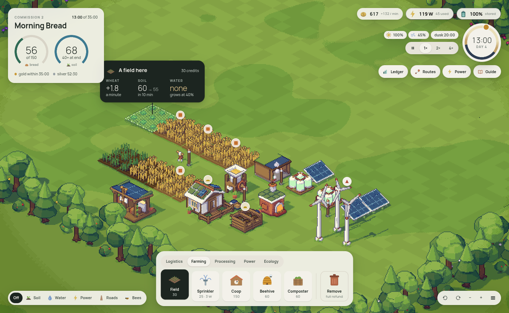

# Soil n Silo

A solarpunk automation game, build-only and point-and-click: each commission is a seeded valley where you lay out fields,
machines, power and the routes your trucks drive until the farm delivers what a nearby settlement asked for. Soil wears out and comes back,
byproducts have to go somewhere, and the sun sets every few minutes. A 3D world drawn as pixel art by
[pixel3d-renderer](https://github.com/CelestialLemon/pixel3d-renderer), for the web.

- Design: [`docs/DESIGN.md`](docs/DESIGN.md)
- Plan: [`docs/ROADMAP.md`](docs/ROADMAP.md), including the renderer gaps
- How to work here: [`AGENTS.md`](AGENTS.md)
- Models: [`docs/ASSET_BRIEF.md`](docs/ASSET_BRIEF.md)
- The interface's design system: [`src/ui/clearday/`](src/ui/clearday/README.md)



```sh
npm install
npm run dev          # http://127.0.0.1:5190
npm test             # the game rules (src/game/), and the bot clearing each commission it has a layout for, in Node
npm run sim -- c2     # a bot plays a commission on the real rules (c1, c2, c2:next, c4), to check it can be cleared and how fast
npm run typecheck
npm run lint         # ESLint: errors fail, warnings are known debt to clear (see eslint.config.js)
npm run build        # typecheck, then the game into dist/
```

Needs Node 22.18 or later (the tests run TypeScript directly, and installing the renderer from git builds it).

**Playing.** Pick a commission (or the sandbox) in the level select; it starts with a letter saying what is wanted. Pick a
building in the dock at the bottom (its card over the pointer says what it would do there), then click or drag to place a row;
click a building to open its card (its recipe and stores, status, settings, history, what it trades next door, the routes that
stop there); select a garage to buy trucks and give them routes, and click buildings to add them as stops; X removes (refunds),
right click or Esc cancels. Drag (or right-drag, arrows) pans, Q/E turn the camera, the wheel, a trackpad pinch, +/− or Z zooms
towards the pointer, Space pauses, 1/2/3 set the speed, V cycles the views (soil, water, power, roads, bees), O opens the
routes, Tab the ledger, W the Power panel and G the guide; Esc with nothing open pauses (settings, what the markers mean, every
key). The game saves the commission in progress in the browser every 30 s and when the page is hidden; `?menu` opens the level
select and `?play=<id>` (`c1`…`c8`, `sandbox`, `r<seed>-<1..3>`) starts a commission directly.

**Builds online.** Every push to `main` or `dev` is built and deployed to GitHub Pages (`.github/workflows/deploy.yml`):
[`/main/`](https://celestiallemon.github.io/Soil-n-Silo/main/) and [`/dev/`](https://celestiallemon.github.io/Soil-n-Silo/dev/).
The site's root redirects to `/main/`. Each build keeps its own save. New work is merged into `dev` and moves to `main` in a
PR from `dev`. Every PR to either, and every push to them, runs the tests and the build on Node 22.18 and the deploy's Node
(`.github/workflows/ci.yml`).

## Layout

```
src/
  main.ts       the game: loop, state, hover and placement previews, and what clicks and keys do
  input.ts      pointer, wheel and key events turned into intents the game answers (the press/drag state machine)
  game/         game rules and state as pure TypeScript (no DOM, no renderer), unit-tested in test/
    sim/        the fixed-step simulation, one concern per module, each importing only the ones above it in this list:
                clock (time, sun, wind), layout (derived lookups), soil, goods (recipes, next-door trades), energy (power
                networks, garage charging), buildings (machines, fields, hives), trucks, stats (history, rates, goals),
                describe (player-facing text), step (advance and tick)
  world/        what the renderer draws: the static farm, the models, the camera, and the view that mirrors the state into objects
  ui/           the HTML HUD and menus over the canvas, and the item icons
    clearday/   the design system (tokens, components, icons, the bundled font)
assets/         Blender build scripts for the models (the source of truth), exported to public/models/
tools/          the commission bot (npm run sim) and its layouts
  clearday/     generators for the Clearday tokens and icons (Python 3)
test/           unit tests (Node's test runner)
docs/           design, roadmap, asset brief
```

### Adding a building

Behaviour shared by a kind of building is declared as data, not written as `type === '...'` checks.

1. **Data entry.** Add the id to `BuildingId` and an entry to `BUILDINGS` in `src/game/data.ts`, with the role flags that apply:
   `power` (watts it draws), `stores` (holds any goods; trucks stop there), `harvests` (grows goods and keeps them on site),
   `grid` (`'source'`, `'storage'` or `'link'` in the power network), `inert` (no work to report on: out of the run log and
   histories), `tall`, `onWater`. A machine also needs a recipe in `RECIPES`.
2. **Model.** Add the model to `assets/` and `public/models/`, wire it in `src/world/`, and give it an icon and guide page in `src/ui/`.
3. **Unique behaviour.** Only what no flag covers: a state shape in `src/game/state.ts` (the `Building` union and `blankBuilding`),
   its per-step logic in `src/game/sim/`, its entry in `forecast.ts`, and a test.

## The renderer

The game installs the renderer from git, pinned to a release tag, `v0.4.0` (see its `CHANGELOG.md` before moving to a newer
one). three.js 0.180 sits beside it. Its public API is what its `src/renderer/index.ts` exports; its README explains how a game uses it.

npm builds the renderer when it installs it from git, which needs the install script approved. The approval in `package.json`
(`allowScripts`) names the exact commit, so after changing the tag run:

```sh
npm install github:CelestialLemon/pixel3d-renderer#v0.4.0
npm install-scripts approve pixel3d-renderer
```

**Changing the renderer and the game together.** Point the game at the local checkout while you work, then go back to a tag once
the renderer change is released:

```sh
npm install ../pixel3d-renderer     # then `npm run build:lib` in the renderer after each change
```

Never commit the game pointing at a local path. Renderer bugs and missing features are issues in the renderer repo, labelled
`soil-n-silo` (see `AGENTS.md`, "Renderer issues").
