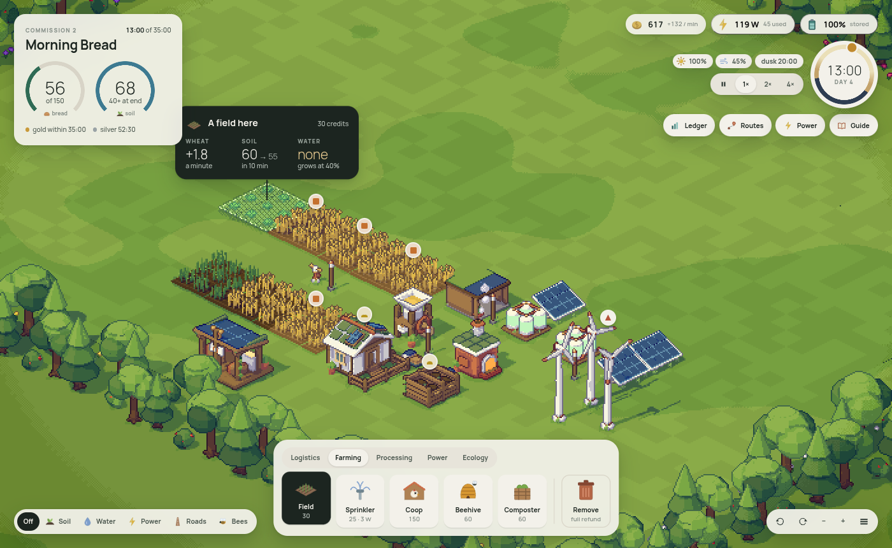

# Soil n Silo

A solarpunk automation game, build-only and point-and-click: each commission is a seeded valley where you lay out fields,
machines, power and the routes your trucks drive until the farm delivers what a nearby settlement asked for. Soil wears out and comes back,
byproducts have to go somewhere, and the sun sets every few minutes. A 3D world painted for the web by brush3d, the game's
own renderer, in [`brush3d/`](brush3d/README.md) ("painted world, inked things").

- Design: [`docs/DESIGN.md`](docs/DESIGN.md)
- Plan: [`docs/ROADMAP.md`](docs/ROADMAP.md)
- How to work here: [`AGENTS.md`](AGENTS.md)
- The renderer, its demo, its tools and its models: [`brush3d/`](brush3d/README.md) (the models: [`brush3d/docs/MODELS.md`](brush3d/docs/MODELS.md))
- Frame cost: [`brush3d/docs/PERFORMANCE.md`](brush3d/docs/PERFORMANCE.md), `?profile` in the game and `npm run framerate`
- The interface's design system: [`src/ui/clearday/`](src/ui/clearday/README.md)



```sh
npm install
npm run dev          # http://127.0.0.1:5190 (and brush3d's demo at /brush3d/)
npm test             # the game rules (src/game/), the bot clearing each commission it has a layout for, and brush3d's wind and water, in Node
npm run sim -- c2     # a bot plays a commission on the real rules (c1, c2, c2:next, c4), to check it can be cleared and how fast
npm run framerate    # the frame rate and load time on every commission, in headless Chromium on the GPU (tools/framerate.ts)
npm run hitches      # frame hitches while a busy commission changes (tools/hitches.ts)
npm run typecheck
npm run lint         # ESLint: errors fail, warnings are known debt to clear (see eslint.config.js)
npm run build        # typecheck, then the game into dist/ and brush3d's demo into dist/brush3d/
npm run render:shot -- out "hour=12"   # brush3d's tools are render:*; see brush3d/README.md
```

Needs Node 22.18 or later (the tests run TypeScript directly).

**Playing.** Pick a commission (or the sandbox) in the level select; it starts with a letter saying what is wanted. Pick a
building in the dock at the bottom (its card over the pointer says what it would do there), then click or drag to place a row;
click a building to open its card (its recipe and stores, status, settings, history, what it trades next door, the routes that
stop there); select a garage to buy trucks and give them routes, and click buildings to add them as stops; X removes (refunds),
right click or Esc cancels. Drag (or right-drag, arrows) pans, Q/E turn the camera, the wheel, a trackpad pinch, +/− or Z zooms
towards the pointer, Space pauses, 1/2/3 set the speed, V cycles the views (soil, water, power, roads, bees), O opens the
routes, Tab the ledger, W the Power panel and G the guide; Esc with nothing open pauses (settings, what the markers mean, every
key). The game saves the commission in progress in the browser every 30 s and when the page is hidden; `?menu` opens the level
select and `?play=<id>` (`c1`…`c8`, `sandbox`, `r<seed>-<1..3>`) starts a commission directly; `?profile` adds a panel that
measures what a frame costs on the map that's loaded. The settings (Esc, or the level select) hold the graphics quality: High
by default, Medium for integrated graphics such as a laptop's.

**Builds online.** Every push to `main` or `dev` is built and deployed to GitHub Pages (`.github/workflows/pages.yml`):
[`/main/`](https://celestiallemon.github.io/Soil-n-Silo/main/) and [`/dev/`](https://celestiallemon.github.io/Soil-n-Silo/dev/),
each with brush3d's demo in its `brush3d/` folder. Every open PR from this repo gets a preview of both at `/pr-<number>/`,
linked in a comment on it and removed when it closes. The site's root redirects to `/main/`. Each build keeps its own save.
New work is merged into `dev` and moves to `main` in a PR from `dev`. Every PR to either, and every push to them, runs lint,
the tests and the build on Node 22.18 and the deploy's Node, and brush3d's cloud check in a browser (`.github/workflows/ci.yml`).

## Layout

```
src/
  main.ts       the game: loop, state, hover and placement previews, and what clicks and keys do
  input.ts      pointer, wheel and key events turned into intents the game answers (the press/drag state machine)
  game/         game rules and state as pure TypeScript (no DOM, no renderer), unit-tested in test/
    sim/        the fixed-step simulation, one concern per module, each importing only the ones above it in this list:
                clock (time, sun, wind), layout (derived lookups), soil, goods (recipes, next-door trades), energy (power
                networks, garage charging), buildings (machines, fields, hives), trucks, stats (history, rates, goals),
                describe (player-facing text), step (advance and tick)
  world/        the camera, the lie of the land, and the seam the loop draws through (scene.ts)
    brush/      the game drawn by brush3d, one piece a file: the land, water, sky and weather, buildings and trucks, crops
                and trees, wind, and the tools on the picture (picking, previews, overlays)
  ui/           the HTML HUD and menus over the canvas, and the item icons
    clearday/   the design system (tokens, components, icons, the bundled font)
tools/          the commission bot (npm run sim) and its layouts, the frame rate and hitch measures (npm run framerate, hitches)
  clearday/     generators for the Clearday tokens and icons (Python 3)
test/           unit tests (Node's test runner)
docs/           design, roadmap
brush3d/        the painterly renderer: its code (src/), demo (index.html, src/demo/), tools (tools/, tools/blender/) and docs
```

### Adding a building

Behaviour shared by a kind of building is declared as data, not written as `type === '...'` checks.

1. **Data entry.** Add the id to `BuildingId` and an entry to `BUILDINGS` in `src/game/data.ts`, with the role flags that apply:
   `power` (watts it draws), `stores` (holds any goods; trucks stop there), `harvests` (grows goods and keeps them on site),
   `grid` (`'source'`, `'storage'` or `'link'` in the power network), `inert` (no work to report on: out of the run log and
   histories), `tall`, `onWater`. A machine also needs a recipe in `RECIPES`.
2. **Model.** Build its model in brush3d (`brush3d/docs/MODELS.md`: the Blender script in `brush3d/tools/blender/`, the
   `.glb` in `brush3d/src/models/`), map the building to it in `src/world/brush/catalog.ts`, and give it an icon and guide
   page in `src/ui/`.
3. **Unique behaviour.** Only what no flag covers: a state shape in `src/game/state.ts` (the `Building` union and `blankBuilding`),
   its per-step logic in `src/game/sim/`, its entry in `forecast.ts`, and a test.

## The renderer

The game is drawn by brush3d, which lives in this repo in `brush3d/` and is changed here like the rest of the game: how it
draws, its layout, its tools and its demo are in [`brush3d/README.md`](brush3d/README.md), its API for the game in
[`brush3d/docs/API.md`](brush3d/docs/API.md). The game uses it only through `brush3d/src/index.ts` (and its rules and tests
through `brush3d/src/shared.ts`); the brush3d world is `src/world/brush/`. It replaced the pixel-art renderer,
pixel3d-renderer, in epic #212 (the swap, #211).
