# Wind turbine candidates

Three alternatives for visual review. **No candidate is selected yet.** The game
continues to load `public/models/wind_turbine.glb`; its model and source are unchanged.

Left to right: **A · Petal**, **B · Prairie**, **C · Zephyr**. All studio renders use
the same orthographic scale, 30° elevation, light, background and 640 × 640 framing.
Lighting and ground in these renders are Blender review staging, separate from the
game exports. The `preview.png` sheets below use the existing Workbench pipeline.

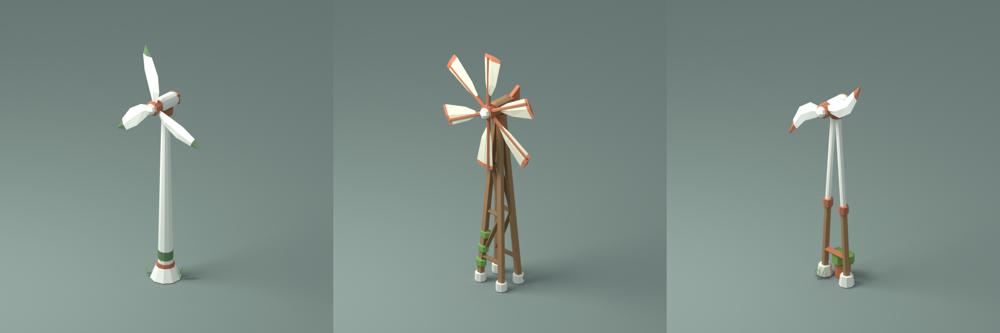

| Candidate | Direction | Triangles | Full rotor sweep |
| --- | --- | ---: | --- |
| [A · Petal](../wind_turbine_petal/wind_turbine_petal.blend) | Three broad, curved ceramic leaves with moss-green tips; a tapered white mast and green cuff. Closest to the current turbine, with a fuller silhouette. | 560 | ~2.5 m across |
| [B · Prairie](../wind_turbine_prairie/wind_turbine_prairie.blend) | Six linen sails with terracotta ends; open timber trestle, copper spokes, tail fin and climbing vine. A small farm windmill. | 984 | ~2.5 m across |
| [C · Zephyr](../wind_turbine_zephyr/wind_turbine_zephyr.blend) | Two swept ceramic wings with copper tips; a split timber-and-ceramic wishbone mast and planter. A sparse, more sculptural alternative. | 704 | ~2.5 m across |

All three have a 3.68 m hub, stay within the 3,000-triangle budget and retain the
one-tile static footprint. The rotor's full swept volume stays above 2.3 m. Each
uses the shared game palette, flat shading and texture-free materials, with one
`move_spin_rotor` mesh whose local X axis follows the front-facing axle and whose
`speed` property is 1.2. Each design uses the current game's horizontal-axis spin
contract. These are visual alternatives with the same gameplay role.

## Views

### A · Petal

| Front-right | Back-right |
| --- | --- |
| 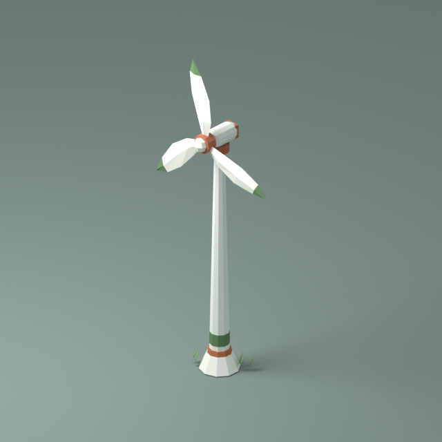 | 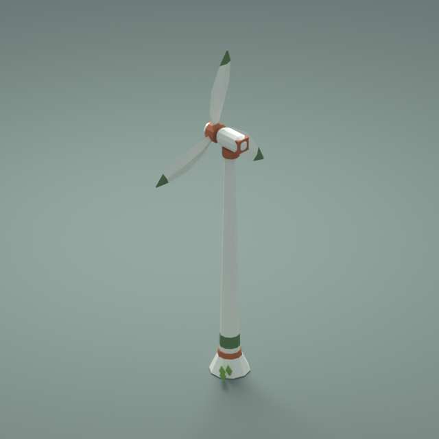 |
| **Back-left** | **Front-left** |
| 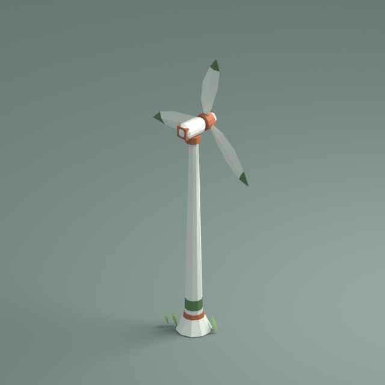 | 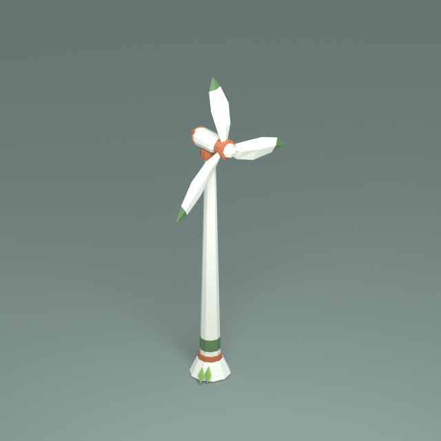 |

### B · Prairie

| Front-right | Back-right |
| --- | --- |
| 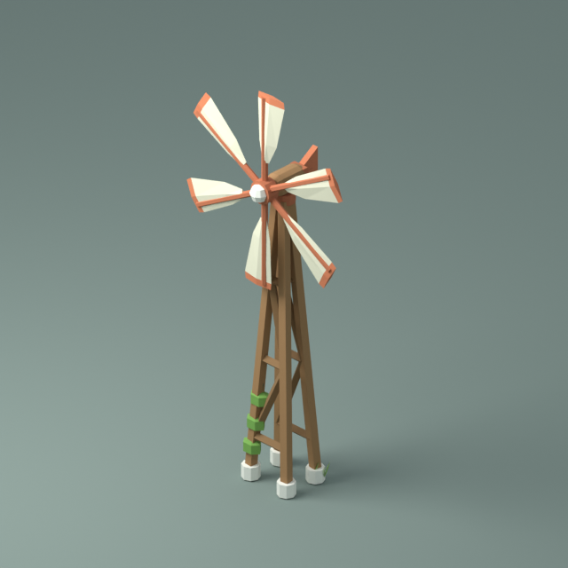 | 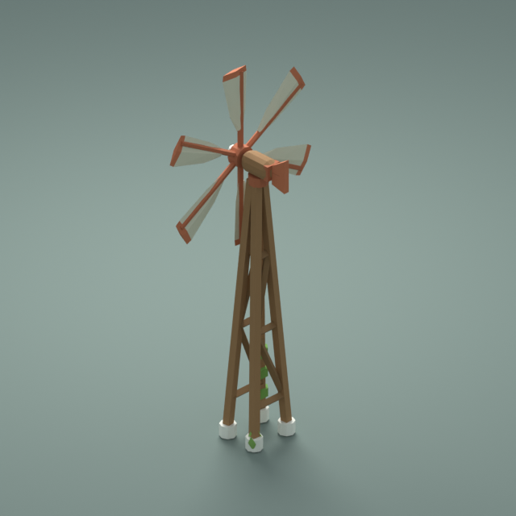 |
| **Back-left** | **Front-left** |
| 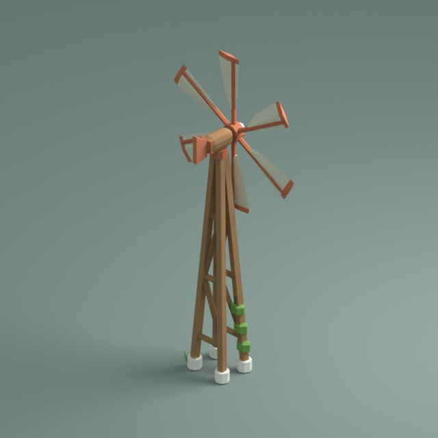 | 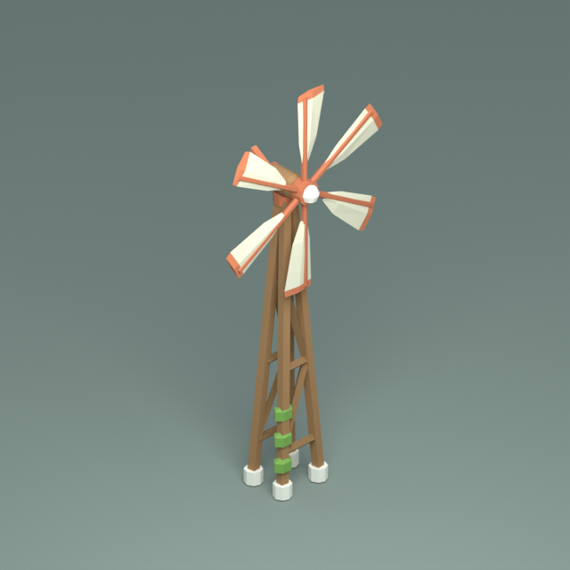 |

### C · Zephyr

| Front-right | Back-right |
| --- | --- |
| 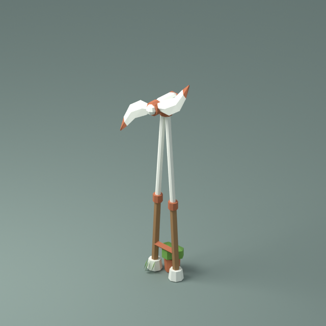 | 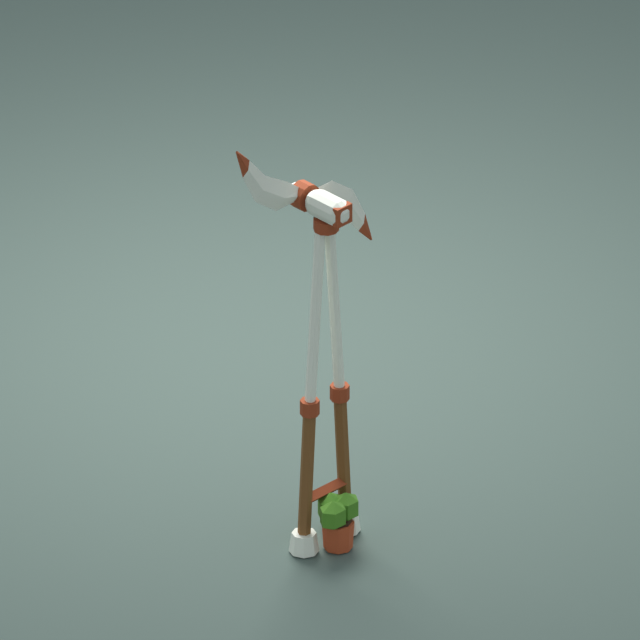 |
| **Back-left** | **Front-left** |
| 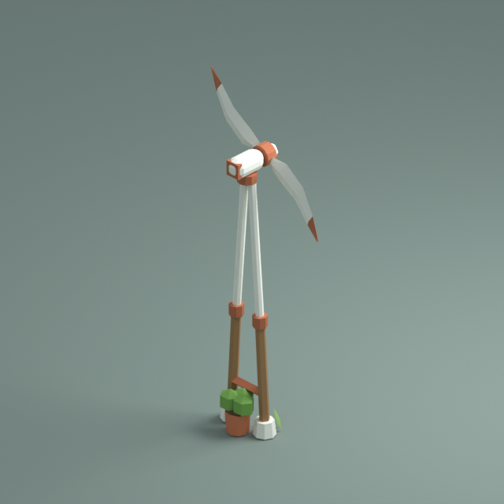 | 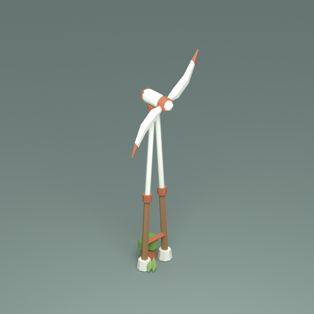 |

## Cardinal views

These follow the existing asset convention: front/back on top, left/right below,
at 30° elevation. They help compare the silhouettes from the game's four sides;
they are Blender renders, without the game's pixel-art post-processing.

| A · Petal | B · Prairie | C · Zephyr |
| --- | --- | --- |
| 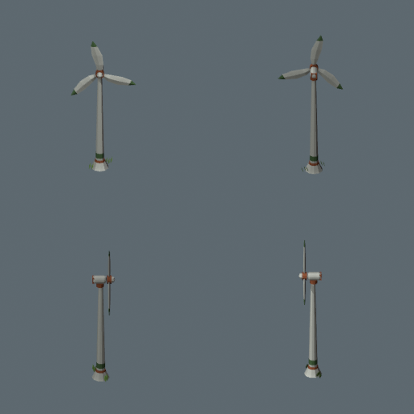 | 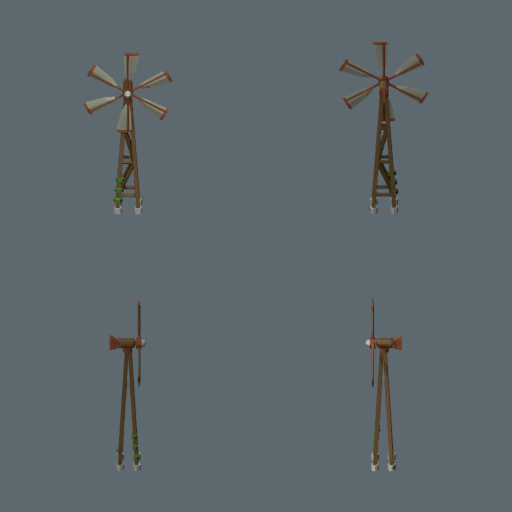 | 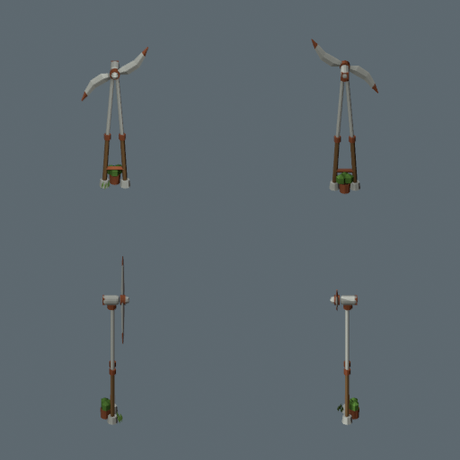 |

## Inspect locally

1. Check out the PR branch and open any linked `.blend` in Blender 5.2. No rebuild
   or external textures are needed. Each file opens on its review camera; NumPad 0
   leaves the camera view so you can orbit freely. F12 renders the saved view.
2. The selected `move_spin_rotor` is the complete rotor. `R`, `X`, `X` rotates it
   around its **local** axle. Orbit to inspect the mast, underside, rear and swept
   clearance. The files contain a static review pose, not a baked animation.
3. The `REVIEW_STUDIO (not exported)` collection contains only the camera, light
   and ground. Hide that collection to inspect the isolated asset. The model meshes
   are in the original collection.
4. The ready-to-use GLBs are `public/models/wind_turbine_petal.glb`,
   `public/models/wind_turbine_prairie.glb` and `public/models/wind_turbine_zephyr.glb`.
   Import any of these into a fresh Blender scene to inspect the actual game export.

To try a candidate in the game, temporarily copy its GLB over `wind_turbine.glb`.
From a clean checkout of this branch, with the dev server running (`npm ci`, then
`npm run dev`), use this in a separate terminal (change `petal` to try another):

```sh
turbine_backup=$(mktemp --suffix=.glb)
cp public/models/wind_turbine.glb "$turbine_backup"
cp public/models/wind_turbine_petal.glb public/models/wind_turbine.glb
```

Open <http://127.0.0.1:5190/?play=sandbox>, place a turbine, and rotate the camera
with Q/E. Check its silhouette at normal zoom and watch the rotor for clearance.
Hard-refresh after swapping candidates. Restore the original from the **same terminal**:

```sh
cp "$turbine_backup" public/models/wind_turbine.glb
rm "$turbine_backup"
```

## Rebuild

The deterministic `build.py` files are the source of truth. The saved `.blend`
files are editable snapshots. To retain edits, port them into the build script.
The normal `assets/build_all.sh` continues to build only the selected game assets.

From the repository root, with Blender 5.2 on PATH:

```sh
for candidate in petal prairie zephyr; do
  blender -b --factory-startup --python-exit-code 1 --python "$PWD/assets/wind_turbine_$candidate/build.py"
done
blender -b --factory-startup --python-exit-code 1 --python "$PWD/assets/wind_turbine_options/compare.py"
```

With the Blender Flatpak, replace `blender` with `flatpak run org.blender.Blender`.
Each build validates the geometry and swept bounds, exports the GLB before adding
the review studio, renders the four cardinal and four diagonal views, and saves
the `.blend`. Studio views use Cycles on the CPU (six threads, 32 samples).
