# Soil n Silo — Design (v0.1, the solarpunk pivot)

Oct 9, 2026 · @Ashutosh Shinde

## Overview

Soil n Silo is a build-only automation game in a solarpunk valley. Each level is a commission from a nearby settlement: on a
seeded map you lay out fields, machines, power and the trucks' routes, and the farm then runs on its own until the commission's goals
are delivered. A level takes about 30 to 60 minutes.

The game replaced a Stardew-like season (the earlier MVP, decided 2026-10-06, built by 2026-10-07) on 2026-10-09. The reason: the
only player is also the designer, so a reward loop of unlocking new crops, items and machines doesn't work: the designer already knows all of
them. An automation loop does: the fun is in building a layout, finding its bottleneck, fixing it and watching the throughput rise,
and that stays fun when every rule is known. Short, seeded levels are also quick to test, where a full season was hours.

**Core loop:** read the map (height, soil, water, wind, space) → shape the ground → lay out a chain → power it → watch it run →
find the bottleneck → fix it → deliver the commission faster.

**What makes it not Factorio:** farming. Soil is a resource that wears out and comes back, so fields need compost, resting or beans;
byproducts must go somewhere (feed, compost or the digester), so the closed loops of a real farm are the puzzle; the sun sets every
few minutes and the wind comes and goes, so power needs storage and a mix of sources.

**In v0.1**

- 18 goods, 5 crops, chickens and bees, 6 processing machines, 4 power sources and storage
- Trucks on routes you set, over the open ground between buildings: no belts and no roads to build; silos to store goods
- Buildings next door trade directly: a mill between wheat fields takes their wheat without a truck
- Pylon power networks, each with its own balance
- Rolling hills, steep banks and occasional cliffs; paid earthworks and levelling on placement
- Soil fertility, slope erosion, sprinklers, compost and pollination
- 8 campaign commissions, random commissions from any seed, a sandbox
- A soft timer: the commission always finishes; gold, silver or bronze by how long it took

**Not in v0.1:** research or unlocks (every building is available from the start), pipes and fluids, weather events, trains,
blueprints and copy-paste, sound, multiple saves per level.

## Camera, presentation and controls

The camera stays as it was: orthographic, a 3/4 view at about 30° pitch, 4 views 90° apart (Q/E), zoom (the wheel, a trackpad pinch,
+/− or Z) and panning (drag, right-drag or the arrow keys). Zoom eases smoothly towards the pointer. Low-poly, flat-colour models drawn as
pixel art by `pixel3d-renderer`. Everything is seen from 4 sides.

Each art pixel is always drawn as a square of the same size on screen (2×2 screen pixels by default; the pixel size is a
setting in the menu, 1×1 to 4×4). Zooming changes how much ground fits on the screen, so models are drawn with more art
pixels close up and fewer far out. Chosen on 2026-10-10 over two other ways, tried side by side in play: magnifying a fixed
picture (art pixels growing from 1×1 to 6×6) and stepping through six fixed detail levels; the free zoom looked and felt best.

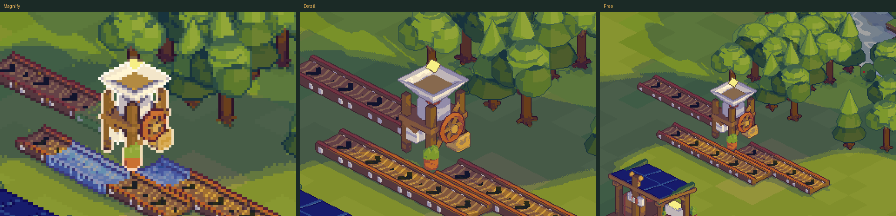

It is build-only and point-and-click. There is no character and no manual farming: you place, rotate, configure and remove.

| Input | Does |
| --- | --- |
| The dock (bottom) or hotkeys (by default F field, L silo, T garage, P pylon, S solar) | Pick a building to place; its placement card says what it would do on the tile under the pointer |
| Click / drag | Place it; a drag places a row (pylons: a power line, spaced so their reaches meet) |
| R | Turn what you're placing; a water wheel faces the river by itself |
| Earthworks in the dock, or K | Raise or lower a ground point, or level an area; drag a rectangle of points; choose its chip, or C / Shift+C to cycle |
| A chip in the strip above a field's or bakery's dock tile; C / Shift+C | Choose the crop (wheat, beans, tomato, sunflower, flax) or the recipe (bread, honey cake) the buildings you place get, without putting the tool down |
| Click a building with nothing in hand | Select it: the inspector shows its status, buffers, settings and history |
| A garage's inspector | Buy a truck; give each of its trucks a route, or none |
| O, or the Routes button | The routes card: every route with its stops, goods, goods a minute, loop time, the gap between trucks at its slowest stop, and problems; point at one to draw it on the map; click it to open it |
| An open route (from a truck, a building, or the routes card) | Rename it; add a stop by clicking a building; set what it drops and picks up and its wait; reorder or remove stops; add or take away trucks; see what each truck is doing and how much it waited, and dump its cargo; copy or delete the route |
| A truck's inspector | Its route, cargo and battery; dump its cargo (the goods are lost); sell it |
| X, then click or drag | Remove (building cost refunded; earthworks stay and are not refunded) |
| Esc / right click | Drop what's in hand, close the inspector |
| Space, 1, 2, 3 | Pause, 1×, 2×, 4× speed. You can build while paused |
| Tab | The ledger: the valley's health, and each good made, used and delivered |
| W | The Power panel: the last day by source, each network, tonight's charge, where the watts go |
| H | The forecast panel (once the valley has a weather station): three days of ranges, and the events with their windows |
| G | The guide: a page for every building (what it does, how to use it, what it takes and gives, its numbers), the goods, and the basics |
| V (or the view bar) | Views: soil fertility, height, sprinkler water, power reach, roads, bee range |
| Esc | Close what is open; with nothing open, the pause screen (the way to the settings, what the markers mean) |

The build preview is see-through, green where it fits and red where it doesn't.

**Readability rules**

- A building with a problem shows a marker above it, each kind with its own shape as well as its colour: half circle waiting
  (for input, or flowers), square blocked, triangle no or low power, drop dry, ring unreachable or no route takes its goods.
- Rest the pointer on a building for a card with its status ("Mill: waiting for wheat"). Point at a tile in the dock for a card
  about that building.
- Trucks carry their cargo in an open bed, so the flow of goods is always visible, and trucks queuing at a building show
  where it is stuck.
- Selecting a truck or a route draws the route's way on the ground, its numbered stops and its trucks. Selecting a building
  lists the routes that stop there. The inspector says what each truck is doing ("taking 6 wheat to the mill", "waiting at the
  field for wheat", "2nd in the queue at the mill", "charging at the garage").
- A building trucks can't reach, or whose outputs are full with no route or building next door taking them, shows a purple marker.
- A building or truck that **weather** stops or slows shows a slate marker with the shape of the event that holds it (a bolt for a
  thunderstorm, a sun for a heat wave, three bars for fog), never one of the layout's shapes, so a layout's problem and the
  weather's are told apart at a glance. Its card says why ("Slowed · fog", and a line with the figures), and its history keeps
  the weather as a status of its own (see Weather events, "Weather's marks"). It marks only what is held, not every building
  the weather touches.
- Goods handed to a building next door hop over the edge the two share. Selecting or pointing at a building tints the
  neighbours it trades with, and its inspector lists them ("Takes wheat from 2 fields", "Gives bran to the coop"); a
  building in hand tints the ones it would trade with, and its placement card says so.
- The placement card shows Earthworks (levelling cost, level and steps), Slope (sloping tiles and soil wear), sprinkler
  watts and lift, the extra wind up high and a wheel's current and fall.
  A field's card counts rain as water while it rains ("Water: rain"), and its ten-minute soil projection walks the next ten minutes an
  hour of play at a time with each hour's warmth and rain (so a rain or warm spell that begins, or ends, within them counts). The
  weather it walks is not the seeded weather ahead: see **Projections (3.4)**.
- The Height view tints land by centre height in blended bands of 3 levels, with steep banks darker. Cliff faces show the breaks.
  It shows while building and doing earthworks, under the grid and contour lines, unless the building in hand has a view of
  its own (silos the roads, sprinklers the water, hives the bees, anything that makes, stores or uses power the power).
- The roads overlay shows the open ground trucks can drive on, and the buildings they can't reach.
- The inspector keeps each building's history over the last 1, 5 or 10 minutes of play (5 by default, the choice kept from
  building to building), so a problem noticed late can be traced: a ribbon of its statuses in time (problems hatched, so they
  don't rely on colour), pointing at it says what happened then and for how long, and below it the share of the time in each
  status as a ring, the goods it made a minute against full speed, and what it waited for, ranked, with a fact for each.
  Solar panels and turbines chart the watts they made and batteries their charge instead (a stretch held by the weather is
  shaded behind the bars, and named below them). Pylons, silos, the depot and saplings have none. The history lives in
  memory, not in the save: after a reload it fills again.
- The guide (G) has a page for every building, with where its good comes from and, during a commission, every building of
  its kind in the valley now; G with a building in hand or selected, or the book in the inspector, leads to it. The basics
  include "Height and earthworks".
- Soil colour shows fertility under fields. Overlays show fertility everywhere, power coverage and roads.
- Power stays in the background until you work with it: pylons are short, quiet posts and nothing else is drawn. The power
  overlay, placing anything that makes, stores or uses power, selecting a building on a network, or pointing at a power
  building shows the networks, each in its own colour: the ground its pylons reach, wires joining its pylons, a line from a
  pylon to every building it powers, and a label with what it makes and uses and how full its batteries are. A focused or
  placed pylon shows both its ranges: its reach (a square, 3 tiles) and its link range (a dashed circle, 8 tiles).
- A battery's cells light up from the bottom as it fills, one ring a quarter.

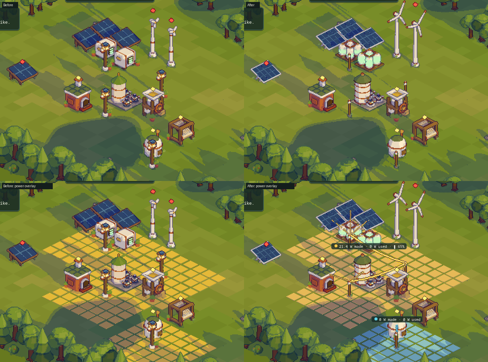

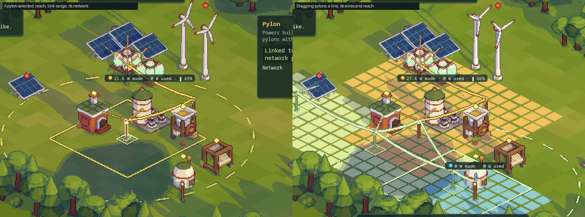

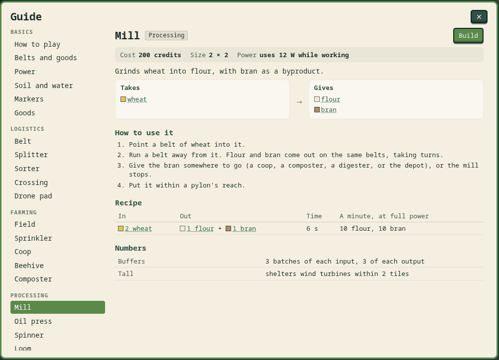

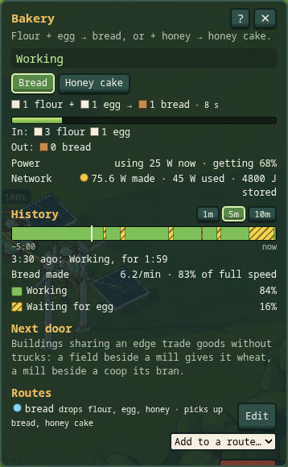 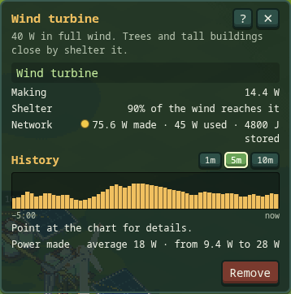

## The interface

The HUD and menus use the Clearday design system (`src/ui/clearday/`, chosen in October 2026 over five other directions):
frosted chalk cards with big soft corners over the world, gauges that fill as goals approach, muted mineral colours, and a
screen kept nearly empty so the valley is what you look at. Its principles:

- **Don't play the game for the player.** No plans, bills of materials, "first hour" steps, bottleneck answers or "one more X
  would…" suggestions before or during play. Screens state facts; the player works out what to do. Analysis belongs after the
  game, on the results screen, the one place a "next time" line is allowed.
- **Find problems in the world.** Problems show as markers over buildings. A problems strip on the right edge is an
  experimental setting, off by default.
- **Projections are optional.** "Done by" and the gold and silver pace ticks appear only with the *Show pace* setting.
- **Keep the HUD quiet; heavy data gets its own place.** Power has its own panel; production chains and lead times live in the
  guide; building rates live in the inspector, never as labels over the map.
- **No hotkeys printed in the HUD.** Every key still works; keys are listed in the guide and appear in tooltips. Every key but Esc can be changed in Settings (Keys tab, from the level select or the pause screen); the panel's Game tab holds the other settings.
- **Status never by colour alone.** Each status pairs its tint with a shape and a word.
- **Two clocks, and watts not energy.** A game day lasts four minutes of play. Anything measured over minutes of play (history,
  rates a minute, idle shares, the commission clock, the results' milestones) is in play time ("5 min ago", `13:00` of play);
  times of day (`dusk 20:00`, `dry at 02:40`, the Power panel's day) are in-game hours. Screens show average watts and battery
  percentages, never watt-hours.

Settings, kept in the browser: interface size (90–130%; the interface also scales with the window, designed at 1920 × 1080 and
held down to about 1366 × 768), pixel size, reduce motion, show pace, and the problems strip.

## Time

The simulation runs in fixed steps of 0.1 s. A day lasts 240 s at 1× (4 minutes); a commission starts at 7 AM, and the sun shines
for the season's hours (from 5 AM to 9 PM in summer down to 8 AM to 4 PM in winter; see Seasons). The level timer counts simulated time, so speed controls only change
how long you wait, and pausing to plan is free.

The wind follows a smooth seeded curve around the season's mean, swinging up to its gust either way, between 0.05 and 1.0 of
full strength.

## Seasons

A commission happens in one **season**: spring, summer, autumn or winter. It never changes during the commission. The season
replaces the old per-commission weather settings: the sun's hours and strength and the wind come from the season, and a
**character** can twist it ("a wet spring", "autumn, gales", "a hard winter"). The table and the characters are in
`src/game/seasons.ts`: one section per lever, so warmth, rain and the river join it as sections of their own.

| | Spring | Summer | Autumn | Winter |
| --- | --- | --- | --- | --- |
| Sun up | 6–19 | 5–21 | 7–18 | 8–16 |
| Sun strength at noon | 0.9 | 1.1 | 0.75 | 0.55 |
| Wind (mean ± gust) | 0.5 ± 0.4, gusty | 0.3 ± 0.25, light | 0.7 ± 0.3, strong | 0.7 ± 0.15, strong and steady |
| Cloud (share of the time) | 0.25 | 0.12 | 0.25 | 0.30 |
| Showers (share of the time, before they build and fade) | 0.22 | 0.05 | 0.12 | 0.15, as snow |
| Calm spells (share of the time) | 0.10 | 0.35 | 0.10 | 0.10 |
| Warmth (dawn low – afternoon high, ± 2 a day) | 7–19°C | 16–30°C | 9–21°C | −5–6°C, frosts |

Each season favours a power source: wheels in spring, solar in summer, wind in autumn
and winter. A summer day gives a solar panel about four times a winter day's energy.

**Characters** add to the season's numbers. A character only fits some seasons (no hard summer), and it also sets the
odds of each weather event (see Weather events):

| Character | Seasons | Shifts now |
| --- | --- | --- |
| Mild | any | sun +0.05, wind −0.05, gust −0.1, warmth low +1, high −1 |
| Wet | spring, summer, autumn | cloud +0.1, rain +0.1, calm −0.05, warmth high −1 |
| Dry | spring, summer, autumn | sun +0.05, cloud −0.05, rain −0.04, calm +0.1, warmth low −1, high +1.5 |
| Hot | spring, summer | sun +0.1, wind −0.05, calm +0.05, warmth low +2, high +3 |
| Gales | spring, autumn, winter | wind +0.15, gust +0.05 |
| Stormy | spring, summer, autumn | sun −0.1, wind +0.05, gust +0.15, cloud +0.15, rain +0.06, warmth high −1 |
| Hard | winter | sun −0.1, wind +0.05, cloud +0.1, warmth low −4, high −3 |
| High river | spring | a faster river (flow +0.3) |

A commission's season is named with its character: "A wet spring", "Autumn, gales", or just "Winter" without one. **Tags**
such as "Short days" or "Strong wind" describe the season on the level card (10 hours of sun or fewer: Short days, 15 or more:
Long days; strength under 0.8: Weak sun, 1.1 or more: Strong sun; mean wind 0.65 or more: Strong wind, 0.35 or less: Light
wind; gusts 0.4 or more: Gusty; a dawn low under 0°C: Frosts, otherwise an afternoon high of 30°C or more: Hot); they aren't
modifiers of their own.

**Where the season shows** (Clearday, facts only; every number is read from the tables in `seasons.ts` and `data.ts`, never
written into the text):

- **The HUD chip** by the dial: the season with its character ("A wet spring"), the weather now (Clear, Cloudy, Rain, Snow;
  `weatherNow`) and the warmth now in °C, above the sun and wind chips. Once a weather event starts, its name replaces the
  sky's word on the weather chip (red for a hard turn, green for a kind one), with no warning and no length.
- **Level cards** (campaign, random, sandbox): the season and character is the first tag, filled; the campaign card's
  conditions column adds the season's warmth range and rain share (with the character's shifts applied).
- **The briefing letter** carries a paragraph on the season in the writer's voice (each campaign letter has its own; random
  commissions and the sandbox get a neutral line per season and character, `letters.ts`), then the weather events the season
  and character can bring ("Weather to watch for this season: a thunderstorm, a flood or a late frost. Kinder turns it can take:
  a soft rain."), never when they come, and then what a weather station gives ("A weather station (80 credits, 3 W) tells when: it gives a forecast
  of the next three days.", `stationWords`, from the price in `data.ts`). Harvest Festival's letter, where the station
  matters (the stormy autumn's tropical storm, its flood and the fog), adds a paragraph in Wren's voice: the old hands expect a big storm in festival
  week and fog before the lanterns go up, and a station "would tell us the day and the hour".
- **The guide** has a page for each season (sun, wind, warmth, rain, cloud, calm, the river, hours a day each crop is
  comfortable, hens, bees, and what each character shifts) and "Seasons and weather" in the basics, which says what you see with and without
  a station ("With and without a station") and how to read the forecast. The field page's crop
  table gives each crop's comfortable range.

### Warmth

**Warmth** is the valley's temperature in °C, one number for the whole valley (`src/game/warmth.ts`). It follows the day: coldest
an hour before the sun rises, warmest at 3 PM, a smooth curve between the season's low and high, plus a smooth seeded drift of
the whole day up to ±2°C (the same every time the commission is played). Conditions (rain, 1.3) and events (phase 2) nudge it
through `WARMTH_NUDGES`, a list of functions each adding its degrees. Rain is the first: while it rains or snows, warmth is nudged down by up to 2°C (by the precipitation's intensity). Thresholds the rules key off:

- **Below 0°C, frost.** A frost-tender crop (tomato, sunflower) in an open field loses its growing crop each moment it is
  frozen, so the field starts again; what it already holds is untouched. A frozen field's status is Frost. (A spring night's **late frost**
  is the same loss for the fields it settles on, place by place: see Weather events.)
- **Below 10°C**, tender crops stop growing (status Too cold). **Below 10°C, bees stay in** (see Hens and bees below).
- **Above 30°C, heat.** An unwatered field's growth multiplier (×0.4 normally) falls to ×0.1 by 34°C, linearly. Heat also slows hens (see below).

**Hens and bees by season** (`warmth.ts`; machines are indoors and don't care). The coop lays at the season's rate (the `hens.lay` lever: ×1 in
spring and summer, ×0.75 in autumn, ×0.5 in winter), further slowed above 30°C by the crop-style fall-off 1 / (1 + (d / 6)²), d the degrees above 30:
half speed at 36°C. **Trees by the coop shade it:** each tree within 2 tiles of the coop's footprint takes 2°C off the heat the hens feel
(`ANIMALS.shadePerTree`; up to 6°C, three trees), so they slow at 30°C plus the shade instead of at 30°C (`coopShade`; the coop's inspector shows
"Shade: 2 trees within 2 tiles", its placement card the same for the spot). The coop stays 'Working'; its inspector, hover and placement card say "Hens, 3°C: cool season, laying at about 50% speed".
Bees stay in below 10°C: a hive makes no honey (status Too cold, "Bees: staying in, 7°C") and a flowering field harvested then gets no
pollination bonus. Warmth swings over a day, so a hive works in the afternoon of a cool spring day. Winter days top out at 6°C, so in winter
the bees stay in all day; Long Nights (winter, honey cake) can't be cleared until the greenhouse (#86), and its bot test is skipped.
The bees also stay in while a gale or a tropical storm blows (see The wind events); a warm spell (see Weather events) lets them fly in winter.
**Bees in winter (`forage.ts`).** Too cold outside (below 10°C), a hive whose reach (`hiveReaches`) takes in a **working greenhouse** (dry, powered
when its crop needs heat, and at its crop's lowest comfortable warmth, `greenhouseWorking`; one cooling without power stops counting at once)
growing a **flowering crop** (beans, tomato, sunflower, flax) forages there: it makes honey from those greenhouses (up to 3, at the usual rate)
and pollinates them. The greenhouse's warmth need not reach 10°C (beans and flax are held at 6°C): bees forage under glass whatever its warmth.
The open fields in reach count for nothing until the outside is warm again (the hive's status stays Too cold if no greenhouse works). A gale or storm
still keeps them in (hold *stopped*). When it is warm enough outside every flowering field in reach counts, as before. Shown: the inspector's Bees
line and the hive's placement card ("Foraging in the greenhouse: too cold outside"; "Bees in the greenhouse" on the card, its Honey and Pollinates
counting only those greenhouses), the ledger's Pollination ring (fields the bees forage on now) and the guide's Hive page. A new greenhouse's
placement card counts its pollination if it would be powered. No saved state changes, so the save version stands.

Each crop has a **comfortable range**: full speed inside it, and outside it a smooth fall-off of 1 / (1 + (d / 6)²), where d is
the degrees outside the range: half speed 6°C out, a quarter 10°C out. This is one more factor in a field's pace, with water and
fertility. The placement card, the hover card and the field inspector say where now falls for the crop ("Tomato, 12°C: cool for
it, grows at about 50% speed"), and the guide's crop table shows each range and whether it is frost-tender.

| Crop | Comfortable | Frost | Winter outdoors |
| --- | --- | --- | --- |
| Wheat | 6–24°C | hardy | slowly |
| Beans | 6–24°C | hardy | slowly |
| Flax | 6–26°C | hardy | slowly |
| Tomato | 18–30°C | tender | no |
| Sunflower | 14–32°C | tender; copes when dry | no |

Sunflower "copes when dry": it loses half as much growth to a lack of water. The flax's liking for wet waits for rain (1.3).
So wheat and flax are slow in a summer's heat, tomato and sunflower are slow in spring and autumn and stopped in winter (oil
and sauce need greenhouses then, phase 4).

**Conditions** are the everyday weather inside a season: small, constant and unannounced, seeded like the wind curve
(`src/game/sim/weather.ts`). The day is cut into spells (4 hours of cloud, 2.5 of showers, 5 of calm); each spell is on with the
season's chance at a seeded strength, and the strength glides from one spell to the next, so a condition builds and fades. The
three numbers above are the chance of a spell being on; showers come out about a third more of the time than their number, from
the gliding (a spring day is rainy about 30% of the time, a summer day about 7%, a wet spring about 43%, a dry summer about 1%).
- **Cloud** takes up to 65% off the sun (solar output). A shower brings cloud with it.
- **Calm spells** take up to 60% off the wind (turbines).
- **Rain waters fields**: while it rains, every open field counts as watered, and **sprinklers rest** (status "Resting in rain"):
  they draw no power. A wet spring frees power; a dry summer needs every watt for water.
- **Snow doesn't**: winter's precipitation is snow, which waters nothing and leaves sprinklers running.
- **The weather now** is clear, cloudy, rain or snow with a precipitation intensity 0–1 and the cloud cover
  (`weatherNow(state)`, for the HUD chip and the look). The battery projection ("tonight") reads the sun, wind and rain ahead as the
  player can know them: the usual for the season without a station, the forecast's ranges with one (**Projections (3.4)**), and counts
  the sprinklers as resting for the share of the time it rains.
- **Falling rain and snow are drawn** (renderer 0.3.4): rain in the open seasons, snow in winter, on the same 3 s easing as the
  cloud cover. The renderer's intensity is `0.15 + 0.35 × precipitation`, so everyday showers read light to moderate (0.15–0.5)
  and the heavy end (up to 1) is left for phase 2's storms and blizzards. Cloud already thickens with a shower (`cloud` is at
  least 1.5 × precipitation). The rain keeps falling while the game is paused (it runs on the frame clock, not the game's).

### Weather events

A **weather event** happens during a commission, lasts half a day to two days (about 2–8 minutes of play; a morning's fog and a
night's frost are shorter) and passes. The system is `src/game/events.ts`: pure data and rules, no drawing. An event has a
**kind**, a **strength** (ordinary or severe; the severe tropical storm is the hurricane), a **start** and a **length** (seconds
of play), and a commission's events are a list on the commission (`Scenario.events`, by start), so they are the same every
time it is played, the bot can play them and the forecast can read them.

**The catalogue** is one table, `EVENTS`: for each kind its name, whether it is a good one, its length, the hours of the day it
can begin in (fog at dawn, a frost at night), the seasons that bring it and how often, the characters that change its odds or
that it is limited to, whether it can be severe, its look and its `push`:

| Event | Seasons (odds) | Characters | Length | Severe |
| --- | --- | --- | --- | --- |
| Thunderstorm | spring, summer | stormy ×2.5, wet ×1.5, hot ×1.2, mild ×0.7, dry ×0.4 | 10–14 h | yes |
| Heat wave | summer | hot ×2.5, dry ×2, stormy ×0.6, wet ×0.5, mild ×0.4 | 24–40 h (severe 40–64 h) | yes |
| Fog | autumn, from 03:00–07:00 | wet ×1.5, mild ×1.2, stormy ×0.5, gales ×0.3 | 4–7 h | yes |
| Soft rain (good) | spring, autumn | wet ×1.8, mild ×1.2, dry ×0.4 | 20–28 h | no |
| Warm spell (good) | autumn, winter | mild ×1.5, hot ×1.5, hard ×0.3 | 24–48 h | no |
| Steady breeze (good) | summer | dry ×1.2, hot ×1.2, stormy ×0.5 | 20–28 h | no |
| Gale | autumn | gales ×3, stormy ×2, mild ×0.4 | 20–28 h | yes |
| Tropical storm | summer (×0.15: "late summer", see The wind events), autumn (×0.3) | stormy ×3, wet ×1.5, gales ×1.2, hot ×0.5, mild ×0.3, dry ×0.1 | 24–48 h | yes: the hurricane |
| Flood | spring; also after a spring thunderstorm and after a tropical storm | high river ×3, wet ×2, stormy ×1.5, mild ×0.6, dry ×0.2 | 24–48 h | yes |
| Late frost | spring, from 20:00–23:00 | dry ×1.5, wet ×0.8, gales ×0.5, mild ×0.4, hot ×0.2 | 8–10 h | yes |
| Cold snap | winter | hard ×2.5, gales ×1, mild ×0.3 | 24–48 h | yes |
| Blizzard | winter, hard character only | | 24–48 h | yes |
| Dust storm | summer, dry character only | dry ×2 | 12–24 h | yes |

The odds and lengths are first sketches. A tropical storm brings its **flood** the moment it ends, at the same strength (a
hurricane's flood is the severe one): the one case where events touch, and the flood is part of its storm, not one of the
level's events.

**Events land one issue at a time.** The whole catalogue is rolled and shown, but a kind's `push` is filled in by its own issue:
2.3 (below) the thunderstorm, heat wave, fog and the three good events; 2.4 (below) gale, tropical storm, hurricane; 2.5 (below) flood; 2.6 (below) late
frost; 2.7 cold snap and blizzard; 2.8 (below) dust storm. Until its issue lands an event changes only the **look** of the sky (cloud and
drawn rain or snow, eased in with the event's ramp; the rules do not see it), the HUD chip and the list the forecast will read.

**The sky events (2.3).** Strengths are what the push is at full strength; each is blended in and out by the ramp.

| Event | Ordinary | Severe |
| --- | --- | --- |
| Thunderstorm | `rain` 0.9 (every field counts as watered, sprinklers rest), `sun` ×0.6 on top of the full cloud, `wind` +0.45 | `rain` 1, `sun` ×0.4, `wind` +0.7: stronger gusts, almost no sun |
| Heat wave | `warmth` +5°C: a summer afternoon passes 34°C (unwatered fields at ×0.1, hens at about 60%) | `warmth` +9°C, and 40–64 h instead of 24–40 |
| Fog | `sun` ×0.4, `trucks` ×0.5 | `sun` ×0.25, `trucks` ×0.35 |
| Soft rain | `rain` 0.35: gentle rain waters every field; not heavy rain | — |
| Warm spell | `mild` 1: the day is lifted to a mild day, 12–24°C (`MILD_DAY`), if it is colder; a warmer day is left alone | — |
| Steady breeze | `wind` +0.4: after the calm spells, so the calm season blows | — |

- The `mild` lever (the highest wins, 0–1) is read in `WARMTH_NUDGES`: `mild × max(0, MILD_DAY curve − the day's warmth)`. In winter that
  takes −5…6°C to 12…24°C: crops that grow at a mild season's pace, bees that fly, no frost; in autumn (9…21°C) it adds a little.
- A heat wave's rules are all the warmth: crops past their comfortable range slow (watered ones too), an unwatered field falls
  to ×0.1 above 34°C, and hens slow (less with trees by the coop). A warm tint lifts the light (the game-side `Look`, `greyLook`:
  `Look.heat` in the catalogue, `lookAt(...).heat`, `Weather.heat`): a warmer lit and shadow tint and a golden sky.
- **Heavy rain.** An event may carry `heavyRain` in the catalogue (the thunderstorm), and `heavyRainEvents(scenario, time)` lists
  those under way. A spring thunderstorm counts as heavy rain, and its flood follows it (see The flood, below). Soft rain and the
  everyday showers do not.
- Fog's look is a haze (see Haze, below). A warm spell lights the day a little gold (`look.heat` 0.3, a third of the way to a heat wave's tint),
  so a kind turn reads in the world too.
- A severe form's length can differ from the ordinary one (`severeHours`): only the heat wave has one so far.

**The flood (2.5).** The river (any water: a lake or pond spreads over its shore the same way) spreads over the low ground beside
it for a day or two, then drains.

- **When.** In spring as a flood of its own (odds in the table), at once after a spring thunderstorm (`then: 'flood', thenIn: ['spring']`
  in its entry; the season must be known: `eventChain` and `eventOn` take it, a summer storm brings none) and after a tropical
  storm in any season. A flood that follows a storm has the storm's strength: a hurricane's is the severe one. It lasts the
  event's 24–48 h (a following one the usual 36 h), builds in and drains over the usual 1.5 h ramps.
- **How high.** The catalogue's `flood` field is the levels the river stands above its own surface at the peak: **1 ordinary,
  2 severe** (`floodLevel(event)`, the hook for 2.4's levels). `floodRise(scenario, time)` is that times the event's intensity, and
  moves the flood through half-level **steps** (`floodStep`, the rise rounded down, so the water never stands above the rise and what it covers is wet): the covered tiles are worked out once per step and kept (`flooded`),
  so the rules and the view read the same set, and the layout is touched when it moves (`syncFlood`).
- **Where: height, not distance.** Every water tile is a source at its own surface (a river's reaches stand at different levels
  either side of a fall). Water spreads tile to tile (four ways) over a tile whose ground (its centre's height, `centreLevel`) is
  lower than the water's surface there. The surface is the source's plus the rise, **less `FALL` = 0.16 of a level for every tile
  it has run**: floods thin out over a wide plain instead of drowning it. A flood over level ground reaches `rise / FALL` tiles
  (about 6 for an ordinary one, 12 for a severe one); a hillside, or a **bank raised with earthworks**, stops it, and ground behind
  a bank stays dry unless the water can go round it. Earthworks change the relief, so the reach is worked out again.
  - *Tuned from the maps* (`tools`, the probe in the PR): without `FALL` a flood on the generator's low, flat valley floor covered
    half to nine tenths of a map and took the start of the farm (the depot's clearing is level 0 and joins the floodplain on
    most maps). With it, an ordinary flood covers the 15–30% of the land beside the river (up to 50% on the low maps with the river
    near the depot: c6, c8), and a severe one 25–60%.
- **What it does.** A field with any tile under water **loses its growing crop** (growth goes to 0 each step; the weather's hold, effect *lost*);
  its stored harvest is untouched. Any other building with a tile under water **stops** (the weather's hold, effect *stopped*, marked with the wave shape): its progress, stock
  and charge are kept, nothing is destroyed. It leaves the power network (a flooded pylon links nothing, panels, wheels and
  digesters make nothing, flooded machines and sprinklers want nothing), trades nothing next door, and trucks cannot load at it.
  The depot is not stopped (but if water stands on all its sides, trucks cannot reach it) and a sapling keeps growing.
- **Trucks** cannot drive through water: a flooded tile is not an open road tile (`roads.ts`), so routes go round it, or wait
  (the stop is skipped, then they are *stuck* until the water drains). A truck caught on a tile as it floods is put on the nearest
  dry tile, as when a building goes up on its tile.
- **Silt.** Ground the water leaves (tiles that drop out of the covered set as the flood drains) gains **`SILT` = 2 fertility**, and
  its recovery level rises by as much (`soilBase`), capped at 100. A flood costs a field its growing crop (about half a crop on
  average, 1.5 wheat; two points of fertility on nine tiles are worth about a seventh of that over a whole level), so silt never
  pays for the flood, but a floodplain gets richer flood by flood.
- **Answer.** Build higher; raise a bank. The placement card of a building in hand states, as a fact, **"Floods: level N"** on ground
  a flood reaches (N the lowest flood level, 1 or 2; shown where the season can bring a flood, and in the sandbox).
- **Drawn.** One renderer fluid layer (`FLUIDS.flood`, `src/world/floodView.ts`) over the covered tiles and the swollen river, each at the
  surface the rules give it; the cells are made at each step and the water stands at the step's surface, so it climbs and drains
  in half levels (an eighth of a metre) and shows what the rules cover (the renderer hides water behind higher ground by depth; where the smooth ground is drawn higher than
  the rules' height, within half a level, the water is raised to cover the tile, so a tile the rules flood always shows water).
- **Marked** as a weather hold (2.2): the flood's own `wave` shape, the card's "Under water" line, the history ribbon and the results' cost
  follow from `buildingHold` (`hold.ts`), which reads `floodHolds` (`flood.ts`). The depot and a sapling are not held.
- **Targets.** The bot's map is flat with no water, so a flood never reaches it. `tools/floodcost.ts` puts a river down its map near
  the depot and plays the layouts through a spring commission's rolled events with and without the flood: a flood beside the farm
  cost 17–24% (up to 43% at worst) with 5–7 buildings flooded. A spring commission nearly always rolls one (75% at difficulty 1,
  98% above), so **`PAR_FACTOR` spring is a tenth higher** (mild 1.1, wet 1.2, dry 1.1, hot 1.1, gales 1.15, stormy 1.3, high river 1.15).
  The tropical storm's flood (autumn too) is retuned in The wind events (2.4). The factors were measured again, all events together, in 2.10 (see Commissions).

**Late frost (2.6).** One clear spring night (8–10 hours, beginning between 20:00 and 23:00; random commissions only, never the
campaign) when frost settles on the lowest ground (`src/game/frost.ts`: pure rules; the rime is drawn in `src/world/rime.ts`).

- **Where: a hollow is judged against the ground round it**, not against the whole map (real frost pools metres down; our whole map
  is not four). A land tile's *depth* is how far, in levels, it lies below the average of the land tiles within 6 tiles of it
  (`FROST_RADIUS`; water doesn't count; the average follows the ground as it is after earthworks). An **ordinary** frost lies where
  the depth is at least 0.2 of a level (`HOLLOW`): the hollows and the valley floor, about a quarter to a third of a map's tiles;
  a slope that is level with its surroundings (depth about 0) is clear. A **severe** frost (a windy, bitter night: the wind
  gains 0.5) lies where the depth is at least −0.2 (`SLOPE_REACH`): slopes freeze too, and only the crests that stand above the
  ground round them are spared (about two thirds of the tiles are frozen). Flat ground has no hollows, so an ordinary frost
  leaves it alone, and a severe one freezes all of it.
- **What it does.** The frost bites once it is half-way through its 1.5-hour build-in (`BITES_AT` 0.5) and lets go half-way through
  its fade. While it bites, a field of a frost-tender crop (tomato, sunflower) with at least 5 of its 9 tiles frozen has its
  growth reset every moment, so the field starts again when the frost has passed; its status is the weather's (`Lost · late frost`,
  see Weather's marks) and the time is counted as held. Hardy crops, and what a field already holds, are untouched.
- **Cards.** In a spring commission that can have a frost (random ones and the sandbox, not the campaign) a field on frost hollow says "Frost hollow: late frost settles here" as a fact: the placement card (bad news
  for a tender crop, plain for a hardy one), the inspector, the hover card over the field, and the hover card over bare ground.
- **Drawn.** White rime lies over the frozen tiles: it builds in with the frost, lies at dawn and melts away over 3 game hours after
  the frost ends (`MELT_HOURS`), through the morning. It is a sheet of tiles tinted white and dithered by opacity (up to 85%),
  game-side; no renderer feature was needed.
- **Answer you can build:** tender crops on slopes, hardy crops in the hollows; the greenhouse (phase 4) is frost-proof.
- **Cost, measured with the bot** (`tools/` layouts on a flat map, where a severe frost freezes every field, the worst case): one
  severe frost on day 2–5 made c6 (sauce) 2.3–2.6 minutes slower (of a 39 minute run), c3 (oil, bread) 0–1.2, c4, c7 and c8 under
  half a minute. An ordinary frost reaches about a quarter of the fields, so it costs less. That is about 3% on average over a
  spring commission's layouts, so `PAR_FACTOR` is unchanged.

**The wind events (2.4).** The gale, the tropical storm and the hurricane (the severe tropical storm). Their rules are in
`src/game/wind.ts` (pure) with the numbers in the catalogue; the holds that mark them are in `hold.ts`.

| Event | Ordinary | Severe |
| --- | --- | --- |
| Gale (autumn, 20–28 h) | `wind` +1 (a full wind's worth, so no calm spell dims it: turbines at full power), `bees` 0 | the same, and `gale` 1.3: exposed turbines stop |
| Tropical storm (autumn, summer; 24–48 h) | `rain` 1 (heavy rain), `sun` ×0.4, `wind` +0.6, `bees` 0; **a flood follows** (ordinary) | the hurricane: `rain` 1, `sun` ×0.05, `wind` +0.8, `bees` 0, `hens` 0, `gale` 3; **a severe flood follows**; trucks stay in |

- **Turbines and shelter.** A turbine stops while the gale it feels, the event's `gale` times the turbine's exposure to the wind
  (`windExposure`: its shelter from trees, tall buildings and higher ground times its height, 0.4 to 1.8), is over `TURBINE_LIMIT` = 1.
  In a severe gale (1.3) that is an exposure above about **0.77**: a bare turbine (1.0) stops, so does one with two trees or tall
  buildings beside it (0.8) or three trees on a rise; a turbine with **three or more trees or tall buildings** within 2 tiles (0.7
  or less) keeps turning. Up a hill a turbine gets 5% more wind a level and stops sooner (three trees at level 8 stop). In a
  hurricane (gale 3) a turbine stops above exposure 0.33, which is every turbine (the least a turbine can get is the shelter floor, 0.4): sheltered or
  not. A gale rarely stops a small turbine, so only the severe one does; the ordinary one has no `gale`. The gale blows in with
  the event's ramp, so the most exposed turbines stop first and the sheltered ones never do.
- **A turbine that keeps turning furls**: it makes `(1 − 0.5 × k) × (1 − 0.5 × k × gust)` of what it would make, `k` = the gale it feels
  as a share of the limit (so 0.7 sheltered by three trees in a severe gale makes about 40–60% of its ordinary power), `gust` a seeded noise 0–1 that changes over
  a few seconds (`FURLED`, `UNSTEADY`): reduced and unsteady. A stopped turbine makes nothing; nothing breaks, it turns again when the
  gale eases.
- **Bees** stay in while the weather's `bees` push is below half (the gale, the tropical storm and the hurricane): the hive's honey stops
  (the weather's hold, *stopped*), and a flowering field harvested then gets no pollination bonus (`beesOut`).
- **Hens** stop laying in a hurricane (`hens` 0, read by `coopPace`; the coop is held, *stopped*; while the storm builds in or fades out they are *slowed*).
- **Trucks stay in their garages through the hurricane's worst hours**: the middle half of the event (`garages` 0.5 in the catalogue,
  `garaging(scenario, time)`). When it begins, a truck on the road drives home; one at its garage charges but does not set off; they set off again when the
  worst hours are over. They are marked as held (*stopped*) while they wait. The 12 hours the flood stands afterwards are not in the worst hours, but the flood keeps trucks off the
  water as it always does.
- **Solar** is weakened by the sun lever (the existing mark: ×0.4 in a tropical storm, ×0.05 in a hurricane: nearly nothing).
- **The flood after** a tropical storm comes at once, at its strength: a hurricane's is the severe one (2 levels), certain and a level higher than the ordinary storm's (1).
- **Marked** as weather holds: the gale has the `chevron` shape and the tropical storm the `swirl`. A stopped turbine is *stopped*, one turning furled is *weak*
  (≤ 85% of its power); its card says "Stopped: the severe gale is stronger than a turbine this exposed can stand. Trees, tall buildings
  or higher ground beside it would keep it turning". A stopped turbine's rotor stands still (a fourth rotor look in `models.ts`, no renderer change).
  A hive stopped by the weather, a coop whose hens have stopped, a truck kept in its garage and a panel under the storm's cloud are marked the same way.
- **Cards.** A turbine in hand, where a severe gale can come (autumn and the sandbox), says "Severe gale: keeps turning" or "stops" from its shelter; the
  "Now" watts take a gale into account.
- **"Late summer"** is the summer commission. A commission is one season, so there is no "late" within it: a tropical storm in summer
  is half as likely as in autumn (`seasons: { summer: 0.15, autumn: 0.3 }`), the storm season's tail, and rarer for it. The odds were
  0.25 and 0.5 in 2.1; the bad events of an autumn are only fog, the gale and the tropical storm, so those odds put a tropical storm in 22% of a mild
  autumn's commissions and 71% of a stormy one's, which is not rare. At 0.15 and 0.3: 14% mild, 34% wet, 32% gales, 58% stormy
  (difficulty 2 and 3); in summer 10% mild, 26% wet, 5% hot, 1% dry, 33% stormy. The hurricane is possible in either season, only in a stormy
  character at difficulty 3 (23% of those in autumn, 13% in summer), at most once a level.
- **Answers you can build:** a power mix (the gale and the hurricane stop the wind but not the wheel or the digester; the tropical storm dims the
  panels), batteries to carry the dark days, turbines in a grove or by tall buildings, garages near the routes, and the flood's answers (higher ground, banks).
- **Cost, measured with the bot** (`PAR_FACTOR`). The bot's map is flat with no water, so, as for the flood (2.5), a synthetic river is put down
  8 tiles from the depot, beside the farm: the worst case for the storm's flood. One event on day 3 against none, on c1, c4 and c6 (the
  mean over the layouts and climates): a gale 0%; a severe gale 0–2% (the bot's farms lean on solar, so a stopped turbine costs little);
  a tropical storm 17–22% (almost all of it the flood after it, a little the dark days); a hurricane 34–39% (worst 59%, on the short c1: it is
  about 9 minutes of lost play however long the run is). Over a population of random commissions (difficulty 2 and 3, the events rolled
  as they would be, 48 runs a climate) the extra over the same run without wind events was, mean and 90th percentile: autumn mild +2%
  and +2%, wet +6% and +24%, dry +0.5% and 0%, gales +5% and +27%, stormy +9% and +28% (worst +34%); summer mild +2%, wet +3% and
  +20%, dry +1%, hot +0.3%, stormy +5% and +23% (worst +48%). So **`PAR_FACTOR` is a tenth higher** for autumn wet (1.25 to 1.35) and gales (1.15 to
  1.25), 0.15 higher for autumn stormy (1.35 to 1.5, where the hurricane is also possible), and a tenth higher for summer wet and stormy
  (1.1 to 1.2); the rest stand. These per-event bumps were replaced by one measurement of every event together in 2.10 (see Commissions).

**The dust storm (2.8).** The dry summer's event: half a day to a day (12–24 game hours) of blowing dust, only in a dry summer (the sandbox
can start it in any season). Odds `dry ×2`, as likely as the dry summer's heat wave, so about four in five dry-summer commissions at
difficulty 2 and 3 roll one (47% at difficulty 1); it is severe in about one in five dry summers at difficulty 3. Its rules are in
`src/game/dust.ts` (pure), with its numbers in the catalogue entry.

| | Ordinary | Severe |
| --- | --- | --- |
| `sun` | ×0.33 (solar to a third) | ×0.2 |
| `trucks` | ×0.6 | ×0.45 |
| `dust` (the fertility an unguarded field's tile loses each game hour, at full strength) | 0.6 | 1.2 |

- **Unsheltered fields lose fertility to the wind.** While the storm blows, every one of the 9 tiles of a field with nothing to
  break the wind loses `dust` fertility a game hour, blown in and out by the ramp (`blowDust`, each step): about 10 points over an
  ordinary storm of 12–24 hours, about 20 over a severe one (a wheat harvest takes 1). Ground without a field is not touched. The
  loss is not recovered: only ground with no field on it rests back to `soilBase` (`rest`), so compost and beans make it good, as
  they do the wear of harvests. Ten points is about a tenth of that field's pace (poor soil ×0.4, rich ×1.4 over 0–100).
- **Trees as windbreaks: `guardedAt`, not shelter.** A field is guarded from the dust by what already guards it from erosion
  (`guardedAt` in `rules.ts`, cached as `isGuarded`): a tree or a sapling within a tile of its 3 × 3 footprint, or a bean field
  sharing an edge. A guarded field loses nothing. I chose it over the turbines' graded shelter (trees in reach, `windExposure`)
  because the field already says "guarded" on its cards, one rule teaches the two lessons (soil held on slopes, soil held in the wind),
  a sapling guards it at once (a cheap answer in time), and Tired Soil (2.10) teaches it with a tree or a sapling beside a field: the card says "guarded" or "exposed".
- **Answers:** trees (or saplings, or beans) beside each field; batteries for the dim hours (a third of the sun for up to a day).
- **Marked** (2.2): the dust storm's own `dots` shape on a solar panel weak under the veil, on a driving truck slowed, and on each field
  losing soil (a new hold effect, **eroded**, "Losing soil · dust storm": the field is held only while the wind blows at a quarter of
  its strength or more, `BLOWS_AT`, and only if it is otherwise running). The card says "Losing soil to the dust storm: no tree, sapling
  or bean field beside it breaks the wind".
- **Cards.** A field (placed, or in hand) says "Dust storm: exposed" or "guarded" with what would guard it, where a dust storm can come:
  a dry summer's random commission, the sandbox, any commission with one placed (Tired Soil, in the campaign). `dustComes`.
- **The look.** The light goes warm brown (`look.heat` 0.5, the heat wave's tint) under a dust haze; see Haze, below.
- **Cost, measured with the bot** (`PAR_FACTOR`; the bot's farms have no trees, so every field is unguarded, the worst case): c1, c4 and
  c6 on a flat map in a dry summer, rolled events (difficulty 2 and 3) with and without the dust storm, over 40 runs that had one: **+9%
  on average, 26% at the 90th percentile, 34% at the worst**. With the soil loss taken out (a farm whose every field is guarded: only the sun and
  the trucks) it is **+1.7% on average, 5% at the 90th percentile, 17% at the worst**, so the soil is the other 7%. Over a population of
  dry-summer commissions (81% have one) the mean extra of an unguarded farm is about 7%, so **summer dry 1.25 to 1.35**.

**Haze (fog and dust, drawn).** Renderer 0.4.0's haze (`setWeather({ haze, hazeColor, hazeTop })`) is one game-side look an
event can carry, `look.haze` in its catalogue entry: `{ amount, color, top, thins? }` (thickness 0–1, sRGB colour, metres of height, and
the share of its thickness left by the event's end for one that lifts). `lookAt` returns the thickest under way, felt as strongly as the
event has built (a severe one ×1.15), `Weather.haze` carries it, and `main.ts` eases it over a few seconds (like the cloud and rain)
into the renderer; the colour is kept while the haze thins out. Both hazes use it: the **dust storm** a warm brown (`0xc49a62`, 0.7 thick
(0.8 severe), 6 m high), the **fog** a cool grey (`0xcfd6d8`, 0.6, 4 m) that is thickest at dawn and thins to about a third of that by
the time it lifts. The renderer never hides the farm under it (a surface keeps a fifth of its colour) and roofs and tree tops rise
out of it. The dust storm needed the mechanism, so fog shares it.

**How each event looks (the 2.9 audit).** Every event is drawn by one game-side look in its catalogue entry or by its own view, never by
the rules; the everyday weather goes on under it, so an event that adds no cloud or rain can still have some. Checked by playing each in the sandbox at its start, peak and end (and the ones that follow each other: a storm and its flood,
a blizzard and the snow it leaves), in the season it comes in:

| Event | What the player sees |
| --- | --- |
| Thunderstorm | Full cloud (`cloud` 1), heavy rain (`precip` 0.9): a dark grey-green valley. In spring the flood follows (below). |
| Heat wave | A hazy gold light (`heat` 1), no cloud of its own; the strongest tint in the game. |
| Fog | A cool grey haze 4 m high under a greyer sky (`cloud` 0.6). The catalogue thickness (0.6, 0.69 severe) is never quite reached: the ramp and the thinning are applied together, so a usual fog peaks near 0.5 (0.57 severe) soon after it begins and thins to nothing as the morning lifts it. Roofs and tree tops stand out of it and the farm is never hidden. |
| Soft rain | Cloud 0.7 and a light rain (`precip` 0.35). |
| Warm spell | A mild gold light (`heat` 0.3); it adds no cloud or rain. |
| Steady breeze | Wind only (the trees lean and gust, the HUD's wind reading rises); it adds no cloud or rain. |
| Gale | Cloud 0.5 and a strong wind that leans the trees; it adds no rain. |
| Tropical storm, hurricane | Full cloud, the heaviest rain (the rules' heavy rain makes `precip` 1) and a strong wind; the two look alike at their peak (the hurricane's `sun` 0.05 is a rule: it dims the panels, not the light). The flood follows. |
| Flood | One silty brown water layer over the swollen river and every tile the rules flood (`floodView.ts`). It climbs in half levels over the 1½-hour ramp, stands for the event and drains over the last 1½ hours. A severe flood (a hurricane's) is two levels and reaches further. The sky is clearing as it rises. |
| Late frost | White rime over the frozen tiles of the frost hollows (`rime.ts`): builds in with the night, lies at dawn and melts away over 3 hours. |
| Cold snap | A pale sky (`cloud` 0.3), and the river's quiet stretches freeze white and blue (`iceView.ts`, grown in from the banks); falls and the water beside them stay open. |
| Blizzard | Full cloud and the heaviest snow (`precip` 1): the ground is buried white, roofs and panels go white by tint, and the snow melts away in patches over the following day (`lyingSnow`, `snowView.ts`). |
| Dust storm | A warm brown haze (0.7, 6 m high; 0.8 severe) and a half-strength warm tint (`heat` 0.5) under thin cloud: the farm shows through, the river turns brown. |

Two things to know when reading the table. The eased numbers (cloud, rain, haze) are the sky's targets: `main.ts` moves toward them with
a 3-second ease, so a still taken the moment an event starts shows less of it than the same event a few seconds on. And a still
cannot show the wind: the gale and the breeze lean the trees only while the game runs.

**Levers.** An event's `push` (per strength) gives some of these levers the value they reach at full strength; the rules
read them through `pushesAt(scenario, time)`, so an effect that is a lever is one line in the event's entry:

| Lever | Combines by | Read by |
| --- | --- | --- |
| `sun` | multiplying | `sunAt`: the share of the sun's light left, on top of cloud |
| `wind` | adding | `windAt`: added to the wind (0–1) after calm spells, before the 0.05–1 clamp |
| `cloud` | the highest | `cloudAt`: the sky is at least this covered (dims the sun like cloud, thickens the look) |
| `rain` | the highest | `precipAt`: it rains (snows, in winter) at least this hard, so fields count as watered and sprinklers rest |
| `warmth` | adding | `WARMTH_NUDGES`: °C added to the valley's warmth |
| `river` | multiplying | `makes`: a multiple of the current, so of what water wheels make |
| `trucks` | multiplying | `drive`: a multiple of the trucks' speed |
| `mild` | the highest | `WARMTH_NUDGES`: how far the day's warmth is lifted to a mild day's curve (0–1), never cooled |
| `gale` | the highest | `turbineInGale` (`wind.ts`): gale-force wind, in multiples of a full wind (0: none); a turbine stops while this times its exposure is over `TURBINE_LIMIT` (1) |
| `bees` | multiplying | `keepingBeesIn`: a multiple of how far the bees fly; below half they stay in |
| `ice` | the highest | `makes`: how far the river's quiet stretches are frozen over (0–1); a wheel not at a fall makes `1 − ice` of what it would |
| `hens` | multiplying | `coopPace`: a multiple of the hens' laying |

An event builds in over 1.5 game hours (15 s of play) and fades out over the last 1.5, so each push is blended from neutral by
the event's `intensityAt`, 0 to 1 (events under way together combine their pushes). An effect that is more than a lever (the
flood's water, where a frost settles) reads the events itself: `activeEvents`, `eventNow`. A new lever is a line in `LEVERS`, a
line in the catalogue where an event pushes it and the place the rules read it.

**Random commissions roll their events** (`rollEvents`, from the seed, difficulty and climate; a stream of its own, so nothing
else about a seed changes): difficulty 1 has one bad event and one good one, all ordinary; 2 has two bad and one good; 3 has two
bad (one may be severe, 50% of the time, 75% in a hard or stormy character) and none or one good. A kind is drawn by its odds
(season × character; a kind already drawn is a fifth as likely again), only from those the season and character allow: the
blizzard needs a hard winter and the dust storm a dry summer. Only a stormy character can grow a tropical storm into a hurricane,
at most one severe event a level, and only at difficulty 3. None comes on day 1; none overlap; at least half a day (12 game hours)
is clear between events. They are laid out in a random order across the days from day 2 to the commission's target time
(or the end of day 7, if that comes later), at a random hour within the kind's window. A level too short for all of them drops the
last ones.

**Campaign events are authored**, not rolled: `eventOn(day, hour, kind, strength?, hours?)` places "a gale on day 4, from 10:00"
(and what follows it) in a campaign commission's `events`. The campaign's are in Commissions, below (2.10).

**The sandbox** has a Weather button among the panel buttons (no key) that opens a sheet listing every event with a Start button
for each strength it has. Starting one ends the one under way (it fades out over the ramp), drops what had not begun and starts the
new one now; Clear the weather does the first two. A game gets its own copy of the commission's events, so manual events are saved with
the game and the sandbox commission itself is untouched.

**Weather's marks (2.2).** The weather's doing is told apart from the layout's in four places, all from one mechanism
(`src/game/hold.ts`). A **hold** is a building (or driving truck) that weather stops or slows; its cause is a kind, a strength and
what it does (**stopped**, **slowed**, **weak** for a generator, **lost** for a crop the weather took). A held building has the
status `weather`, and its `need` carries the cause (`fog:ordinary:slowed`: `holdNeed`, read back with `readHold`). Everything
else reads that:

- **The marker**: a slate tint (one for all weather) and the event's own shape, `shape` in its catalogue entry (`SHAPES`, drawn in
  `game.css`; one for each bad event: bolt, sun, bars, chevron, swirl, wave, diamond, flake, slash, dots). Trucks have no
  status, so a driving truck slowed by an event carries the same marker (`truckHold`). The pause screen's list of markers and the
  guide's Statuses page list each event that marks things, with `holds` (what it does, in a few words).
- **The card**: the pill reads "Slowed · fog" (what, then the event, as "Stopped · gale", "Weak · thunderstorm"), with a line under it that
  says how much (a panel "making about 40% of its power: the fog dims the sun"; hens' laying with the °C the heat wave adds; a truck
  "driving to the mill, slowed by the fog").
- **The history**: `weather` is its own status, and each cause is its own run, so the ribbon shows "Slowed · fog" apart from "no input" or
  "no power", and "What it waits for" lists "Held by the fog" (a wait of its own, `weather`) with its share of the window. A
  generator's power chart shades the stretch the weather held it behind the bars.
- **The results** say what each event that held something cost, in time, as a line under "What made the difference": "The heat wave
  on day 3 held back fields and cost about 3½ minutes", or "… cost the run very little", or, when the run can't measure it, just what it held.

The holds there are now: a solar panel under an event that takes the sun to 80% or less (thunderstorm, fog); hens and fields
under an event that heats the valley, when the heat takes their pace to 85% or less of what it would have been without it (so the
season's own heat isn't marked: only the part an event adds, `feltPush` of the `warmth` lever); a driving truck when an event takes
the trucks' speed to 80% or less (fog); a field whose tender crop a late frost has taken (**lost**, the diamond; the field is held whatever else its status is, as a frozen field already is). A field a dust storm is stripping of soil (**eroded**, the dots) when nothing guards it (the dust storm, 2.8). A building's layout problem comes first (a panel with no pylon is "Not connected", not held), and only
a building that would otherwise be running is held. A later event (2.4–2.8) declares its cause the same way: a `shape` and `holds` in
its catalogue entry, and its rule setting `status = 'weather'` and `need = holdNeed({ kind, strength, effect })` where it stops or slows
something (a gale stopping an exposed turbine, a flood stopping a building, a frozen wheel); the marker, card, history and results
follow with no more code.

**What an event cost, estimated.** The run log (`src/game/runlog.ts`, saved with the game) keeps, for each event, the seconds the weather held anything, by
kind of building (`held`, keyed by the event's index in the commission), and, sampled every 10 s with the goal curve, the value of
everything the valley has made (`output`, at the depot's prices). An event that held nothing is not told. For one that did,
`weathercost.ts` takes the valley's rate of output before the event began (over up to 4 minutes of play) and after it was over (the
same, if the run went on), averages them for what it would have made left alone, and finds how much less it made over the event and
the half minute after it (`LAG`: goods held up arrive late); the cost is that shortfall at that rate, as a length of play, to the half
minute. It is not told if it is under a minute (`NOTICEABLE`: below that it is no more than chance: "cost the run very little"), or if
there was less than half a minute of play before the event to measure by (an event on the first day) or no output record. Output
is measured, not the goal good delivered, because deliveries come in truckloads: against the same bot runs replayed without the
event it is closer (an RMS error of 68 s over 42 runs, against 104 s). It is an estimate, stated as "about", and it can be a
minute out.

**Showing events (3.6).** What the player sees of the weather depends on whether the valley has a weather station.

| | Without a station | With one |
| --- | --- | --- |
| Before play | the briefing names the events the season can bring, never when, and says a station gives the forecast, with its price | the same |
| Now | the season, its character, the sky and the warmth on the chip; an event once it starts, in the sky and as its name on the chip, with no warning and no length | the same |
| Ahead | nothing | the forecast panel (**H**): three days of ranges and events with their windows; a mark on the chip while something is due in the next day |
| "Tonight", "Batteries run dry…", a field's soil in ten minutes | for a usual night or day of the season, with no event that has not begun (**Projections (3.4)**) | a band worked out for every way the forecast allows |

**Availability: the station is available from the first commission** (and in the sandbox), not unlocked by a later one. It is cheap information, not a power:
a forecast of the next three days does not make a farm run better, it lets the player *choose* what to build ahead of an event (a bank before a flood,
a sapling beside each field before a dust storm, a battery before a storm), and a commission's events are what teach that. A player who builds one in
First Light sees a soft rain on its way and learns what a forecast is; one who waits for a later commission would meet the first storm blind.
It is not free: 80 credits and 3 W are real money and watts in the first minutes (a station built at the start of Windy Ridge costs the bot 4 minutes of 40;
see the playtest below).

**The winter events (2.7).**

| Event | Ordinary | Severe |
| --- | --- | --- |
| Cold snap | `warmth` −8°C, `ice` 1, `hens` ×0.6 | `warmth` −13°C, `hens` ×0.35 |
| Blizzard (hard winters only) | `sun` ×0 (none), `trucks` ×0.5; snow on the panels after | `trucks` ×0.3 |

- **The frozen river** (`src/game/ice.ts`). The cold snap freezes the river at its **quiet stretches**; the grid is worked out once from the
  map: a river tile (current > 0; ponds and lakes are left alone) is **open** if it is beside a river tile at another level (the
  lip of a fall) or within one tile (Chebyshev) of one, and every other river tile can freeze. A wheel beside any open tile keeps turning
  (`wheelSite().runs`, kept in `derived().runs`, so it is worked out per layout), and one that touches only frozen water makes
  `1 − ice` of its watts: the ice builds in over the event's ramp (1½ game hours), so the wheel slows as the river freezes and runs again as it thaws. A wheel
  beside a fall keeps its full watts (and its ×`POWER.wheelFall`). Marked "Slowed · cold snap" while the ice forms and "Stopped · cold snap" once it reaches 95%.
  Sprinklers still draw from the water under the ice (nothing in the rules reads whether the water is frozen).
- **Hens** lay at ×0.6 of the season's pace (×0.35 in a severe snap): `hens` lever, read in `coopPace`, marked "Slowed · cold snap".
  The coop's card says how much. The −8°C also slows crops further (they are already past their range in winter) and bees stay in.
- **Greenhouses** need more heat for it with no lever of their own: the −8°C (−13°C) lowers the outside the heating is worked from, so a
  tomato greenhouse goes from about 14 W at −5°C to about 19 W at −13°C (see The greenhouse).
- **The blizzard** leaves the wind as the season has it, gives no sun, slows the trucks to half (a third in a severe one) and marks
  them "Slowed · blizzard". Panels are "Stopped · blizzard" in daylight while it lasts.
- **Snow on the panels** (`src/game/snow.ts`, `panelSnow`): a rule. It builds over the first 3 hours of a blizzard (smooth) and, once it is
  over, melts off linearly over the **16 game hours** the blizzard `lingers` (catalogue field). A panel makes `1 − 0.92 × snow` of its power
  (`panelShare`, so 8% under the deepest snow), and is marked "Weak · blizzard" while snow is at least 20% deep; the hold is
  attributed to the blizzard after it is over (`eventIndex`), and the results count a blizzard's cost over its lingering hours
  (`weathercost.ts`). Two winter nights and one winter day later the panels are clear.
- **Lying snow** (`lyingSnow`, a look only): a function of the weather so far in winter (everyday snow showers and events): a full fall buries
  the ground in 3 hours, the cover halves every 9 hours once it stops. A light shower dusts the ground; a blizzard buries it for a day or more.
  Drawn as a white dithered sheet over the grass of the map and the ring of country drawn with it (`world/snowView.ts`), under a field's raised
  soil so fields stay dark, and roofs go white by tint (`WorldView.snow`: ×0.55 of the cover on every building, ×0.9 of the panel snow on a panel).
- **The frozen river** is drawn with a renderer fluid layer (`world/iceView.ts`, `FLUIDS.ice` a hair over the baked water), grown inward
  from the banks as the ice forms and melted back. It covers only what the rules freeze: the river's quiet stretches, on the land too
  (the country round the map). A fall and the water one tile round it stay open, so the wheels that keep turning stand by open water.
- **The guide** has a page for each, and the wheel's placement card says whether it freezes in a winter's cold snap.

### The forecast (3.1)

What a weather station will know (3.2 builds it, 3.3 shows it, in the forecast panel): `forecastAt(scenario, issued)` in `src/game/outlook.ts`, pure rules with no
state. It is **the truth, blurred**: a pure function of the scenario and the hour it was issued, so the game keeps only that hour. It looks
**three days ahead** (72 game hours) and is **issued every game hour** (`issueTimeOf(time)` is the last whole hour). In the sandbox the weather
is changed by hand (`startEvent`, `clearWeather`), so the forecast is worked out again at once at the exact time (`forecastAt(sc, s.time)`):
an event started by hand is under way, never "coming", and nothing is forecast ahead (the sandbox has no events of its own); the one thing told
ahead is the flood that follows a storm started by hand, because it is part of the storm.

**Honest, and only narrowing.** Every number and window holds what really happens, and each hour's range lies inside the hour before's. Both
come from one construction: a range is the **cell of a fixed grid** that holds the truth, and the grid gets finer as the lead shrinks, each
size dividing the one above. The truth is in its cell at every size, and a finer cell lies inside a coarser one. (The issue sketched a window
of a seeded position round the truth, `[truth − u·w, truth + (1 − u)·w]`. That nests too, but it gives the truth away: the window's ends in two
forecasts of the same event are two equations in the truth and `u`. A cell says only which cell. It also reads better, "day 6" and "morning"
are cells of the clock.) The sizes step; they are not a line, so a window's width tells how far off an event is only to a tier.

| Lead | Events: named | A time (start, end) told in | A day's high and low | A day's sun, wind, rain |
| --- | --- | --- | --- | --- |
| 0–6 h | kind and strength | 2-hour cell of the clock | 2°C cell (about ±1) | a 0.1 cell (sun, wind), 2 h (rain) |
| 6–24 h ("tomorrow") | kind and strength | 4-hour cell (±2) | 2°C | the same |
| 24–48 h ("day two") | kind; strength may still be open | half a day (00:00–12:00, 12:00–24:00) | 4°C cell (about ±2) | a 0.3 cell, 6 h of rain: "a band" |
| 48–72 h ("day three") | a family and a day: "a storm, possible" | a day | 8°C cell (about ±4) | none |

- A lead is measured to the event's own start (and, for its end, to its end); for a day, to its noon, so the lead of a day is public and the
  rows read day by day: at 14:00 the day in progress is as sharp as 0–24 h, tomorrow (noon in 22 h) the same, then 46 h and 70 h. The forecast
  lists the day in progress and each day whose noon is within 72 h, so three or four days.
- **Events.** One entry for each event not yet over that is under way or begins within 72 h (`EventForecast`). Before it is listed it is not
  told (not "none coming"); once it is, it stays until it is over. Nothing is listed that does not come: **"possible" is how vague the
  forecast is, never a doubt**. It carries `start` and `end` windows (an event under way has one start; the forecast is then of its end: "the
  gale eases, 18:00–21:00"), the `length` they allow, and `possible`: the kind and strength pairs not yet ruled out. The start window is
  never earlier than the issue time (it has not begun, which is known); the end window never earlier than the start window plus the least that
  any possible kind lasts, nor later than the start window plus the most (the catalogue's hours, which tighten as the kinds do). An entry's
  `id` is its event's index in `Scenario.events`, the same from one forecast to the next; the list is ordered by the windows (then `id`),
  never by the true starts inside them. A length the catalogue does not give (only a hand-authored one) widens the bounds by whole quarter
  days, never to its exact value.
- **Naming less than the truth is honest**: a hurricane is a tropical storm, which is a storm. Day three says the **family**, day two the
  kind (`strength` still open, so a "tropical storm" may be a hurricane), tomorrow all of it. Families (`FAMILIES`), each all bad events or all
  good ones: **storm** (thunderstorm, tropical storm, gale), **flood**, **heat spell** (heat wave), **cold spell** (late frost, cold snap,
  blizzard), **haze** (fog, dust storm), **fair spell** (soft rain, warm spell, steady breeze). A family lists only the kinds the season and
  character can bring (what the briefing already says), so in an autumn a "storm" is a tropical storm or a gale. `certainty` is `possible`
  (a family), `likely` (a kind or a kind and strength) or `certain` (under way).
- **A flood after its storm** is part of the storm (2.5): it is listed (`after` = the storm's id) once the storm's kind is named, or the flood is
  under way. Its start window is the storm's end window; its own end is told as any end is; its strength is the storm's (so a hurricane's
  flood is a severe one). "A tropical storm, then a flood" in the panel.
- **A day** (`DayForecast`, `dayTruth`): its **high and low** (the highest and lowest of the hourly readings of the valley's warmth with the
  events' nudges), and its **conditions**, from the seeded curves at the middle of each hour of the day: the sun's **share of a clear
  day's** (cloud, fog, a blizzard take it down), the **mean wind** and its **strongest hour** (calm spells lower the mean), and the **hours of
  rain or snow** (winter: `snow`). The words (`SUN_BANDS`, `WIND_BANDS`, `RAIN_BANDS`, `wordsFor`) are bands of those numbers, and a range gives
  the first and last band it spans ("light wind to windy"), so the truth's band is always among the words. Day one has only its hours from the
  start hour. Each is the cell of the true value, so no derived range is built from other ranges that could fail to nest.
- **Blocks of the day (3.7)** (`src/game/blocks.ts`, `Forecast.blocks`). A day's numbers say little of an hour (a night's wind strays from its
  day's mean, an afternoon's sun by up to 0.4, a shower is on or off), so the near term is also told in **blocks of the day**: clock-aligned
  (midnight, then every 6, 3 or 1 hour). **Six-hour** blocks cover the three days (and 6 h more to the end of the block), a six-hour block
  splits in **threes** once it begins within 24 h, and a three-hour block in **hours** once it begins within 6 h (so an hour 2 h ahead is an
  hour, one 30 h ahead a six-hour block, and the block in progress is told for what is left of it). Each block carries, as a range every
  moment of its hours lies in: `sun` (the sun's share of a clear sky that cloud leaves, 0.35–1), `wind` (the seasonal wind before an event's
  push and before it is held to 0.05–1; its top is the strongest hour), `precip` (how hard the showers fall at any moment, 0 where the sky
  can be dry at some moment), `rain` (the share of an **hour** that showers, over the hours that start in the block: the water a field gets
  in an hour) and `drift` (the seeded drift of the day's warmth, °C; the day's curve is public). **No weather event is in a block**: the
  events are told on their own with windows, and a projection lays each one's effect on the block at its own timing (sun is the least of
  the block's share and the events' cloud, wind adds the push, rain is on where either rains, warmth takes the nudges), so the two are
  never pulled apart and no margin is needed for them.

  *How it is honest and nested.* A block's range is the range of the true values over its hours, each end rounded outward to a fixed grid
  (sun and wind 0.025 for hours, 0.05 for threes, 0.1 for sixes up to 48 h ahead and 0.2 beyond; rain and precip 0.125, 0.125, 0.25, 0.5;
  drift 0.25, 0.5, 1, 2 °C: each divides the one above), so the truth is inside and the grid says only which cell. A finer block lies in the
  coarser one that held its hours, over fewer hours and on a finer grid, so each hour's range is inside the last one's (the block in progress
  is cut to what is left of it: the range over fewer hours is inside the range over more). The true values come from 5-game-minute **bins**
  that hold the curve at both ends and the most its curvature can take it past them (`Δ²/8 ×` the largest second derivative: the spell's
  smoothstep glide is at most `6/len²`, the wind's noise and calm product at most `3.853·gust + 0.144·max(|mean ± gust|)` per hour², at most 0.002 for any
  season), so a bin's range holds every moment of it, not only the samples. The hour's rain share is read as twelve samples at the
  five-minute midpoints (the same samples the soil card takes of the seeded weather), which fall in twelve consecutive bins. Tested by
  walking the weather every 0.07 game hour (`test/outlook.test.ts`).

- **What it carries.** Only ranges, the pairs not ruled out, windows and `certainty`: no truth and no seed. What reads it (the panel, 3.4's
  projections) can tell two scenarios apart only by what the forecast says. `cornersOf(entry)` is the events an entry allows at its corners:
  each possible kind and strength at the vertices of the region its start window, end window and published length range allow together, so
  every one satisfies all that the forecast says (while only a family is told, the length range spans its kinds); `cornerWorlds(forecast, entry)` lays a flood after each of its storm's corners, inside the flood's
  own window. A projection run in each brackets the truth where it is
  monotone in the start and the end of each event (such a result is highest and lowest at a vertex); one that depends on a length itself, which
  falls as the start rises, can have its extremes between the vertices, so 3.4 checks its own function against the truth and samples the region
  where it must. It is the forecast that tells the projection what it knows: an entry only on day three (`detail: 'family'`) is told as a wide
  window and every kind the season allows.
- **The bot is unchanged**: nothing in the rules reads the forecast yet, and the one change outside it (`warmthIn(scenario, time)`, the
  warmth without a game around it; `warmthOf` is the same as before) gives the same numbers, so no target time moves.
- **Tests** (`test/outlook.test.ts`): for every campaign commission and for 40 random seeds at each difficulty, at every hour until two hours
  past the last event, every event window, length, kind and strength, and every day's warmth and conditions holds the truth, nothing is named
  that does not come or named twice or dropped before it is over, and each range lies inside the one an hour before; the tier boundaries (72,
  48, 24 h), a flood after its storm, an event under way, the sandbox, determinism, and that moving an event half an hour inside its cells changes
  nothing.

### The weather station (3.2)

The building that gives the forecast (3.1): `src/game/station.ts`. Panel (3.3) and projections (3.4) read it through `stationForecast`.

- **1 × 1, 80 credits, 3 W**, in the **Power** category (it is infrastructure on the grid, beside the pylon, rather than a farming tool). A
  powered building like the sprinkler: it needs a pylon in reach and draws `BUILDINGS.station.power` all the time (the sprinkler rests in rain,
  the station never does). It stands on any grass tile, steep banks included; **where it stands makes no difference**: no shelter, height or
  exposure rules, and it is not `tall` (it shelters no turbine). **It is available in every commission from the start** (3.6: see **Showing events**).
- **One is enough; a second adds nothing.** The placement card says so as a fact once the valley has a station ("The valley already has a
  station: a second adds nothing", not a warning) and placing another is allowed. Two stations are one source of the forecast: it is renewed
  while any works.
- **It works** only on full power and dry. Not working: a network that gives it none (`power`) or only part of its 3 W (`short`: a station short
  of power stops, it does not renew on a trickle), a station no pylon reaches (`nolink`, read from the layout as it stands, so a pylon bulldozed
  while paused counts at once) and one under flood water (`flood`: a flooded building is stopped, so it also draws nothing). The power it got is
  last step's, as for every building.
- **The forecast is kept as one number**: `GameState.forecastIssued`, the hour of the last forecast in seconds of play (null before the first).
  The forecast itself is `forecastAt(scenario, forecastIssued)`, so nothing else is saved. While a station works, the step renews it at every
  whole game hour (`issueTimeOf(time)`, once an hour, never earlier than the one in hand), and on the first step it works.
- **Out of date.** With no working station the number stays, and the forecast is `stale` from that moment (not an hour later: the inspector
  must not say "renewed every hour" of a station that has none), also when the one in hand is older than the hour in progress. It keeps what it last said and stops narrowing; what has
  happened since is dropped from it as `forecastAt` does for an old hour. A station that works again renews at once. The reason (`StationFault`)
  is the one of the station nearest to working: `short` ("short of power"), `power` ("no power"), `nolink` ("no power, no pylon in reach"), `flood` ("under water"). Hours
  are told as the hour of the forecast ("as of day 4, 14:00").
- **Bulldoze the last station and the forecast is gone** (`forecastIssued` null); a station built afterwards starts with none, and gives its
  first forecast the step it has power. One of two bulldozed leaves the forecast as it is.
- **The sandbox's Weather panel** renews the forecast at once, at that exact moment (`renewNow`, if a station works), so an event the player
  starts, or the sky they clear, is told as it is (under way, never "coming within the hour"); the next whole hour renews as usual. Without a
  working station nothing is renewed and the forecast stays out of date. (The sandbox has no weather of its own ahead, so there is little for
  an old forecast to say; one read after the player changed the weather shows the new weather, since the forecast is a function of the scenario.)
- **The inspector** says what it sees: "Forecast: 3 days ahead, renewed every hour"; out of date it says "out of date: no power", and an
  "Issued" row has the hour of the forecast ("day 4, 14:00"); before the first, "none yet" (and why). The dock and guide tile say "Station". A button opens the forecast panel (3.3). Its status
  pill, hover card, history ribbon and marker are those of any powered building (`Forecasting` while it works; No power, Not connected, or
  stopped by the flood otherwise). **The guide** has its page (cost, power, what it sees, that one is enough).
- **The model** is `public/models/weather_station.glb` (3.5): the cups turn with the wind whether or not it has power, at three speeds by the
  wind (below 0.35 of full wind 1.5 rad/s, below 0.7 3.5, else 6), as the turbine's rotor does, with no power test.
- **The bot** builds one in Tired Soil, Riverlands and Harvest Festival (3.6; `station()` in `tools/layouts.ts`, west of the sauce's first pylon), after the first
  loop runs and a few minutes before the first event. It plays the whole seeded weather in hand, so the forecast tells it nothing: the station is only its cost
  (+18 s, +63 s and +35 s on 29:13, 36:35 and 36:52). The other layouts build none.
- **Tests** (`test/station.test.ts`): the numbers; the placement card before and after; hourly renewal and nothing before power; no pylon;
  out of date and back; flood; two stations; bulldozing; the sandbox's renewal; the save (version 16, a bad hour refused, version 15 refused).

### Projections (3.4)

The screens that look ahead (`tonight()` and `placement()`'s soil in `src/game/forecast.ts`) used to run the seeded sun, wind, cloud, showers,
calm spells and events: they told the future. They now read the weather ahead through a **view** (`Ahead`, `src/game/ahead.ts`), never from the
scenario, and the view is chosen by what the player has (`Reading`): `usual` without a station, `forecast` with one (the forecast in hand:
a fresh one, or an out-of-date station's last), and `truth` for tests and the bot (nothing the player sees). `readingOf(state)` picks.

**The usual weather** (`src/game/expected.ts`, the "expected" twin of `sunAt`, `windAt`, `cloudAt`, `precipAt`, `calmAt` and `warmthOf`). Each
average is worked out from the same model the seeded curves use (the spell lengths and strengths, the gliding, the cloud a shower brings,
the 12% below which a shower is only a drizzle), from the laws of a spell condition at an unknown time (`spellLaw`: two spells side by side
with a glide between them) and of the independent cloud and shower spells:

| What | Usual |
| --- | --- |
| Sun | the season's daily curve times the average share cloud leaves (`1 − 0.65 ×` the average cover) |
| Wind | the season's mean times the average share calm spells leave (`1 − 0.6 ×` the average calm), no seeded gusts |
| Rain | the average share of time it showers: sprinklers rest, and a field counts as watered, that share of the time (in winter, snow: neither) |
| Warmth | the season's daily curve without the seeded drift, cooled by the average rain (`2°C ×` the average precipitation) |
| Events | none that has not begun |

`test/expected.test.ts` holds each to the long-run mean of the seeded curves, in every season and character (within 0.01–0.015 of cloud,
rain, calm, wind and sun, 0.2°C of warmth; measured over 120 seeds × 80 times).

**What is known now stays known.** The weather of this hour holds and eases linearly to the usual over **1 game hour** (`EASE_HOURS`). An event
**under way** is taken to keep on through the projection (its length is not known without a station: it is run with no end); an event that is
over is a fact (the snow it left on the panels melts by its rule, and ice thaws by its rule once the cold snap is over).

**With a station** the projection is run over the ways the forecast allows, and shows the spread (`viewsOf`):

- **Worlds.** For each event the forecast names (but not one only called "possible", day three), the events it allows at its corners (`cornerWorlds`:
  each kind and strength not ruled out, at the vertices of the start and end windows and the length range, a flood after each of its storm's
  corners) and at the middle of what the windows allow (a night's charge is not monotone in when a storm begins), combined across events (at
  most 128 worlds; beyond that each event keeps only its corners, then only the extremes of each kind and strength, so the combined worst
  cases stay). **Tonight's band (3.7)** also stands the event at **every half hour** inside its start and end windows (a lattice of multiples of half an
  hour, so a window that narrows keeps its points: `gridWorlds`), up to 256 worlds (a night is two runs a world, not nine); beyond that, as above. A
  review found a thunderstorm ending between the corners and the middle of its window that the night's charge fell outside of by 2.7% of the capacity;
  at hourly points 0.2%, at half hours none. Reviews still built misses of about 0.1% by moving a storm's length and its flood together, so the band is widened by
  **0.5% of the capacity** (`TIMING_SLACK`) wherever the worlds differ in an event's timing, and not otherwise (so a band still lies inside the one before). What the player sees since the forecast was issued is folded in: an event
    that has begun is told in full (kind, strength, start) with the forecast's end range; one that is over is a fact; one that has not begun
  starts no earlier than this hour. An out-of-date station's forecast is read the same way (what it named, and the usual weather for the rest: an hour past its last block is the usual weather as one value, and the label says "the usual weather past it"; the range is not claimed to hold the real outcome there).
- **Conditions (3.7).** The weather of an hour is read from the forecast's **block** that holds it (`Forecast.blocks`, "The forecast (3.1)"), not from its
  day. The block holds the weather with no event in it, so the events' effects are laid on it at the world's own timing, exactly: the sun is
  `clear × min(block share, 1 − 0.65 × the events' cloud) × the events' sun`, where the events' cloud is the greater of their own and the cloud
  of the rain they bring (rain over 0.12, 1.5 of its strength); the wind is `block + the events' push`, held to 0.05–1 as the seeded wind is;
  it rains where the block's showers or an event's rain do; the warmth is the day's curve plus the block's drift, cooled by the showers or the rain an event
  brings (up to 2°C), plus the events' nudges. So no margin is needed: **`NIGHT_MARGINS` and `SOIL_MARGINS` are gone.** For the first hours the block's range is
  cut to the **cone** round what is known now (sun's share 0.8 an hour at the most, and a jump of 0.12 where a shower sets in; wind 1.3 an hour). What
  the player sees now is the weather *with* the events under way in it, at a strength that fades as an event ends (and its end is not told
  exactly), so the cone assumes an event under way may hide up to its full cloud and push up to its full wind: where it could hide cloud the sun's
  share is read as at least what is seen, and the wind as between what is seen less the full push and what is seen (one side only where it sits at
  a limit, 1 or 0.05). Two scenarios that differ only in when an event ends give the same projection. Past the last
  block (an out-of-date forecast) the weather is the usual. Each projection says which conditions it varies and how (`Lenses`): the night's sun, wind
  and rain, **together** at their lowest and at their highest (the charge only rises with each, so those two runs bracket every other; there were 27
  combinations before), the soil's rain at its lowest and highest, each run twice where the warmth is a range: at the **slowest** pace over the
  warmths the block allows (its drift, with the showers' cooling at none and at the hardest) **hour by hour**, and at the fastest (a crop's pace peaks
  inside its warm range, so not at one level all through: a review found a harvest that uniform levels missed): up to 4 runs a world. Rain has two readings: at a **moment** it is on or off (`Ahead.rain`, the sprinklers rest;
  the block's `precip` says whether the sky can be wet or dry at some moment), and over an **hour** it is a share (`Ahead.hourRain`: the twelve
  five-minute samples of the hour; the soil card reads this, in the seeded weather too, and the block's `rain` holds it). Rain an event brings is
  its own samples, so the hour's share is at least the greater and at most the sum of the two. A turbine's unsteadiness in a gale is the seeded
  noise in the truth; a lens takes it at its worst when its wind is lowest and at its best when highest (the usual weather, in the middle).
- **Spread.** Tonight is the lowest and highest charge at each moment over all the runs (the band, drawn behind the line of the hardest night), the
  dry time the earliest and the latest (or "may run dry from" a time, when some nights last), the shortfall ("up to 45 W": the greatest step's shortfall in the run that is short most; the average over a night's short hours is not monotone in the weather) and the time short as ranges (from nothing where some nights last). The soil
  is the lowest and highest over the runs, rounded outward ("62 → 55–59"). (The soil used to be widened by one harvest's change wherever the runs disagreed. The slowest and fastest hour-by-hour runs bracket the harvests the weather allows (the pace also rises with the soil and a harvest wears it, so the slow run's pace is taken at the least soil any run can have and the fast run's at the most, the two stepped together; a review found the fast run harvesting fewer times than the truth when it ignored that), which the sweeps below check, so that allowance is gone; it stays only where the forecast leaves room in when a **dust storm or a late frost** begins or ends, because soil is not monotone in such an event's timing (a storm a little longer can suppress a harvest) and the worlds are only sampled: a review found a case.)
- **Only the forecast.** A view reads the forecast, the climate, and what the player can see now (which events have begun and ended, with their
  kind, strength and start, and the weather of this hour): never the scenario's events or curves ahead, so two scenarios whose forecasts read the
  same give the same range (`test/projections.test.ts` moves an event inside its cells and checks).
- **The truth is inside, nesting.** For every campaign commission and 30 random ones, at every 13th hour, the real night (the projection run on the
  seeded weather) is inside the band at every step and its dry time inside the dry range; the real soil is inside the soil range; and a range lies
  inside the one an hour before (from the charge the real night has then). It was also measured over thousands of cases on seeds the tests do not use:
  zero misses in about 1,800 nights and 3,000 soils (campaign and 60 random commissions, two layouts), 2,800 nights round storms at every lead from 70 h to the storm,
  and about 33,000 soils (some 500 random commissions, three crops). Nesting is exact where the inputs are (the blocks, the cone). In the nights the sweeps
  show no band that moves out of the last hour's (the test allows 1.5% of the capacity): 0 of about 15,000 hour-to-hour pairs (campaign, 80 random
  commissions, three layouts, and round storms at every lead) moved at all, where the day-range version had 12 of 15,000 and one of 1.6%, and a review had found
  43% → 32% once; before the half-hour points were added, 2 of 4,900 moved by 1.0%. It is not a proof: the worst night could lie between the points
  that are sampled (a half hour), and only the sweeps say it does not. A certified bound would need the event's effect bounded over the whole window,
  which the nonmonotone turbine in a gale does not allow cheaply.
- **Day three.** An event the forecast only calls possible (a family: "a storm, possible") that the player has not seen begin or end is not in
  the range, and the label says so ("a possible storm on day 5 is not counted"), on tonight's card and the history line as on the soil card;
  the test leaves those cases out. The usual weather counts the cloud and cooling of rain an event under way brings.
- **How wide (3.7).** Before the blocks a day's ranges said little about a night (the wind of a night strays by up to ±0.2 from its day's mean, the sun of
  an afternoon by up to ±0.4, a shower is on or off), so the margins made the band about half the battery's capacity wide on average, and 0–100% in
  Harvest Festival on day 2 ("may run dry from 21:40"). With the blocks, over the campaign and 60 random commissions at two layouts (1,768 nights, times
  across the first six days), the band is **0.15 of the capacity wide on average (0.54 before), and 0.34 at its widest point on average (0.75 before;
  0.83 before, 0.40 after, for the afternoon, 13:00–19:00)**; Harvest Festival's day 2 at 14:00 with two turbines and two panels, 0–100% before, is now 89–100% ("holds"). The soil
  card's range is 2.9 wide on average (6.2 before; 4.9 against 8.1 over 2,000 soils across a different set of seeds). What is left is real:
  the far hours of a 60-hour soil run are told only in sixes and on coarse grids, and a night's wind is told by the hour only a few hours ahead.

**Words.** The labels say what the projection assumes, as facts: "Tonight, for a usual winter" and "in 10 min, in a usual spring" without a
station; "from the forecast" with one; "from the forecast of day 4, 14:00" when it is out of date. The Power panel draws the band with the line of
the hardest night, "dry between 01:40 and 03:10" or "may run dry from 02:10"; the history view says "Batteries run dry between … tonight, from the
forecast"; a field's card shows the soil range. The guide's Power and Field pages say how the projections are made, with and without a station.

**Cost.** The worlds are worked out per forecast hour (cached with the events the player has seen begin or end), the views for half a second of play
(they read the weather as it was then, and remember what they say to the eighth of a second), and each projection runs the layout once per view
(2 per world for the night, up to 4 for the soil): about 1 ms for a night (it was 2–5) and 5–25 ms for a field's card with many events, so the placement
card, which is recomputed as the ghost moves, stays cheap. The blocks cost a few ms the first time a forecast is made for a scenario (the bins are kept per scenario).

### The forecast panel (3.3)

The station's forecast as a HUD sheet like the Power panel: `src/ui/forecastPanel.ts` (the DOM) over `src/ui/forecastWords.ts` (the words and
what the panel keeps of the forecast, pure, so `npm test` covers it: `test/forecastPanel.test.ts`). It only reads `stationForecast`; it adds
no rule and no number of its own, so every range it prints is the forecast's.

- **Opens** from a **Forecast** button beside Power (the HUD's panel buttons are Ledger, Routes, Power, Forecast, Guide; the sandbox's Weather
  stays after them), from the station's inspector ("Open the forecast"), and with its own key, **H** (Settings → Keys, Panels). The button
  shows **only while the valley has a station** (out of date or not); the key says "The valley has no weather station" otherwise. Opening it
  closes the Ledger and the Power panel (as those do each other), and it closes itself if the last station is bulldozed. It is a live sheet like
  the Power panel (the game runs on and the other keys work); Esc closes it. The sandbox's Weather panel and this one coexist as separate sheets
  (each button and, for this one, the key toggles its own; like every sheet, one covers the HUD's buttons while it is open, so one is closed
  to open the other). Choosing an event in the Weather panel renews the forecast at once (`renewNow`) and shows the sky; this panel then shows it.
- **The days.** A column for each day the forecast lists (`Forecast.days`): **Today** (the day in progress), **Tomorrow**, then "Day 5" and so
  on: today plus the three days ahead, so three or four columns by the hour (the days whose noon is within 72 h). A day before today is
  dropped from an old forecast. Each column:
  - the day's **high** and **low** as ranges ("8 to 12°C", "−1 to 3°C", a real minus; one value where the range is one);
  - the **sun**, **wind** (and its strongest hour) and **rain**, or **snow** in winter, as the words of the bands the range spans ("cloudy to
    partly cloudy", `wordsFor`) with a small bar that shows where the range lies; rain also as hours ("up to 2 hours", "4 to 6 hours",
    "none"). The third day ahead is not told them: "Sun, wind and rain are not told this far ahead";
  - its **events**, in the day the event's window begins (an event that has begun is in today's column); one the forecast lists in no column (past the last, or begun once an out-of-date forecast's days have run out) goes
    under "Also in the forecast". "None told for this day yet": an event that is not listed is **not told, not ruled out**.
- **An event** is a card: the name with its article ("A severe gale", "A storm", "A tropical storm, then a flood": a flood after its storm
  is folded into its storm's card while the storm is listed), how sure ("possible": only its family; "likely"; "under way"; never a doubt),
  the **window it happens in** from the earliest start to the latest end ("10:00–22:00", "tomorrow 22:00–day 6 04:00"; an end at midnight is
  "24:00", a lower bound is told rounded down and an upper one up, to the ten minutes; with a flood after it, the window runs to the flood's end), then lines for when it can begin, when it can end, how long it can last, and what it may still be ("may be a thunderstorm, a
  tropical storm or a gale", "may grow to hurricane"). An event under way says "until" the latest end and has no start. Times are told to ten
  minutes and have a day word against today ("tomorrow", "day 6"), not repeated inside one day.
- **Hard turns and kind turns** (the weather panel's own words) are told apart by **shape and word**, not colour: a hard turn is a **triangle**
  (the warning icon) with "Hard turn" on a card with a square corner and a rust edge; a kind turn is a **circle** with "Kind turn" on a rounded
  card with a ring.
- **Out of date** (`stale`): a banner "Out of date: no power since day 4, 14:00" (the station's `FAULT_WORDS`: "no power", "short of
  power", "no power, no pylon in reach", "under water"; the time is the hour the forecast was issued, the last renewal), under it "This is
  what it last said. Times already past are dropped from it, and it does not narrow until the station renews it", and the header says
  "From day 4, 14:00" instead of "Issued". It **keeps what it last said** and **drops what is past**: an event whose latest end is past is gone;
  the windows of the others are cut at the time now (a start window "10:30–12:00" read at 10:30; one whose start is past is told "until",
  "should have begun; ends …"); days before today are gone. It is redrawn every ten game minutes. A valley whose station has had no power yet
  says "No forecast yet" and why.
- **The HUD chip**: a small mark on the weather chip while the (not out-of-date) forecast names an event that begins within the next day: a
  triangle if any is a hard turn, a circle if all are kind. Nothing else changes, no toast, nothing flashes; its tooltip says what ("In the next
  day, from the forecast: a tropical storm, then a flood, likely tomorrow 08:00–day 4 24:00"). The mark is the one hint; the rest is in the
  panel. It is not shown while the forecast is out of date.
- **Facts, never advice**: the panel says what will happen and when, not what to build. The guide's Seasons and weather page has a section,
  "Reading the forecast" (ranges, narrowing, events and their words, hard and kind turns, out of date), that the panel's "How to read it"
  button opens; the station's page says what it gives.
- **Known and acceptable**: the forecast is a function of the scenario, so after the sandbox's Weather panel changes the weather, an old
  forecast read later shows the new weather (the station's own note in 3.2).

### The valley's look by season

The season is fixed per level, so its colours are set when the map is built and quantised with the rest (`TURF` in
`src/world/ground.ts`, the forest floor in `terrain.ts`). The grass runs from lush (low, by water) to dry (high, far from it)
in every season, held to one lightness along it (each season's colours are levelled to their mean lightness) so the hillshade still shows the lie of the land:

| Season | Lush grass | Dry grass | Bank, cliff lip |
| --- | --- | --- | --- |
| Spring | fresh green `66b14d` | yellow-green `97a34b` | `a0a060`, `5f8a3a` |
| Summer | green `7aaa50` | golden `b59541` | `b0a064`, `7a8a3a` |
| Autumn | olive `7a8846` | brown `a27644` | `8e7c58`, `6a7438` |
| Winter | frost-pale `b2c1a4` | pale `bbbbb2` | `a8a698`, `8a9a7c` |

The trees are the seasonal models (not tinted), the far woods' crowns and floor follow the season too. **Wildflowers** are the
ambient life drawn on the grass: spring has half as many again as summer (cream and lilac), summer's turn gold, autumn keeps
a few late amber ones (0.3 of summer's), winter has none. The game draws no butterflies or birds yet.

**Grey days**: the look for the hour (`lookAt`) is blended by the weather now (`greyLook`, `src/world/greyLook.ts`), so the
change glides with the spells. Full cloud takes 60% off the sun's light, 12% off the exposure and 40% off the colour, fades
the warm and cool tints by 70% and pulls the sky 65% to its own grey and a little darker; rain takes a further 20% of the sun,
8% of the exposure, 30% of the colour and pulls the sky another 30% to grey. Snow greys the same way as rain.

The renderer's weather (v0.3.4) is driven too, eased over 3 seconds so nothing jumps: the **cloud cover** of the drifting
shadows follows the cloud now, and the **wind** leans the trees and sways them (lean = the game's wind × 2, gusts 0.5 + the
wind), so a gale bends them and a calm spell stills them. Rain and snow fall on the same easing (see "Falling rain and snow are drawn" above).

## The map

Each level is generated from a seed: a grid of about 48 × 40 one-metre tiles.

| Tile | Notes |
| --- | --- |
| Grass | Buildable. Has a fertility (0–100) from noise, which fields use |
| Water | A river (running, over small falls) or ponds. Not buildable. Sprinklers near water use less power. A field sharing an edge with water at the ground's own level is fully watered without a sprinkler |
| Rock | Not buildable. Can be cleared for 15 credits |
| Tree | Not buildable. Slows wind turbines next to it. Can be cleared for 5 credits (soil health drops a little) |

The ground rolls in broad, low-frequency hills, with flat floodplains along rivers and round lakes and ponds, and a flat
home area at level 0 round the depot. At relief 0.65 and above, occasional mesas rise gradually on one flank and have a
cliff rim on the other; sites that would cut off a truck route are skipped. Rivers have a 3-level fall at relief 0.55 and
above, a second at 0.85. Rock and forest favour high ground and cliff edges, without closing the routes between open grass.

Soil varies locally and is richer near water, poorer uphill. The uphill difference is 2.25 × relief per level; the generator
centres the grass soil at each quarter-level of centre height to keep the commission's mean, then rounds and clamps it to 5–95.

Beyond the edge the country carries on, a shade duller: the river, a track climbing out from the depot, woods rising
into higher hills above the map's height limit. It is only scenery. Trees are oak, birch, pine, willow, poplar and apple,
with bushes mixed in. Willows favour water within 2 tiles, pines levels 9 and above; apples occur on low ground. Each tree
species has three model variants (`ASSET_BRIEF.md`); the species changes only its looks.

A **freight depot** (3 × 3) stands at one edge. Anything a truck drops at it counts towards the goals and pays credits (see Logistics).

### Height and earthworks

Each tile has four corner heights, whole levels from 0 to 16 (`MAX_LEVEL`), 0.25 m per level. The ground slopes between
its corners. A tile is gentle when its highest and lowest corners differ by at most 1 level; a span of 2 (`STEEP`) is a
steep bank. Two tiles join where both ends of their facing edges match; otherwise there is a cliff. Water tiles are flat.

Chosen on 2026-10-17: rolling ground replaces stepped levels, which looked blocky and synthetic in play. The owner wanted
organic solarpunk land: rolling hills, floodplains, meadows and plateaus, with cliffs as an occasional feature. Corner
heights keep the rules clear. A mountains-themed commission could come later.

| Height changes | Rule now |
| --- | --- |
| Building ground | Fields need no cliff inside their 3 × 3 footprint; slopes are fine. One-tile buildings stand on any grass tile. All other buildings need flat ground at one level |
| Levelling on placement | If it does not fit, flatten its footprint to the level needing the fewest steps, lower on a tie, never below nearby water. A wheel must meet the river's level. Add 6 credits per step to the building price |
| Levelling steps | At each grid point of the footprint, count each distinct height there once, and add its distance to the chosen level |
| Earthworks | Raise or lower a point one level, or level an area. 6 credits per step (a point moved a level). Free in sandbox, as is levelling on placement |
| Trucks | Only gentle, joined, open grass. Steep banks and cliffs block travel. Each level climbed adds 0.6 tiles of effort, in time and battery; descent adds none |
| Next door | Goods pass only where at least one shared tile edge joins; cliffs stop them in both directions |
| Field water | An edge touching water waters the field only if both ends of the ground edge are at the water's level |
| Sprinklers | 3 W with water within 8 tiles, else 8 W; add 0.5 W per level of centre height above the highest water in reach, or above level 0 without it |
| Wind turbines | Wind × (1 + 0.05 × centre level). Shelter costs 10% per tree or tall building within 2 tiles, plus 3% per level of higher ground, down to 40%, before the height multiplier. Shelter also keeps a turbine turning in a severe gale (it stops when its exposure is above about 0.77; see The wind events) |
| Erosion | Soil loss × (1 + 0.5 × span / 2), or × (1 + 0.25 × span / 2) when guarded. Flat tiles ×1; full steepness ×1.5, or ×1.25 guarded. Beans still restore soil |
| Water wheels | 20 W × current in m/s, ×2 beside a fall; a flat 2 × 2 bank at the river's level, facing it |

Raise and Lower move a grid corner with every tile whose ground joins there (`sheetAt` in `relief.ts`). At a cliff, a
single point moves the sheet under the pointer. Dragging covers a rectangle of points, moving every sheet with a tile
between them. Level flattens the tiles between the points (or the hovered tile) at their mean corner height, rounded.

When an area is levelled, the ground round it follows where it joined and can stay within `STEEP`; where it cannot, or
where water, a tree, rock or a building stops it moving, the area meets it at a cliff. The steps count only the area's points and their
distinct heights, not the surrounding ground that follows.

Earthworks need empty grass: clear trees and rock first; water stays put and buildings cannot be moved. The whole dig is
refused if it would move a building, tree or rock, take a corner outside 0–16 or below water beside it (diagonal contact
counts), or leave a tile steeper than `STEEP`. Neither levelling nor earthworks are refunded, and removing a building leaves
its ground as it is. Chosen on 2026-10-17: earthworks are possible but costly, because terrain should shape a layout without
blocking something that has to be built somewhere.

For turbine shelter, each tall building counts once. Higher ground counts only by the highest neighbouring corner within
reach above the turbine tile's highest corner, not per tile.

The rules keep whole levels at tile corners, but the ground is drawn as a smooth surface fitted to them
(`src/world/surface.ts`): as gently curved as it can be while every corner stays within half a level of its rule height,
so the rolling ground reads without the Height view. Water, and worked ground (any tile earthworks have touched, or a
building that needs level ground stands on), is drawn exactly at its corners' levels, so pads and dug ground are flat. The
picture and the rules may be slightly out of step elsewhere; the build modes, with their grid and contour lines at the rule
heights, are the authority. Chosen on 2026-10-18. Everything that stands on the ground (buildings, crops, trees, overlays)
stands on the drawn surface.

A fixed hillshade (light from the west, a little north) lightens or darkens the grass by up to two steps, from a blurred slope, so
its bands run in clean curves. Steep banks are worn turf. Cliff faces have strata every 2 levels under a turf lip, earth
low down and stone from level 8. The map's ground and 3 tiles of country round it are drawn as objects in 8 × 8 chunks, so
earthworks can fit again and redraw the ground round them (`src/world/ground.ts`); the country beyond is static.

Small things stand in the grass for life: tufts, a few wildflowers (cream, lilac in patches) and small stones
(`src/world/detail.ts`). They are decoration only: no rule counts them, and they never stand on water, buildings, fields,
worked ground, trees or rock, nor over a cliff's edge. Their places are fixed by the land (one possible spot a metre
square, kept apart), with fewer flowers and more stones on drier ground and fewer of all on steep ground; they follow
earthworks, and hide while an overlay or the build and earthworks tools show. They reach 12 tiles into the country.

## Goods

| Good | From | Used by | Pays |
| --- | --- | --- | --- |
| Wheat | Field | Mill | 2 |
| Beans | Field (restores soil) | Coop (feed) | 2 |
| Tomato | Field | Cannery | 3 |
| Sunflower | Field | Oil press | 3 |
| Flax | Field | Spinner | 3 |
| Egg | Coop | Bakery | 6 |
| Manure | Coop | Composter, digester | 1 |
| Honey | Beehive | Bakery | 10 |
| Flour | Mill | Bakery | 7 |
| Bran | Mill (byproduct) | Coop (feed), composter, digester | 1 |
| Oil | Oil press | Cannery | 12 |
| Seed cake | Oil press (byproduct) | Coop (feed), composter, digester | 2 |
| Compost | Composter | Fields | 4 |
| Yarn | Spinner | Loom | 10 |
| Linen | Loom | (product) | 45 |
| Bread | Bakery | (product) | 22 |
| Tomato sauce | Cannery | (product) | 40 |
| Honey cake | Bakery | (product) | 60 |

Prices and timings are starting values; they live in `src/game/data.ts`.

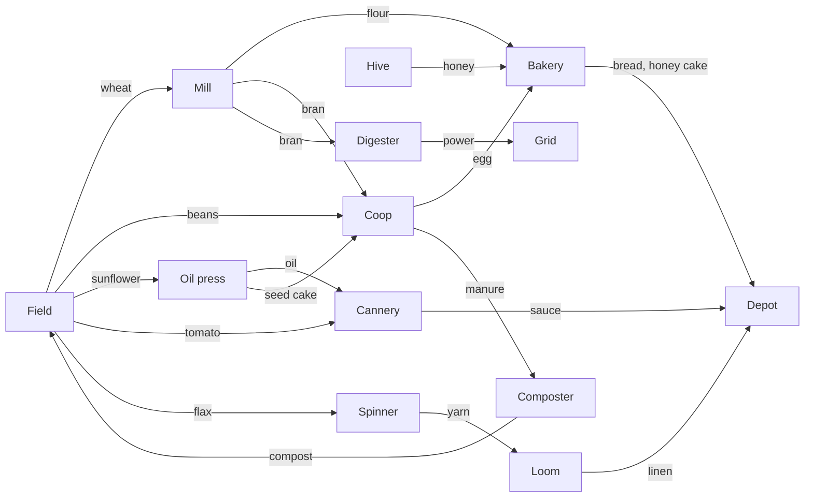

## Buildings

Every building is available from the start. Removing one refunds its building cost; levelling is extra and is not refunded.

| Ground needed | Buildings |
| --- | --- |
| No cliff inside the footprint; slopes allowed | Field |
| Any grass tile, including a steep bank | Sprinkler, beehive, wind turbine, pylon, weather station, sapling |
| Flat at one level | Silo, garage, coop, composter, all processing machines, solar panel, water wheel, battery, digester, depot |

Placement levels unsuitable ground for the extra price in "Height and earthworks". Trees, rock, water and buildings still
block placement; a wheel also needs running water beside it.

### Logistics

There are no belts and no roads to build. Goods move by **truck**, along **routes** you set, over the open ground between
buildings. Storing goods is a building of its own, the **silo**, and carrying them is the trucks' job, so you buy each
separately: a slow route wants more trucks, not more storage. (Chosen on 2026-10-12 over silos whose own drones carried every
good: they swarmed the nearest jobs, left far ones waiting, held whatever their drones happened to grab, and the only way to
more drones was more storage. Drones come back later as automatic helpers, see Open questions.)

| Building | Size | Cost | Power | Notes |
| --- | --- | --- | --- | --- |
| Silo | 2 × 2 | 80 | — | Stores up to 30 of each good. Trucks drop goods into it and pick them up |
| Garage | 2 × 2 | 100 | 20 W per truck charging | Home of up to 4 trucks, bought here for 60 each. Charges them |

**Roads are the empty ground.** A truck drives on any gentle grass tile with nothing on it; water, rock, trees and every building
(fields, pylons, sprinklers and saplings too) block it. Steep banks and cliffs block travel too. It chooses the least effort, from tile
centre to tile centre in 8 directions (a diagonal only when both tiles beside it are open and all four edges round the corner join), at 3 tiles/s on
the flat. Each level climbed between tile centres adds 0.6 tiles of effort: 0.2 s and 0.6 J; downhill has no extra cost. Trucks pass through each
other on the road.

To load or unload, a truck parks on an open tile next to the building: the one it can reach with the least effort, where
the ground joins the building's edge (not below or above a cliff). At its garage a truck leaves by the side that reaches its
stops. A building with no open tile next to it, or only ones walled off from where the truck is, can't be reached: the truck skips that stop and goes on
to the next, and if it can reach none of its stops it waits where it is. Its way is worked out again whenever the layout
or ground changes, so a building placed across its way sends it round, and a truck on a tile you build on (or that floods) moves to the nearest open
tile from which it can drive to its garage (the nearest open tile if none can, e.g. the garage is walled in), so it is never left in a walled pocket with no way out. Packing buildings tightly saves ground but makes trucks drive further round, or cuts a building off.

**One truck at a time.** A building loads or unloads one truck at a time (the depot two); the others queue beside it in the
order they came. A queue is the sign of a bottleneck: split the route, or put a silo between.

**Routes.** A route is a loop of up to 8 stops. Each stop is a building and what to do there:

- **Drop:** the goods to unload. The building takes only what it uses and has room for; the depot takes everything and buys it.
- **Pick up:** the goods to load: a field's harvest, a machine's outputs, a silo's stock.

A good is either dropped or picked up at a stop, never both.

A stop can do both: drop compost at a field and pick up its wheat. A truck carries 6 goods, of any mix. It drives to stop 1,
2, …, the last, then stop 1 again. At a stop it drops what the building takes, then picks up into the room it has left (goods the building won't take yet stay
aboard), 4 goods a second; picking up several goods, it
takes one of each in turn (in the stop's order, skipping any the building has none of), so a mix comes out even. It is **done** when it carries none of the stop's
drop goods and is full (or the stop picks up nothing), and then leaves at once. Until it is done it waits for room in the
building or for more goods, up to the stop's **wait** (0 s unless you set it, up to 60 s) after the last good moved; with a
wait of 0 it moves what it can and leaves. If another truck is queued for the building, a truck with nothing to move right
now leaves at once, so a truck waiting for a full mill to make room never blocks the truck that would empty it. Goods a truck
couldn't drop ride on to the next stops. Picking up fills the truck: a route that picks up tomatoes at a field and then oil
at a silo, both for a cannery, can arrive at the silo already full of tomatoes. Give each ingredient its own route.

A new stop starts out picking up everything the building makes and dropping everything it takes, which suits most stops: a
field, then a mill, then the depot. A silo stop starts out dropping everything and picking up nothing; a good you set it to pick up is no longer dropped there.

**Trucks.** Every truck belongs to a garage and runs one route at a time, or none (it drives home and waits at its garage).
Several trucks can run the same route: adding trucks is how a route goes faster. A truck given another route, or none, leaves
any building or queue at once and keeps its cargo; it drops it at the first stop that takes it. Selling a truck refunds it,
and removing a garage sells its trucks; goods they carry are lost, like goods in any building removed. Removing a building
takes it out of every route that stops there. A truck whose current stop goes away (its building removed, or the stop taken
out of the route) leaves the building or its queue at once and goes on to the next stop; a route left with no stops sends its
trucks home. Two routes that pick up the same good share it by how often
their trucks come, so on First Light one truck taking wheat to the depot and one taking it to the mill split it about half
each. Routes and neighbours decide where every good goes; there is no sell list and no per-building input toggle.

**Power.** A truck has a 300 J battery and uses 1 J a tile. Before it leaves a stop it checks that after the next leg it could
still drive home to its garage; if not, it drives home first, charges full (at 20 W, so 15 s from empty) and then drives
straight to that next stop, without checking again. A truck that runs empty on the way crawls on at 0.5 tiles/s, so a route
too long for its battery is slow but never stuck. A truck that can't drive to its garage (the layout walled it off) can't
charge: it carries on its route without the check, crawling once empty, and shows that it can't reach home. A garage outside every pylon's reach, or on a network out of power, can't
charge: a truck that has charged nothing for 5 s goes on anyway, crawling once empty, so a garage whose power comes from a
digester its own trucks feed never locks up. Trucks are bought fully charged. At night trucks charge from what the batteries hold, like any machine.

**Byproducts stay strict.** A mill whose bran no route picks up fills its own buffer and stops. A silo full of one good takes no
more of it, but still takes every other good, so only that chain stops. Trucks share their room, though: a truck full of bran
that none of its stops takes has no room for anything else, and stops every chain on its route. Give a byproduct somewhere to
go, or a route of its own.

**Problems a route shows** (on the route, on its trucks, in the routes panel, and as a marker on the building): a stop that
can't be reached, a stop with nothing to do (it neither takes nor gives any of its goods), a truck carrying goods none of its
stops takes (or full of compost none of its fields takes now), a truck that can't reach its garage, a route with no trucks,
and a building whose outputs are full with no route or neighbour taking them. A truck stuck with goods no stop takes can **dump** its cargo: the goods are lost.

**Next door.** Buildings that share an edge (touching only at a corner doesn't count) trade without trucks. Goods go wherever
the ground joins along at least one shared tile edge. Cliffs stop goods in both directions. Chosen on 2026-10-17: drop the
gravity chute down cliffs, so next-door goods follow the same joined-edge rule. Each step, every machine takes up to one of
each good its recipe uses from the buildings next door that have it waiting, from whichever has the most, and a field takes compost the same way. Buildings sharing a giver take turns: the one that took a good longest
ago goes first, so two coops beside one mill both get its bran. Fields, hives and machines give (a harvest, honey, a machine's outputs);
machines and fields take. Silos and the depot don't trade next door: storing and selling stay the trucks' job, so a farm
still needs trucks for the long hops and the last one. Next door comes first: it runs before trucks load, so a mill beside
a field gets its wheat before a truck that stops there. A walled-in building needs no road when no route stops there and it
trades with its neighbours.

So the short, dull hops (fields to the mill, bran to the coop, flour and eggs to the bakery, manure to the composter) can be
built into the layout, and trucks are left for the far and specific ones. Packing buildings together costs open tiles, so
it is a trade: a mill boxed in by fields gets their wheat, but no truck can bring it more. Byproducts stay strict next door
too: a composter whose only taker is one full field stops, and with it the coop that feeds it. (Chosen on 2026-10-12, after
playing trucks: every level needed many trucks, and routes doing a field-to-mill hop were the bulk of them.)

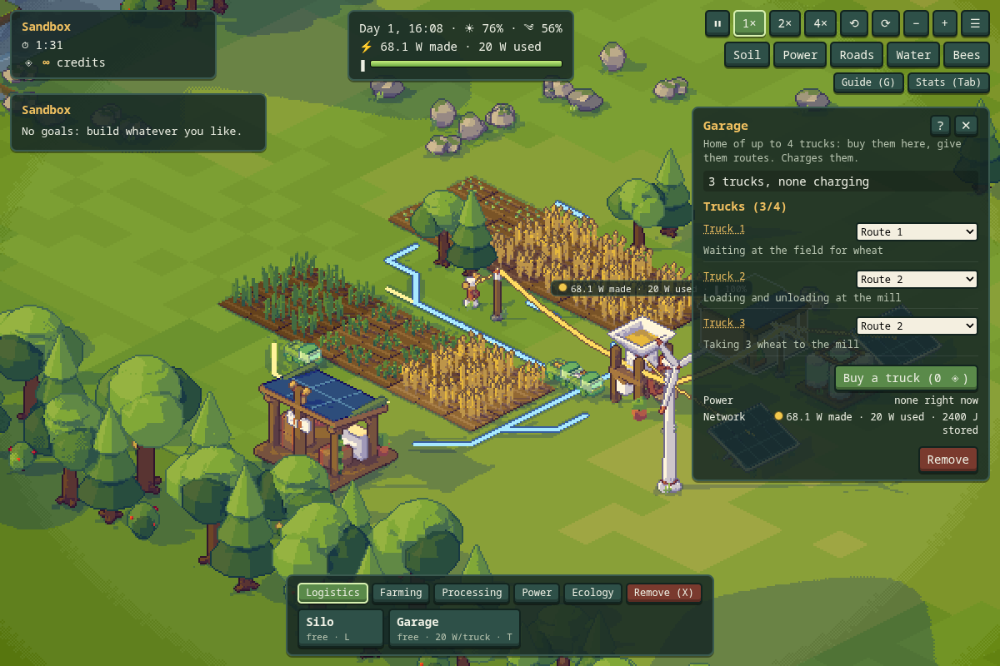

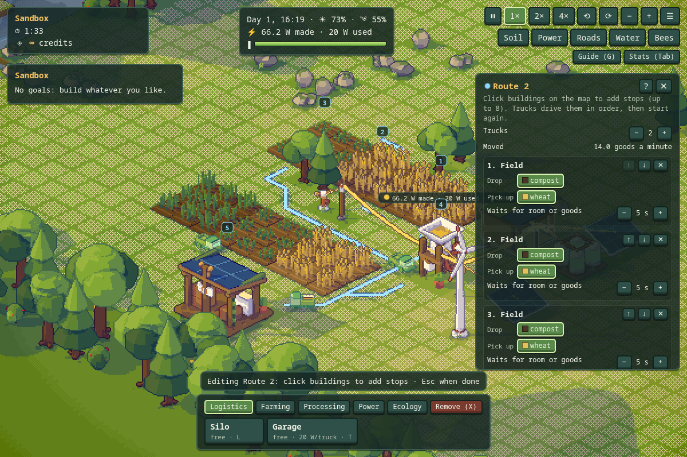

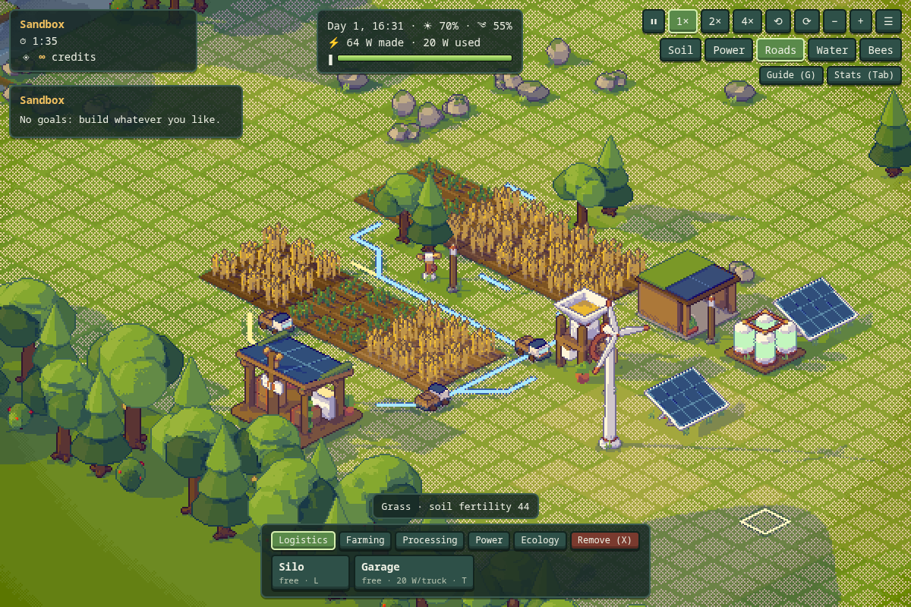

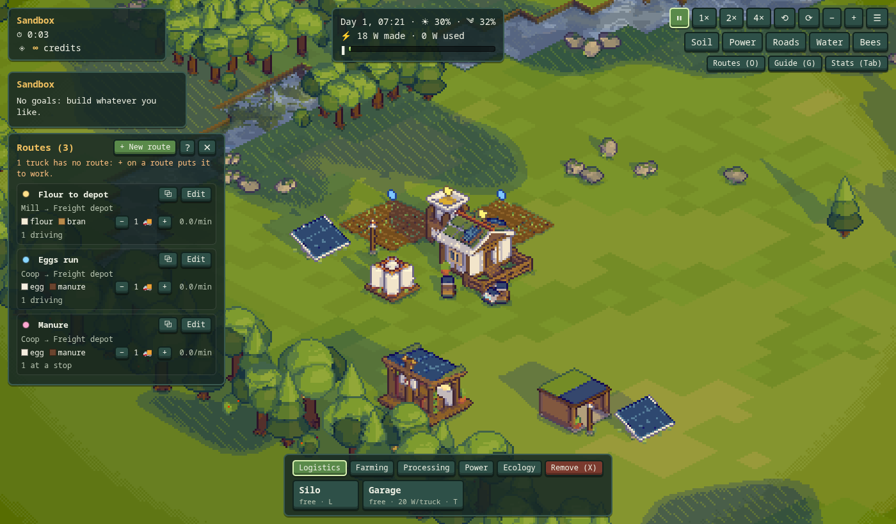

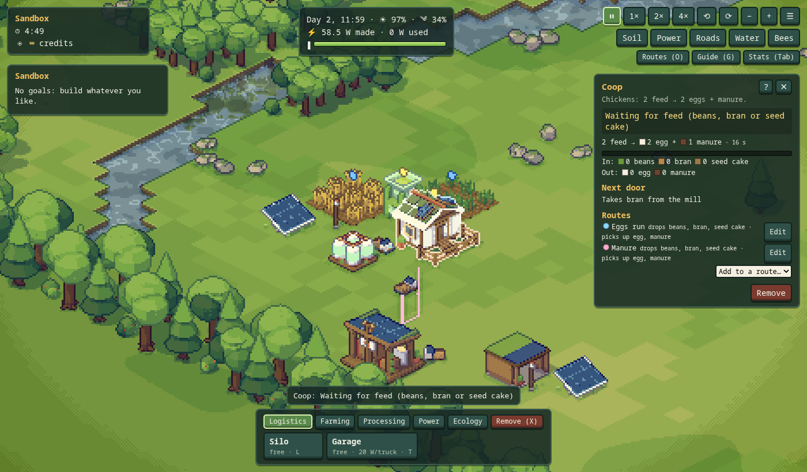

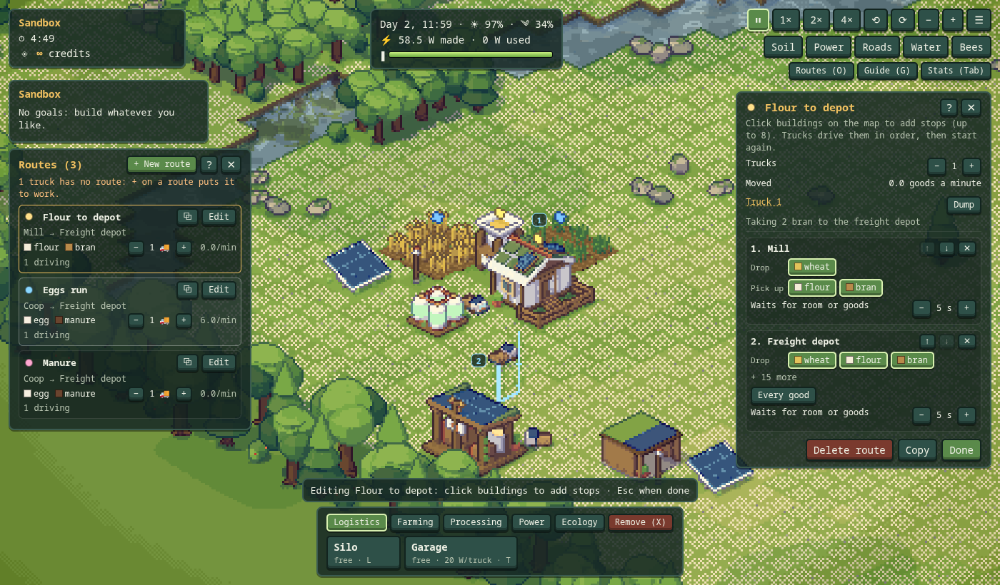

### Farming

| Building | Size | Cost | Power | Notes |
| --- | --- | --- | --- | --- |
| Field | 3 × 3 | 30 | — | Grows the crop chosen as it is placed (wheat, until you choose another) on its 9 tiles. Takes compost (a truck brings it) |
| Greenhouse | 3 × 3 | 150 | — | A field under glass (4.1): any crop in any season, sheltered from the weather, heated by power. Flat ground only (levelled like a machine's, no cliff). Waters like a field: a sprinkler or a water edge; rain does not reach it. See **The greenhouse** below |
| Sprinkler | 1 × 1 | 25 | 3 W within 8 tiles of water, else 8 W; +0.5 W per level lifted, from centre height | Waters fields whose centre is within 3 tiles |
| Coop | 3 × 3 | 150 | — | Four chickens. Every 2 feed (beans, bran or seed cake) give 2 eggs and 1 manure, 16 s |
| Beehive | 1 × 1 | 60 | — | Makes honey from flowering fields (not wheat) within 4 tiles, faster with more of them (up to 3). Pollinates fields within 4 tiles |
| Composter | 2 × 2 | 60 | — | Any 2 of manure, bran and seed cake → 1 compost, 20 s |

**Crops**

| Crop | Grows in | Yield | Soil per harvest |
| --- | --- | --- | --- |
| Wheat | 40 s | 3 | −1 |
| Beans | 50 s | 2 | +2.5 (restores) |
| Tomato | 60 s | 4 | −1.5 |
| Sunflower | 70 s | 3 | −2 |
| Flax | 55 s | 3 | −1.5 |

**The greenhouse (4.1).** A building of its own (`greenhouse` in `BUILDINGS`), not a kind of field, that shares the field's growing rules through
one helper, `growsCrops(b)` (`state.ts`): crops chosen as it is placed (like a field: chips, C, the remembered choice), the same
growth, store (`FIELD.store`), harvest, compost, next-door trading, truck stops, history and soil projection. Rules that belong to the open
field alone test `type === 'field'`. No hotkey (G is the guide). The model is a placeholder until 4.5: a field's soil and crops
under a timber frame.
- **Ground:** flat (`groundOf`), unlike the field (which only needs no cliff). Its soil wears with each harvest, takes compost, and erodes
  by `erosionAt` like a field's; a tree or sapling beside it guards it (a bean *field* beside it does not).
- **Water:** a sprinkler within reach or a water edge, like a field. Rain and soft rain do not water it, so a sprinkler that waters a
  greenhouse draws its power in the rain (one that waters only open fields still rests), and the placement card's soil projection
  does not count on rain for it.
- **Inside warmth** (`inside` on the building, saved; save version 18): the target is the crop's `comfort.low` (6°C wheat, beans, flax;
  14°C sunflower; 18°C tomato). With the power it needs the greenhouse holds it, or the outside when warmer, and it is vented down to
  `min(comfort.high, FIELD.heat)` when hotter (free; the cap matters only for sunflower, 32 → 30°C). A new greenhouse starts at that warmth.
  Crops grow by `warmthPace` of the *inside* warmth, as outdoors: slower below the range, a tender crop stops below `FIELD.tenderStops`
  (10°C) but is never lost (no frost loss inside), and its growth is kept.
- **Heating (4.2).** It draws `GREENHOUSE.loss` = 0.6 W for each °C the outside is below the target (`heatNeed`; nothing when warmer), as a
  consumer on the network like a machine (`wants` in `energy.ts`, `heated` on its `BUILDINGS` entry): a tomato greenhouse about 14 W at
  −5°C, wheat about 7 W, nothing in summer, little on a spring night. A cold snap's −8°C needs more through the colder outside alone
  (the `heating` lever is gone). The power log records the watts under `greenhouse`, a line of its own in the Power panel.
- **Cooling and warming** (heat balance with Sol, time in game hours, `insideAfter` in `warmth.ts`): `dT/dh = (O − T)·loss/capacity + P/capacity`,
  `loss` 0.6 W/°C, `capacity` `GREENHOUSE.capacity` = 3 W·h/°C, P the watts it is given (its network's share of `heatNeed`). Each 0.1 s step is
  integrated exactly with the outside and P held: it relaxes toward `O + P/loss` with a time constant of 5 game hours (50 s of play),
  so a step's size changes nothing. Full power holds the target; none relaxes toward the outside; half power settles halfway. Tomato at
  −5°C from 18°C with no power: 13.8°C after 1 h, 10.4°C after 2 h (a third of the growth speed lost), −0.4°C after 8 h; it stops
  below 10°C after 2.1 h. Half power for 16 h: 7.0°C. A short shortage costs a little growth, a night without power costs the night.
  **The warming back is slow**: the heating only ever delivers the steady-state watts (no extra to catch up), so after a 16 h outage
  with full power again the growth resumes after about 5 h, 13.5°C after 8 h, 16°C after 12 h, and a 2 h outage costs about 3 hours
  of growth with its tail. Faster recovery would need extra watts or a faster warming than cooling; not done (energy-consistent
  baseline), a call for the design lead.
- **Heating in the projections (4.3).** The screens that look ahead count a greenhouse's draw hour by hour from the warmth ahead
  (`view.warmth`, `heatNeed`), not as a constant: **tonight's band** takes it with the sun, the wind and the rain (`NIGHT_LENSES` has
  `warmth` in `together`): the lowest run is the cold end of the forecast's range, the highest the mild end; without a station it is the
  season's usual warmth. A lens that varies the warmth takes the showers' cooling with it (the coldest drift with the wettest showers), so
  the truth is inside even though rain rests sprinklers: the sweep in `test/projections.test.ts` (every commission, 3 heated layouts) holds.
  The told cold snaps and warm spells ride in the worlds as any event. A flooded greenhouse (as it is now) draws nothing. `Tonight.heating`
  has the most the greenhouses draw in a step of the night and the average (the cold end), and `why`: the hardest night runs dry and the
  same night without their heating holds. The Power panel says it under the chart ("The greenhouses draw up to 14 W and 6 W on average
  through the night… They are why the batteries run dry"). **The placement card** of a greenhouse has a Heating fact for the crop chosen
  ("up to 14 W tonight", "6 W on average over a day", a range with a station: from the cold end to the mild end) and says a cold snap
  told in the forecast would raise it (or that the told snap is counted). Not done: the forecast panel's event rows do not say how
  a cold snap or warm spell changes the heating (the rows are not tied to the player's buildings and a range of watts would crowd them).
- **Status:** a greenhouse below its target for lack of power shows the existing No power or Low power status, described as "Cooling: not
  enough power"; the history ribbon records it as for any building. Not connected to a pylon, it gets no share and cools too (needs
  nothing in summer, so no shortage then).
- **Reaches it:** floods (the growing crop is lost, it starts again; what it holds is kept).
  **Does not:** late frost and cold snap (nothing is lost, and the crop keeps its full-speed warmth), gales and storms, dust (no fertility
  lost), heat waves (no slowdown). Snow on its roof is only drawn and changes nothing. Nothing breaks it: weather disrupts, never destroys.
- **Bees** reach it like a field when they fly; in the cold they forage in it while it works and grows a flowering crop (see Bees in winter).
- **Cards:** the inspector and hover card are a field's plus "Inside 18°C, outside −3°C, heating 13 W" (the watts it gets); the placement
  card shows the outside warmth, the watts it would need now, and its pylon reach (its soil projection assumes full power), and its heating ahead (4.3), with
  no frost hollow or dust line. The guide has a Greenhouse page.
- **Bot:** not yet (4.6), so no target time changes (nor in 4.3: the projections do not feed the rules).

- **Choosing while placing.** While a field or bakery is in hand, a strip over its dock tile (its pointer on the tile) has a
  chip for each crop or recipe; the one in hand is lit. Click a chip, or press C (Shift+C goes
  back), to change it; the tool stays in hand. A click places one building with the choice, and a drag places every
  building in it with the choice, so four fields of beans are one pick and one drag. The ghost of a field shows the crop, and
  the placement card and the toast name it. The level remembers the last choice for each of the two (it is in the save), so
  the next pickup starts on it; a level starts on wheat and bread. Changing a placed building in its inspector doesn't change
  what is remembered. (Chosen on 2026-10-16: players forgot to switch after placing, and found a field grew the wrong crop
  much later.)
- Grow times are with water at fertility 60 and a comfortable warmth (see Warmth). Growth speed is ×0.4 without water (a field sharing an edge with a river or pond
  at its own ground level counts as watered), and from ×0.4 (fertility 0) to ×1.4 (fertility 100) by average fertility.
- On sloping tiles, each harvest loses 1 + 0.5 × span / 2 times the crop's normal soil loss (span is the difference
  between highest and lowest corners). A tree or sapling within one tile of the field (diagonals count), or a bean field
  sharing an edge, guards it: use 0.25 instead of 0.5. Gentle slopes lose ×1.25, steep banks ×1.5; guarded, ×1.125 and ×1.25.
  Flat tiles lose the normal amount. Beans restore soil without this multiplier. Eroded soil is lost; it does not yet wash
  onto the ground below.
- A pollinated field (a hive within 4 tiles) yields 1 more of a flowering crop.
- A harvest waits in the field (up to 6) until a truck picks it up. A full field stops growing.
- A field holds no compost. It takes one (from a truck or a composter next door) only while its average fertility is under
  85, and spreads it at once: +12 on each tile. A truck carries the compost a field won't take on to the next stop, and
  doesn't wait for a field whose soil is good to take it (it still waits for a harvest the stop picks up). Compost no field
  needs has to go somewhere (the depot or a silo), or the composter fills and stops. (Chosen on 2026-10-15: fields used to
  keep up to 4 compost for later, so the first field on a route took every unit and the rest starved.)
- A route whose only compost drops are fields picks up only as much compost as they take now, counting what its trucks
  already carry; a route that also drops compost at the depot or a silo picks it up freely. So a truck never fills up with
  compost its fields won't take and jams: with no room for their harvest the fields would stop growing, and their soil would
  never wear down to take it. A truck that ends up full of it anyway (a composter next door fed the fields first) says so,
  and can dump it. (Chosen on 2026-10-15, after the Morning Bread bot locked up that way.)
- Ground without a field rests: it regains 0.1 fertility a second (6 a minute), up to what it started at. Moving a field
  lets worn ground recover.

### Processing (powered)

| Building | Size | Cost | Power | Recipe |
| --- | --- | --- | --- | --- |
| Mill | 2 × 2 | 200 | 12 W | 2 wheat → flour + bran, 6 s |
| Oil press | 2 × 2 | 220 | 15 W | 2 sunflower → oil + seed cake, 8 s |
| Spinner | 2 × 2 | 200 | 10 W | 2 flax → yarn, 6 s |
| Loom | 2 × 2 | 300 | 20 W | 3 yarn → linen, 10 s |
| Bakery | 2 × 2 | 350 | 25 W | flour + egg → bread, 8 s; or flour + egg + honey → honey cake, 12 s (chosen as it is placed; bread until you choose another) |
| Cannery | 2 × 2 | 300 | 18 W | 3 tomato + oil → tomato sauce, 10 s |

A machine holds a small buffer of each input and each output. It starts a batch when it has the inputs and room for every output.
**Byproducts are strict:** a mill whose bran has nowhere to go stops, which is the point: route it to chickens, compost or the
digester.

### Power

| Building | Size | Cost | Notes |
| --- | --- | --- | --- |
| Solar panel | 2 × 2 | 70 | 30 W at noon, following the sun; nothing at night |
| Wind turbine | 1 × 1 | 120 | 40 W at full wind at level 0; +5% per centre level, multiplied by shelter from trees, tall buildings and higher ground (see Height and earthworks) |
| Water wheel | 2 × 2 | 200 | A flat river bank at the water's level; faces the side with most river contact. 20 W per m/s of current, ×2 beside a fall, day and night |
| Battery | 2 × 2 | 150 | Stores 2.4 kJ, charges and discharges at up to 40 W |
| Digester | 2 × 2 | 180 | Burns one manure, bran or seed cake every 10 s for a steady 30 W |
| Pylon | 1 × 1 | 10 | Powers buildings with any tile within 3 tiles; links to pylons within 8 tiles |
| Weather station | 1 × 1 | 80 | Draws 3 W all the time; gives the forecast (see "The weather station") |

A wheel uses the strongest current touching its bank at the same level, times the season's **flow** (the `river` section of
`seasons.ts`): spring 1.5, summer 0.6, autumn 0.9, winter 0.5; a high river adds 0.3, a dry season takes off 0.1. So a spring
wheel makes 30 W per m/s and a summer one 12. The placement card and the inspector state the season's effect. The drawn water
level does not change with the season (the same river in every season; only the current, and so the watts, follow it). The
river never freezes and never floods in the season itself: those are events (cold snap, flood, phase 2; the cold snap freezes it except at a fall, see the winter events). Ponds and lakes have
no current and are unchanged. The bot's layouts have no wheel, so no target time moved. A fall counts if any of those river tiles shares
an edge with water at a different level. Still ponds and lakes cannot turn it; falls are a bonus, not a requirement.

Pylons that link form a network. Each network adds up what its generators make and what its machines want; surplus charges its
batteries, a shortfall drains them, and if that isn't enough every machine on it slows to the share it gets. A building outside
every pylon's reach has no power.

### Ecology

| Building | Size | Cost | Notes |
| --- | --- | --- | --- |
| Sapling | 1 × 1 | 5 | Grows into a tree in 60 s |

**Soil health** is the average fertility of all field tiles (50 before you have a field), plus 0.25 for every tree more than
the map started with (minus for every tree fewer), at most 10 either way. Some commissions need it above a level when the rest
is delivered.

## Commissions (levels)

A commission has goals, a target time and modifiers. It ends when every goal is met.

- **Goals:** deliver *n* of a good; reach a delivery rate of a good (per minute, over the last minute); keep soil health above a
  level at the end.
- **Medals:** gold within the target time, silver within 1.5×, bronze any time after. There is no failing.
- **Season:** a season and perhaps a character (see Seasons), which set the sun and the wind.
- **Weather events:** a list of events (see Weather events): rolled from the seed for a random commission, placed by hand for a campaign one (see Campaign weather, below).
- **Modifiers:** soil richness, how much rock, water and forest the map has, relief (0 flat to 1 rugged), starting credits.

**Campaign** (seeds fixed, so each plays the same every time; goals, credits and target times in `src/game/scenarios.ts`):

| # | Name | Goals | Target | Season | Modifiers | Relief |
| --- | --- | --- | --- | --- | --- | --- |
| 1 | First Light | 120 wheat, 80 flour | 20 min | A mild spring | Gentle | 0.2 |
| 2 | Morning Bread | 150 bread; soil health ≥ 40 | 45 min | A wet spring | | 0.4 |
| 3 | Windy Ridge | 90 oil, 80 bread | 55 min | Autumn, gales | Rocky, hilly | 0.9 |
| 4 | Linen for the Looms | 50 linen; 5 yarn/min | 40 min | A hot summer | | 0.4 |
| 5 | Long Nights | 100 honey cake | 70 min | Winter | | 0.5 |
| 6 | Tired Soil | 50 sauce; soil health ≥ 55 | 40 min | A dry summer | Poor soil | 0.6 |
| 7 | Riverlands | 30 linen, 30 sauce, 80 bread | 50 min | Spring, high river | Cramped | 0.3 |
| 8 | Harvest Festival | 40 honey cake, 30 sauce, 30 linen; soil health ≥ 60 | 50 min | A stormy autumn | Everything | 0.7 |

**Campaign weather (2.10).** Each commission has the events that teach what it means to, placed by hand (`eventOn(day, hour, kind, strength?)`, in `src/game/scenarios.ts`):
none on the first day, one at a time, at least half a day clear between them, all inside the target time. Day 1 starts at 07:00 and a day is 4 minutes of play.

| # | Commission | Events (day, hour) | Teaches |
| --- | --- | --- | --- |
| 1 | First Light | a soft rain, day 2 at 06:00 (a day) | seasons exist; rain waters the fields and rests the sprinklers |
| 2 | Morning Bread | a thunderstorm, day 5 at 09:00 (12 h; no flood follows it here) | a dark, rainy spell for power: batteries carry it, the rain waters the fields |
| 3 | Windy Ridge | a **severe** gale, day 7 at 08:00 (a day) | shelter for turbines: bare turbines stop, ones with trees, tall buildings or other turbines beside them keep turning (an ordinary gale only fills the turbines, so it would teach nothing) |
| 4 | Linen for the Looms | a heat wave, day 4 at 08:00 (32 h) | flax dislikes heat; sprinklers and shade |
| 5 | Long Nights | a cold snap, day 3 at 18:00 (36 h), then a warm spell, day 7 at 08:00 (36 h) | the cold, then a break in it (the greenhouse comes in phase 4; the commission cannot be finished before it) |
| 6 | Tired Soil | a dust storm, day 4 at 09:00 (18 h) | trees as windbreaks guard the soil: a sapling or tree beside a field, or a bean field sharing an edge |
| 7 | Riverlands | a flood, day 6 at 08:00 (36 h) | the floodplain, banks (earthworks) and silt |
| 8 | Harvest Festival | a tropical storm, day 3 at 08:00 (36 h) and the flood after it, then fog, day 7 at 04:00 (5.5 h) | everything; the station (phase 3) matters: the storm is named three days out, the letter says so |

The late frost, the blizzard and the hurricane are left for random commissions. The briefing letters name the events a campaign commission will bring
("Weather to watch for this season: a gale."; the flood after a storm is part of the storm), and a random commission's the events its season and
character can bring. Each event is placed after the farm has had time to get going, so it tests what was built (a gale on day 7 meets the whole power
layout, a flood on day 6 the whole farm) rather than the first minutes.

**The bot plays the real weather**, with the cheap, obvious answers each event teaches (`tools/layouts.ts`; `test/bots.test.ts` checks each):
Riverlands has a river 16 tiles east of the depot (`RIVER_AT`: the bot's map is flat with no water) and the layout raises a bank two levels high in
the column 15 tiles east, from 19 tiles north of the depot's row to 2 south (about 250 credits), so the flood never reaches the farm (without it the flood
holds 6 buildings and costs about 3.5 minutes of 37); Windy Ridge's four turbines stand in a 2 × 2 block, each sheltered by the other three (exposure 0.7), so the
severe gale furls them and stops none (it costs about half a minute; with bare turbines, 2.5); Tired Soil has a sapling beside every field (30 credits), so the dust storm takes no soil. Morning Bread's thunderstorm
costs the bot nothing once it comes after the farm is built (day 5; on day 4, in the middle of the build, it cost 3.7 minutes), and First Light's soft rain, Linen's heat wave (+1.2 minutes), Harvest Festival's
storm and fog (+1.8) need no change (Harvest Festival's bot has no river: on its real map even a severe flood leaves the land near the depot dry, 0% of it at ordinary strength and 3% severe, so the bot's farm is not flooded; with a river beside it the run takes 3 minutes longer).

**Playtest of phase 2 (2.10, 2026-10-24).** Headless: the campaign and random commissions at each difficulty, through the bot (`npm run sim`, `tools/seasonfactor.ts`) and loaded
in a browser (the briefing, the chip, the sky and haze, markers, the results line, the flood water). No event's length, strength or odds needed changing: what the events cost the bot is
modest (the flood beside a farm without a bank about 9%, a severe gale on bare turbines 6% and on sheltered ones 1%, the dust storm on unguarded fields 8% and on guarded ones 1%, a heat wave 4%, a thunderstorm after the build nothing),
and a hurricane is the one big cost (a third more, rare: a stormy autumn at difficulty 3). The campaign's placements moved only to teach better (Windy Ridge's gale severe, day 7; Morning Bread's thunderstorm from day 4, in the
middle of the build, to day 5; Riverlands' flood from day 5 to day 6, once the farm stands).
**No event asks for quick reactions.** Every effect is a rule that acts by itself: nothing can be done *during* an event that has to be done in a hurry (the answers are built ahead), the shortest
(the fog, 4–7 game hours: 40–70 seconds of play) only slows trucks and dims panels, the frost's loss happens as it arrives, a flood rises over many hours in half-level steps, and the game can be paused
at any moment to look, since pausing is free. Nothing flashes or interrupts: an event is the chip, the sky, markers on what it holds, and its line in the results.
Left open: Long Nights (c5) cannot be finished before the greenhouse (its events are placed; its bot test stays skipped, its target 70 a placeholder); a random winter takes 2.6 to 3.8 times the base time until then;
and the weather has been played only headless, not by hand.

**Playtest of phase 3 (3.6, 2026-10-26).** Driven headless (scripts on the real rules, outside the repo) and in headless Chromium on the dev server (the briefing, the guide's
"Seasons and weather", the forecast panel and the Power panel on Harvest Festival's day 2 at 14:00, from saves with and without a station); not yet played start to finish by a person.
- **Does the forecast change what the player builds, and when?** Yes, three ways. *Whether:* a random commission's briefing names 3.9 kinds of event the season can bring and 2.4 of
  them happen (900 commissions, seeds 1–300 at each difficulty), so without a station a player insures against a flood or a frost that never comes; with one, only against what is
  listed. *When:* the first event of a random commission falls on day 5.7 at the median (earliest day 1.7), and each is named by its family 72 game hours ahead (12 minutes of play), by
  kind at 48 h and in full at 24 h (4 minutes), enough to buy any answer (a bank for 250 credits, a sapling beside each field, a battery) when it is named rather than at the start.
  Harvest Festival's storm is named from the first minute (49 h ahead), and its flood is told once the storm's kind is. *Power first:* the station takes 3 W and only works on all of it,
  so in the bot's Harvest Festival, built at minute 6 on a grid with no battery yet, it was "short of power" until minute 9 and renewed nothing before then (the first event begins at 8.2):
  a player who wants the forecast early wants power first.
- **Horizons and widths.** An event's start window is 24 h wide at three days out ("day 5"), 12 h at two, 4 h tomorrow, and 2 h inside six hours; a day's high and low ±4, ±2, ±1°C; sun, wind and rain
  only from two days out. Tomorrow is sharp enough to act on, and day three is vague enough ("a storm, possible") that the next update is wanted. The panel at day 2 14:00 in Harvest Festival
  reads well: tomorrow's card carries "a tropical storm, then a flood, likely", begins 08:00–12:00, the storm ends day 4 08:00–24:00, the flood ends day 6. No width needed changing.
- **Honest in play** (rerun on the forecast with 3.7's blocks). Every minute of bot runs with a station (First Light's layout in every season and character at each difficulty, and Harvest Festival's in its own
  weather and the same worlds), the forecast in hand was checked against what happens: 16,128 checks (events' start, end, length and possible kinds, every day's warmth, sun, wind, gust and rain) and 1.17 million
  samples inside the blocks (the seasonal wind and the showers at 15 moments of each block, and each block against the one that held its hours in the last forecast): no range missed and none widened (1,296 of those
  minutes were out of date, a station short of power, and the old forecast stayed honest).
- **What it looks like** (3.7). The forecast panel shows today's and tomorrow's weather in six-hour stretches ("Through the day"), and the Power panel's tonight band is a band with a station and one line without. Harvest Festival,
  day 2 at 14:00, three panels, a turbine, six sprinklers and two half-charged batteries: the usual stormy autumn says "held, lowest 57%" as a single line; the forecast says "held, 7%–64%" and the hardest night's line runs down to
  about 0% by sunrise, because tomorrow is a dark day with 20 to 22 hours of rain (the band's top is the night in which the sprinklers rest and the wind blows). With two panels, two turbines and one battery the band is 100% to 100%: it says
  the night is safe. The station's own 3 W shows (52 W used against 49).
- **The price, 80 credits and 3 W, stays.** Built at the start, the station costs the bot Harvest Festival +68 s (36:52 to 38:00), Tired Soil +2:27, Riverlands +2:03 and Windy Ridge +4:05 of 39:37
  (10%: its power is wind alone and 1,100 credits), more than its 80 credits are worth because credits and watts are what the first minutes lack. A few minutes later it costs +18 s, +63 s and +35 s
  (the bot's layouts). So it is a real choice in the tight commissions (Windy Ridge builds none), and a cheap one in the rest. `PAR_FACTOR` is unchanged: `tools/seasonfactor.ts` reran
  with the stations in the layouts and no climate's suggested factor is above its table value.
- **Left open.** (1) Playing it by hand, start to finish, on a few commissions. (2) Where the night's rain is open (a block that can be dry or pouring for 3 to 6 hours) the band's top is wide, since a night of rain lets the
  sprinklers rest and fills the batteries: the band says what can happen, but a player may want it split by the rain; look at it in play. (3) The forecast panel's "None told for this day yet" on a day a storm and its flood still span
  (Harvest Festival's day 4: the storm ends then) reads as "nothing is coming"; the card of the day it begins carries it. A wording to look at with the panel in hand. (4) Long Nights still waits for the greenhouse (#86).

The bot (`npm run sim`) deliberately uses a flat, open map with even soil to test the economy, not terrain;
`test/height.test.ts` covers the height rules. It clears First Light in about 15.5 minutes, Morning Bread in about 33 and
Linen for the Looms in about 28 with trucks (with silos and drones it took about 14, 38 and 45), building as credits allow. Its Morning Bread layout built round
neighbours (`npm run sim -- c2:next`: a mill between two fields, a bakery beside it, a coop under both, a composter beside the
coop) clears it in about 30 minutes with 3 trucks on 2 routes, where the all-truck layout uses 4 on 3; a person needs a few minutes more to plan and
place. The bot's layouts for the other five, built round neighbours too, clear Windy Ridge in about 39 minutes, Long Nights
in about 50 (before bees stayed in all winter), Tired Soil in about 29, Riverlands in about 37 and Harvest Festival in about 35 (`npm run sim -- c3` and so on).

Target times are about 1.4 times the bot's best time, rounded to 5 minutes, as First Light's 20 is to its 14: the bot knows
its layout and plays a flat, open map, so a person needs that much more. (Balanced on 2026-10-20, once every commission had
a bot layout: trucks and neighbours had made Linen for the Looms, Long Nights, Tired Soil, Riverlands and Harvest Festival
much quicker than their targets, and Long Nights took the bot 17 minutes, so its order went up from 60 honey cake to 100.
When seasons replaced the weather settings on 2026-10-21, a wet spring's weaker sun slowed Morning Bread by about 2 minutes,
so its target went from 35 to 40 minutes, and a stormy autumn's wind sped Harvest Festival up by about 3, so its target went
from 50 to 45. Conditions then (2026-10-22): rain waters the fields and cloud dims the sun, which slowed First Light to about 15 and
Morning Bread to about 30 and sped Riverlands up to about 32, so its target went from 50 to 45; the other targets stood then.
Hens and bees by season (2026-10-22) changed little: the bot's eggs are rarely the limit, so Harvest Festival (autumn) went from 36 to 39 minutes (its target 50 to 55) and Riverlands from 45.0 to 45.1; the rest stood. Long Nights can no longer be cleared (bees stay in all winter), so its test is skipped until #86.
Warmth (2026-10-22) slowed the bot on First Light from 15 to 17, Morning Bread from 30 to 36, Riverlands from 32 to 45 (cold spring days slow every crop, and tomato and sunflower stop below 10°C), Tired Soil to 29 and Harvest Festival to 36, and on Windy Ridge from 31 to 62 minutes (sunflowers for the oil stall below 10°C and
barely grow in an autumn that tops out at 18°C), on Linen for the Looms from about 25 to 35 (a hot summer's heat is hard on
flax) and on Long Nights from 29 to 80 (hardy crops in a winter between −5 and 6°C), so the targets went to 25, 50, 85, 50, 115, 40, 65 and 50
minutes (commissions 1 to 8); Windy Ridge and Long Nights want their goals or seasons rethought.
Warmth tuning (2026-10-22), after the warmth numbers had pushed Windy Ridge to 62 minutes, Riverlands to 45 and Linen for the Looms to 34: spring now runs 7–19°C
(was 4–16) and autumn 9–21°C (was 6–18), and the crops' comfortable ranges widened (wheat 6–24, beans 6–24, flax 6–26, sunflower 14–32; tomato stays
18–30), so a cool spring or autumn day costs less. The fall-off width (6°C), the tender stop (10°C), frost and the daily curve stand. The bot now takes First
Light 15.5 minutes, Morning Bread 32.6, Windy Ridge 39.1, Linen for the Looms 28.2, Tired Soil 28.8, Riverlands 36.8 and Harvest Festival 35.0, so the targets
are 20, 45, 55, 40, 40, 50 and 50 minutes. Long Nights (about 50 minutes in the study, before bees stayed in) still can't be cleared, so its test stays skipped and
its target 70 stands until #86 gives a real time. After phase 1 (2026-10-22) every campaign target is again about 1.4 times the bot's time: First Light 15.5 (20), Morning Bread 32.6 (45), Windy Ridge 39.1 (55), Linen for the Looms 28.2 (40), Tired Soil 28.8 (40), Riverlands 36.8 (50) and Harvest Festival 35.0 (50), so none changed. After phase 2 (2026-10-24), with the authored events and the bot's answers to them (below):
First Light 15.5 (20), Morning Bread 32.6 (45), Windy Ridge 39.6 (55), Linen for the Looms 29.4 (40), Tired Soil 29.2 (40), Riverlands 36.6 (50) and Harvest Festival 36.9 (50),
all still about 1.4 times the bot's time, so none changed.)
Bees in winter (4.4): no bot layout builds a greenhouse, so no bot time or target changed (the seven bot tests pass at their targets); Long Nights stays skipped until 4.6.

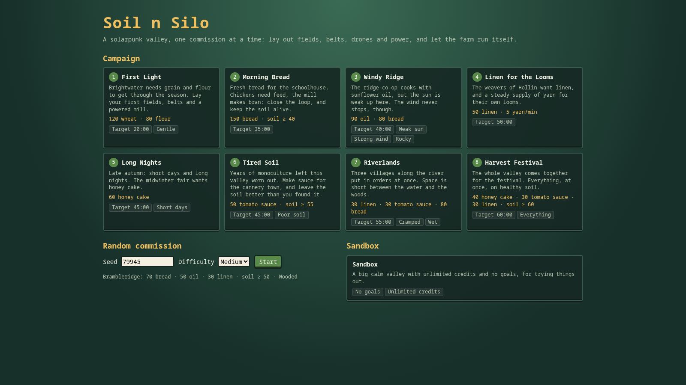

**Random commission:** any seed and a difficulty (1–3) pick a season (any of the four, equally), a character that fits it,
up to two ground modifiers (poor soil, rocky, wooded, hilly or flat), 2–4 goals and its weather events (see Weather events). A winter commission never asks for oil,
sauce, honey or honey cake (no sunflower or tomato grows in a winter field, and bees stay in), which the bot can't clear before
the greenhouse (#86); the other goals come in any season. **Target time:** (15 + 12 × difficulty + 6 × goals) minutes, the
time of a mild spring, times a **season-and-character factor** (`PAR_FACTOR` in `src/game/scenarios.ts`), rounded to 5 minutes, so
every season and character can earn gold. One table, measured once (2026-10-24, 2.10), with the weather events in: `node tools/seasonfactor.ts` plays every bot layout
in every climate with the events a random commission rolls there (difficulty 1 to 3, four seeds each: 4 × 3 runs a layout and climate, 8 layouts), spread over as long as the bot takes in a mild spring (a level is never shorter than 28 minutes, so the events the shortest layouts, First Light's, outrun are not measured), and compares each
run with the same layout and seed in a mild spring with no events. The factor is halfway between the mean ratio over the layouts and the worst layout's, rounded up to 0.05
(a commission's goals decide which layout it is like: autumn is quicker for oil and honey cake and slower for linen and bread). The bot's map is flat and has no water, so each
layout gets a river a couple of tiles beyond the farm's west edge (a flood beside the farm, the worst case; Riverlands' bot has its bank) and, except Tired Soil's, no trees (an unguarded farm for the dust storm):
the events are measured at their worst, so the factors are on the safe side. The per-event bumps the earlier issues put in (stormy spring 1.3, wet and stormy summer 1.2, dry summer 1.35, wet and gales autumn,
stormy autumn 1.5) counted a part of the same cost twice; the table is now **spring** mild 1.2, wet 1.25, dry 1.1, hot 1.2, gales 1.2, stormy 1.25, high river 1.2; **summer** mild 1.15, wet 1.15, dry 1.3, hot 1.3,
stormy 1.15; **autumn** mild 1.15, wet 1.25, dry 1.2, gales 1.2, stormy 1.35; **winter** mild 2.5, gales 2.6, hard 3.75 (the bot needs 1.8 to 2.3 times as long for flour, 2.4 to 3 for bread and 2.7 to 4.3 for linen).
The ratio (the climate and its events together), averaged over the layouts, is 1.14 in a mild spring, 1.17 in a wet one, 1.19 stormy, 1.07 dry, 1.14 gales; 1.00 in a mild summer (a dry one 1.09, a hot one 1.14: heat hurts wheat and flax, and calm
days starve solar and wind, but tomato and sunflower love it); 0.97 to 1.10 in an autumn (stormy 1.10); at the 90th percentile of single runs 1.2 to 1.5 times. The worst single runs were 1.8 times (a stormy autumn with a hurricane) and 1.7 (First Light's layout in a hot spring, with a flood and frosts, and in a few autumns). Wet and stormy summers measured a little under a
mild one (their storms water the fields as much as they cost) and take its factor. Playing each layout against the target of a random commission of its own difficulty and goal count, the bot earns gold in all runs but the 6 to 8 of 96 in a
spring that are Windy Ridge's or Long Nights' layouts at difficulty 1, which ask for more than a difficulty 1 commission does. Relief starts at
0.25 + 0.15 × difficulty (0.4, 0.55, 0.7); Hilly sets it to 0.9, Flat to 0 (one or the other, never both). Relief
scales the rolling hills; corner heights stay within 0–16. Flat is all one level.

**Sandbox:** a large map (relief 0.5), unlimited credits, no goals: for trying things. It starts in a mild spring; the level
select picks any season and any character that fits it. It has no events of its own: the Weather panel starts them.

## Economy

You start with credits (1,100–1,800 by commission). Everything costs credits; every good delivered to the depot pays its price.
Early on, raw goods are the way to afford the first machines; products pay far better per field.

## Saving

The game saves the commission in progress (one at a time) in the browser every 30 s and when the page is hidden, and remembers
each commission's best medal and time. Saves are version 17 (the commission's events are saved with it, and the hour of the weather station's last forecast; the run log keeps what the weather held and the valley's output). A save from an older version of the game is refused.

## Open questions

- [ ] Is `EARTH.step` (6 credits per point moved a level) right for earthworks and automatic levelling?
- [ ] Should levelling under a removed building be refunded? It stays paid and the ground stays changed for now.
- [ ] Should the river's falls be the only wheel sites, rather than a bonus on any bank with current?
- [ ] Do gentle routes, steep banks and occasional cliffs shape layouts well, and is the 0.6-tile climb cost right?
- [ ] Tuning: crop times, machine times, prices and target times are first guesses. A scripted bot run per commission
  (`npm run sim`) should check that each one can be cleared and roughly in its target time.
- [ ] Truck numbers (6 goods, 3 tiles/s, 300 J, no wait by default, 4 per garage) and the silo's 30 of each good are first guesses.
- [ ] Next door: should it reach further (a radius, or through a silo next to both), and should silos or the depot ever take
  from neighbours? Kept to machines and fields for now, so storing and selling stay the trucks' job.
- [ ] Next door: a producer with two hungry neighbours feeds them in turn, one good a step each; a machine boxed in by fields
  can't also get wheat by truck. Is that the right puzzle?
- [ ] Should a stop cover several buildings (say every field in a box, the truck going to whichever has the most waiting),
  so a row of fields isn't one stop each?
- [ ] One truck at a time per building makes a busy silo the bottleneck. A puzzle (build a second silo) or a chore (give
  silos two bays)?
- [ ] Should a pick-up have a limit ("up to 3 oil"), so one route can carry two ingredients without the first filling it?
- [ ] Should buildings load on one side only, the one they face (R)? It would make turning a building matter.
- [ ] Drones, once trucks have been played: automatic helpers from a drone hub that fly straight over water and crowded
  ground, carry little and use more power, and are assigned jobs by the hub as a whole, so none chase the same job.
- [ ] Blueprints/copy-paste once layouts grow large.
