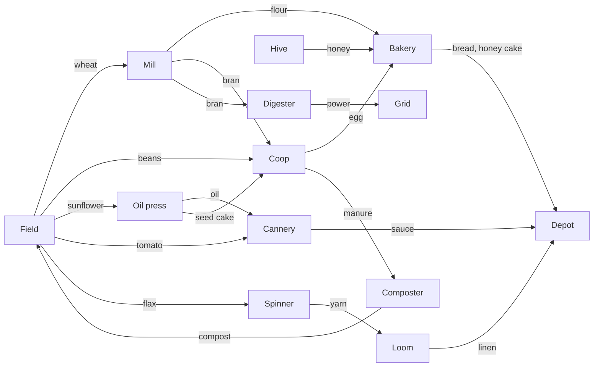

# Soil n Silo — Design (v0.1, the solarpunk pivot)

Oct 9, 2026 · @Ashutosh Shinde

## Overview

Soil n Silo is a build-only automation game in a solarpunk valley. Each level is a commission from a nearby settlement: on a
seeded map you lay out fields, machines, power and the trucks' routes, and the farm then runs on its own until the commission's goals
are delivered. A level takes about 30 to 60 minutes.

The game replaced a Stardew-like season (the earlier MVP, decided 2026-10-06, built by 2026-10-07) on 2026-10-09. The reason: the
only player is also the designer, so a reward loop of unlocking new crops, items and machines doesn't work: the designer already knows all of
them. An automation loop does: the fun is in building a layout, finding its bottleneck, fixing it and watching the throughput rise,
and that stays fun when every rule is known. Short, seeded levels are also quick to test, where a full season was hours.

**Core loop:** read the map (height, soil, water, wind, space) → shape the ground → lay out a chain → power it → watch it run →
find the bottleneck → fix it → deliver the commission faster.

**What makes it not Factorio:** farming. Soil is a resource that wears out and comes back, so fields need compost, resting or beans;
byproducts must go somewhere (feed, compost or the digester), so the closed loops of a real farm are the puzzle; the sun sets every
few minutes and the wind comes and goes, so power needs storage and a mix of sources.

**In v0.1**

- 18 goods, 5 crops, chickens and bees, 6 processing machines, 4 power sources and storage
- Trucks on routes you set, over the open ground between buildings: no belts and no roads to build; silos to store goods
- Buildings next door trade directly: a mill between wheat fields takes their wheat without a truck
- Pylon power networks, each with its own balance
- Rolling hills, steep banks and occasional cliffs; paid earthworks and levelling on placement
- Soil fertility, slope erosion, sprinklers, compost and pollination
- 8 campaign commissions, random commissions from any seed, a sandbox
- A soft timer: the commission always finishes; gold, silver or bronze by how long it took

**Not in v0.1:** research or unlocks (every building is available from the start), pipes and fluids, weather events, trains,
blueprints and copy-paste, sound, multiple saves per level.

## Camera, presentation and controls

The camera stays as it was: orthographic, a 3/4 view at about 30° pitch, 4 views 90° apart (Q/E), zoom (the wheel, a trackpad pinch,
+/− or Z) and panning (drag, right-drag or the arrow keys). Zoom eases smoothly towards the pointer. Low-poly, flat-colour models drawn as
pixel art by `pixel3d-renderer`. Everything is seen from 4 sides.

Each art pixel is always drawn as a square of the same size on screen (2×2 screen pixels by default; the pixel size is a
setting in the menu, 1×1 to 4×4). Zooming changes how much ground fits on the screen, so models are drawn with more art
pixels close up and fewer far out. Chosen on 2026-10-10 over two other ways, tried side by side in play: magnifying a fixed
picture (art pixels growing from 1×1 to 6×6) and stepping through six fixed detail levels; the free zoom looked and felt best.

It is build-only and point-and-click. There is no character and no manual farming: you place, rotate, configure and remove.

| Input | Does |
| --- | --- |
| The dock (bottom) or hotkeys (by default F field, L silo, T garage, P pylon, S solar) | Pick a building to place; its placement card says what it would do on the tile under the pointer |
| Click / drag | Place it; a drag places a row (pylons: a power line, spaced so their reaches meet) |
| R | Turn what you're placing; a water wheel faces the river by itself |
| Earthworks in the dock, or K | Raise or lower a ground point, or level an area; drag a rectangle of points; choose its chip, or C / Shift+C to cycle |
| A chip in the strip above a field's or bakery's dock tile; C / Shift+C | Choose the crop (wheat, beans, tomato, sunflower, flax) or the recipe (bread, honey cake) the buildings you place get, without putting the tool down |
| Click a building with nothing in hand | Select it: the inspector shows its status, buffers, settings and history |
| A garage's inspector | Buy a truck; give each of its trucks a route, or none |
| O, or the Routes button | The routes card: every route with its stops, goods, goods a minute, loop time, the gap between trucks at its slowest stop, and problems; point at one to draw it on the map; click it to open it |
| An open route (from a truck, a building, or the routes card) | Rename it; add a stop by clicking a building; set what it drops and picks up and its wait; reorder or remove stops; add or take away trucks; see what each truck is doing and how much it waited, and dump its cargo; copy or delete the route |
| A truck's inspector | Its route, cargo and battery; dump its cargo (the goods are lost); sell it |
| X, then click or drag | Remove (building cost refunded; earthworks stay and are not refunded) |
| Esc / right click | Drop what's in hand, close the inspector |
| Space, 1, 2, 3 | Pause, 1×, 2×, 4× speed. You can build while paused |
| Tab | The ledger: the valley's health, and each good made, used and delivered |
| W | The Power panel: the last day by source, each network, tonight's charge, where the watts go |
| G | The guide: a page for every building (what it does, how to use it, what it takes and gives, its numbers), the goods, and the basics |
| V (or the view bar) | Views: soil fertility, height, sprinkler water, power reach, roads, bee range |
| Esc | Close what is open; with nothing open, the pause screen (the way to the settings, what the markers mean) |

The build preview is see-through, green where it fits and red where it doesn't.

**Readability rules**

- A building with a problem shows a marker above it, each kind with its own shape as well as its colour: half circle waiting
  (for input, or flowers), square blocked, triangle no or low power, drop dry, ring unreachable or no route takes its goods.
- Rest the pointer on a building for a card with its status ("Mill: waiting for wheat"). Point at a tile in the dock for a card
  about that building.
- Trucks carry their cargo in an open bed, so the flow of goods is always visible, and trucks queuing at a building show
  where it is stuck.
- Selecting a truck or a route draws the route's way on the ground, its numbered stops and its trucks. Selecting a building
  lists the routes that stop there. The inspector says what each truck is doing ("taking 6 wheat to the mill", "waiting at the
  field for wheat", "2nd in the queue at the mill", "charging at the garage").
- A building trucks can't reach, or whose outputs are full with no route or building next door taking them, shows a purple marker.
- Goods handed to a building next door hop over the edge the two share. Selecting or pointing at a building tints the
  neighbours it trades with, and its inspector lists them ("Takes wheat from 2 fields", "Gives bran to the coop"); a
  building in hand tints the ones it would trade with, and its placement card says so.
- The placement card shows Earthworks (levelling cost, level and steps), Slope (sloping tiles and soil wear), sprinkler
  watts and lift, the extra wind up high and a wheel's current and fall.
- The Height view tints land by centre height in blended bands of 3 levels, with steep banks darker. Cliff faces show the breaks.
  It shows while building and doing earthworks, under the grid and contour lines, unless the building in hand has a view of
  its own (silos the roads, sprinklers the water, hives the bees, anything that makes, stores or uses power the power).
- The roads overlay shows the open ground trucks can drive on, and the buildings they can't reach.
- The inspector keeps each building's history over the last 1, 5 or 10 minutes of play (5 by default, the choice kept from
  building to building), so a problem noticed late can be traced: a ribbon of its statuses in time (problems hatched, so they
  don't rely on colour), pointing at it says what happened then and for how long, and below it the share of the time in each
  status as a ring, the goods it made a minute against full speed, and what it waited for, ranked, with a fact for each.
  Solar panels and turbines chart the watts they made and batteries their charge instead. Pylons, silos, the depot and
  saplings have none. The history lives in memory, not in the save: after a reload it fills again.
- The guide (G) has a page for every building, with where its good comes from and, during a commission, every building of
  its kind in the valley now; G with a building in hand or selected, or the book in the inspector, leads to it. The basics
  include "Height and earthworks".
- Soil colour shows fertility under fields. Overlays show fertility everywhere, power coverage and roads.
- Power stays in the background until you work with it: pylons are short, quiet posts and nothing else is drawn. The power
  overlay, placing anything that makes, stores or uses power, selecting a building on a network, or pointing at a power
  building shows the networks, each in its own colour: the ground its pylons reach, wires joining its pylons, a line from a
  pylon to every building it powers, and a label with what it makes and uses and how full its batteries are. A focused or
  placed pylon shows both its ranges: its reach (a square, 3 tiles) and its link range (a dashed circle, 8 tiles).
- A battery's cells light up from the bottom as it fills, one ring a quarter.

 

## The interface

The HUD and menus use the Clearday design system (`src/ui/clearday/`, chosen in October 2026 over five other directions):
frosted chalk cards with big soft corners over the world, gauges that fill as goals approach, muted mineral colours, and a
screen kept nearly empty so the valley is what you look at. Its principles:

- **Don't play the game for the player.** No plans, bills of materials, "first hour" steps, bottleneck answers or "one more X
  would…" suggestions before or during play. Screens state facts; the player works out what to do. Analysis belongs after the
  game, on the results screen, the one place a "next time" line is allowed.
- **Find problems in the world.** Problems show as markers over buildings. A problems strip on the right edge is an
  experimental setting, off by default.
- **Projections are optional.** "Done by" and the gold and silver pace ticks appear only with the *Show pace* setting.
- **Keep the HUD quiet; heavy data gets its own place.** Power has its own panel; production chains and lead times live in the
  guide; building rates live in the inspector, never as labels over the map.
- **No hotkeys printed in the HUD.** Every key still works; keys are listed in the guide and appear in tooltips. Every key but Esc can be changed in Settings (Keys tab, from the level select or the pause screen); the panel's Game tab holds the other settings.
- **Status never by colour alone.** Each status pairs its tint with a shape and a word.
- **Two clocks, and watts not energy.** A game day lasts four minutes of play. Anything measured over minutes of play (history,
  rates a minute, idle shares, the commission clock, the results' milestones) is in play time ("5 min ago", `13:00` of play);
  times of day (`dusk 20:00`, `dry at 02:40`, the Power panel's day) are in-game hours. Screens show average watts and battery
  percentages, never watt-hours.

Settings, kept in the browser: interface size (90–130%; the interface also scales with the window, designed at 1920 × 1080 and
held down to about 1366 × 768), pixel size, reduce motion, show pace, and the problems strip.

## Time

The simulation runs in fixed steps of 0.1 s. A day lasts 240 s at 1× (4 minutes); a commission starts at 7 AM, and the sun shines
for the season's hours (from 5 AM to 9 PM in summer down to 8 AM to 4 PM in winter; see Seasons). The level timer counts simulated time, so speed controls only change
how long you wait, and pausing to plan is free.

The wind follows a smooth seeded curve around the season's mean, swinging up to its gust either way, between 0.05 and 1.0 of
full strength.

## Seasons

A commission happens in one **season**: spring, summer, autumn or winter. It never changes during the commission. The season
replaces the old per-commission weather settings: the sun's hours and strength and the wind come from the season, and a
**character** can twist it ("a wet spring", "autumn, gales", "a hard winter"). The table and the characters are in
`src/game/seasons.ts`: one section per lever, so warmth, rain and the river join it as sections of their own.

| | Spring | Summer | Autumn | Winter |
| --- | --- | --- | --- | --- |
| Sun up | 6–19 | 5–21 | 7–18 | 8–16 |
| Sun strength at noon | 0.9 | 1.1 | 0.75 | 0.55 |
| Wind (mean ± gust) | 0.5 ± 0.4, gusty | 0.3 ± 0.25, light | 0.7 ± 0.3, strong | 0.7 ± 0.15, strong and steady |
| Cloud (share of the time) | 0.25 | 0.12 | 0.25 | 0.30 |
| Showers (share of the time, before they build and fade) | 0.22 | 0.05 | 0.12 | 0.15, as snow |
| Calm spells (share of the time) | 0.10 | 0.35 | 0.10 | 0.10 |
| Warmth (dawn low – afternoon high, ± 2 a day) | 7–19°C | 16–30°C | 9–21°C | −5–6°C, frosts |

Each season favours a power source: wheels in spring, solar in summer, wind in autumn
and winter. A summer day gives a solar panel about four times a winter day's energy.

**Characters** add to the season's numbers. A character only fits some seasons (no hard summer), and it will also set the
odds of each weather event once there are events:

| Character | Seasons | Shifts now |
| --- | --- | --- |
| Mild | any | sun +0.05, wind −0.05, gust −0.1, warmth low +1, high −1 |
| Wet | spring, summer, autumn | cloud +0.1, rain +0.1, calm −0.05, warmth high −1 |
| Dry | spring, summer, autumn | sun +0.05, cloud −0.05, rain −0.04, calm +0.1, warmth low −1, high +1.5 |
| Hot | spring, summer | sun +0.1, wind −0.05, calm +0.05, warmth low +2, high +3 |
| Gales | spring, autumn, winter | wind +0.15, gust +0.05 |
| Stormy | spring, summer, autumn | sun −0.1, wind +0.05, gust +0.15, cloud +0.15, rain +0.06, warmth high −1 |
| Hard | winter | sun −0.1, wind +0.05, cloud +0.1, warmth low −4, high −3 |
| High river | spring | a faster river (flow +0.3) |

A commission's season is named with its character: "A wet spring", "Autumn, gales", or just "Winter" without one. **Tags**
such as "Short days" or "Strong wind" describe the season on the level card (10 hours of sun or fewer: Short days, 15 or more:
Long days; strength under 0.8: Weak sun, 1.1 or more: Strong sun; mean wind 0.65 or more: Strong wind, 0.35 or less: Light
wind; gusts 0.4 or more: Gusty; a dawn low under 0°C: Frosts, otherwise an afternoon high of 30°C or more: Hot); they aren't
modifiers of their own.

**Where the season shows** (Clearday, facts only; every number is read from the tables in `seasons.ts` and `data.ts`, never
written into the text):

- **The HUD chip** by the dial: the season with its character ("A wet spring"), the weather now (Clear, Cloudy, Rain, Snow;
  `weatherNow`) and the warmth now in °C, above the sun and wind chips. Later phases add the event now.
- **Level cards** (campaign, random, sandbox): the season and character is the first tag, filled; the campaign card's
  conditions column adds the season's warmth range and rain share (with the character's shifts applied).
- **The briefing letter** carries a paragraph on the season in the writer's voice (each campaign letter has its own; random
  commissions and the sandbox get a neutral line per season and character, `letters.ts`), then a place for the events a
  season can bring (empty until phase 2).
- **The guide** has a page for each season (sun, wind, warmth, rain, cloud, calm, the river, hours a day each crop is
  comfortable, hens, bees, and what each character shifts) and "Seasons and weather" in the basics. The field page's crop
  table gives each crop's comfortable range.

### Warmth

**Warmth** is the valley's temperature in °C, one number for the whole valley (`src/game/warmth.ts`). It follows the day: coldest
an hour before the sun rises, warmest at 3 PM, a smooth curve between the season's low and high, plus a smooth seeded drift of
the whole day up to ±2°C (the same every time the commission is played). Conditions (rain, 1.3) and events (phase 2) nudge it
through `WARMTH_NUDGES`, a list of functions each adding its degrees. Rain is the first: while it rains or snows, warmth is nudged down by up to 2°C (by the precipitation's intensity). Thresholds the rules key off:

- **Below 0°C, frost.** A frost-tender crop (tomato, sunflower) in an open field loses its growing crop each moment it is
  frozen, so the field starts again; what it already holds is untouched. A frozen field's status is Frost.
- **Below 10°C**, tender crops stop growing (status Too cold). **Below 10°C, bees stay in** (see Hens and bees below).
- **Above 30°C, heat.** An unwatered field's growth multiplier (×0.4 normally) falls to ×0.1 by 34°C, linearly. Heat also slows hens (see below).

**Hens and bees by season** (`warmth.ts`; machines are indoors and don't care). The coop lays at the season's rate (the `hens.lay` lever: ×1 in
spring and summer, ×0.75 in autumn, ×0.5 in winter), further slowed above 30°C by the crop-style fall-off 1 / (1 + (d / 6)²), d the degrees above 30:
half speed at 36°C. The coop stays 'Working'; its inspector, hover and placement card say "Hens, 3°C: cool season, laying at about 50% speed".
Bees stay in below 10°C: a hive makes no honey (status Too cold, "Bees: staying in, 7°C") and a flowering field harvested then gets no
pollination bonus. Warmth swings over a day, so a hive works in the afternoon of a cool spring day. Winter days top out at 6°C, so in winter
the bees stay in all day; Long Nights (winter, honey cake) can't be cleared until the greenhouse (#86), and its bot test is skipped.
Hives in a gale, warm spells and bees in a greenhouse come later (phases 2 and 4).

Each crop has a **comfortable range**: full speed inside it, and outside it a smooth fall-off of 1 / (1 + (d / 6)²), where d is
the degrees outside the range: half speed 6°C out, a quarter 10°C out. This is one more factor in a field's pace, with water and
fertility. The placement card, the hover card and the field inspector say where now falls for the crop ("Tomato, 12°C: cool for
it, grows at about 50% speed"), and the guide's crop table shows each range and whether it is frost-tender.

| Crop | Comfortable | Frost | Winter outdoors |
| --- | --- | --- | --- |
| Wheat | 6–24°C | hardy | slowly |
| Beans | 6–24°C | hardy | slowly |
| Flax | 6–26°C | hardy | slowly |
| Tomato | 18–30°C | tender | no |
| Sunflower | 14–32°C | tender; copes when dry | no |

Sunflower "copes when dry": it loses half as much growth to a lack of water. The flax's liking for wet waits for rain (1.3).
So wheat and flax are slow in a summer's heat, tomato and sunflower are slow in spring and autumn and stopped in winter (oil
and sauce need greenhouses then, phase 4).

**Conditions** are the everyday weather inside a season: small, constant and unannounced, seeded like the wind curve
(`src/game/sim/weather.ts`). The day is cut into spells (4 hours of cloud, 2.5 of showers, 5 of calm); each spell is on with the
season's chance at a seeded strength, and the strength glides from one spell to the next, so a condition builds and fades. The
three numbers above are the chance of a spell being on; showers come out about a third more of the time than their number, from
the gliding (a spring day is rainy about 30% of the time, a summer day about 7%, a wet spring about 43%, a dry summer about 1%).
- **Cloud** takes up to 65% off the sun (solar output). A shower brings cloud with it.
- **Calm spells** take up to 60% off the wind (turbines).
- **Rain waters fields**: while it rains, every open field counts as watered, and **sprinklers rest** (status "Resting in rain"):
  they draw no power. A wet spring frees power; a dry summer needs every watt for water.
- **Snow doesn't**: winter's precipitation is snow, which waters nothing and leaves sprinklers running.
- **The weather now** is clear, cloudy, rain or snow with a precipitation intensity 0–1 and the cloud cover
  (`weatherNow(state)`, for the HUD chip and the look). The battery forecast ("tonight") uses the seeded sun and wind, cloud and
  calm included, and counts the sprinklers as resting during the rain it expects.
- **Falling rain and snow are drawn** (renderer 0.3.4): rain in the open seasons, snow in winter, on the same 3 s easing as the
  cloud cover. The renderer's intensity is `0.15 + 0.35 × precipitation`, so everyday showers read light to moderate (0.15–0.5)
  and the heavy end (up to 1) is left for phase 2's storms and blizzards. Cloud already thickens with a shower (`cloud` is at
  least 1.5 × precipitation). The rain keeps falling while the game is paused (it runs on the frame clock, not the game's).

### The valley's look by season

The season is fixed per level, so its colours are set when the map is built and quantised with the rest (`TURF` in
`src/world/ground.ts`, the forest floor in `terrain.ts`). The grass runs from lush (low, by water) to dry (high, far from it)
in every season, held to one lightness along it (each season's colours are levelled to their mean lightness) so the hillshade still shows the lie of the land:

| Season | Lush grass | Dry grass | Bank, cliff lip |
| --- | --- | --- | --- |
| Spring | fresh green `66b14d` | yellow-green `97a34b` | `a0a060`, `5f8a3a` |
| Summer | green `7aaa50` | golden `b59541` | `b0a064`, `7a8a3a` |
| Autumn | olive `7a8846` | brown `a27644` | `8e7c58`, `6a7438` |
| Winter | frost-pale `b2c1a4` | pale `bbbbb2` | `a8a698`, `8a9a7c` |

The trees are the seasonal models (not tinted), the far woods' crowns and floor follow the season too. **Wildflowers** are the
ambient life drawn on the grass: spring has half as many again as summer (cream and lilac), summer's turn gold, autumn keeps
a few late amber ones (0.3 of summer's), winter has none. The game draws no butterflies or birds yet.

**Grey days**: the look for the hour (`lookAt`) is blended by the weather now (`greyLook`, `src/world/greyLook.ts`), so the
change glides with the spells. Full cloud takes 60% off the sun's light, 12% off the exposure and 40% off the colour, fades
the warm and cool tints by 70% and pulls the sky 65% to its own grey and a little darker; rain takes a further 20% of the sun,
8% of the exposure, 30% of the colour and pulls the sky another 30% to grey. Snow greys the same way as rain.

The renderer's weather (v0.3.4) is driven too, eased over 3 seconds so nothing jumps: the **cloud cover** of the drifting
shadows follows the cloud now, and the **wind** leans the trees and sways them (lean = the game's wind × 2, gusts 0.5 + the
wind), so a gale bends them and a calm spell stills them. Rain and snow fall on the same easing (see "Falling rain and snow are drawn" above).

## The map

Each level is generated from a seed: a grid of about 48 × 40 one-metre tiles.

| Tile | Notes |
| --- | --- |
| Grass | Buildable. Has a fertility (0–100) from noise, which fields use |
| Water | A river (running, over small falls) or ponds. Not buildable. Sprinklers near water use less power. A field sharing an edge with water at the ground's own level is fully watered without a sprinkler |
| Rock | Not buildable. Can be cleared for 15 credits |
| Tree | Not buildable. Slows wind turbines next to it. Can be cleared for 5 credits (soil health drops a little) |

The ground rolls in broad, low-frequency hills, with flat floodplains along rivers and round lakes and ponds, and a flat
home area at level 0 round the depot. At relief 0.65 and above, occasional mesas rise gradually on one flank and have a
cliff rim on the other; sites that would cut off a truck route are skipped. Rivers have a 3-level fall at relief 0.55 and
above, a second at 0.85. Rock and forest favour high ground and cliff edges, without closing the routes between open grass.

Soil varies locally and is richer near water, poorer uphill. The uphill difference is 2.25 × relief per level; the generator
centres the grass soil at each quarter-level of centre height to keep the commission's mean, then rounds and clamps it to 5–95.

Beyond the edge the country carries on, a shade duller: the river, a track climbing out from the depot, woods rising
into higher hills above the map's height limit. It is only scenery. Trees are oak, birch, pine, willow, poplar and apple,
with bushes mixed in. Willows favour water within 2 tiles, pines levels 9 and above; apples occur on low ground. Each tree
species has three model variants (`ASSET_BRIEF.md`); the species changes only its looks.

A **freight depot** (3 × 3) stands at one edge. Anything a truck drops at it counts towards the goals and pays credits (see Logistics).

### Height and earthworks

Each tile has four corner heights, whole levels from 0 to 16 (`MAX_LEVEL`), 0.25 m per level. The ground slopes between
its corners. A tile is gentle when its highest and lowest corners differ by at most 1 level; a span of 2 (`STEEP`) is a
steep bank. Two tiles join where both ends of their facing edges match; otherwise there is a cliff. Water tiles are flat.

Chosen on 2026-10-17: rolling ground replaces stepped levels, which looked blocky and synthetic in play. The owner wanted
organic solarpunk land: rolling hills, floodplains, meadows and plateaus, with cliffs as an occasional feature. Corner
heights keep the rules clear. A mountains-themed commission could come later.

| Height changes | Rule now |
| --- | --- |
| Building ground | Fields need no cliff inside their 3 × 3 footprint; slopes are fine. One-tile buildings stand on any grass tile. All other buildings need flat ground at one level |
| Levelling on placement | If it does not fit, flatten its footprint to the level needing the fewest steps, lower on a tie, never below nearby water. A wheel must meet the river's level. Add 6 credits per step to the building price |
| Levelling steps | At each grid point of the footprint, count each distinct height there once, and add its distance to the chosen level |
| Earthworks | Raise or lower a point one level, or level an area. 6 credits per step (a point moved a level). Free in sandbox, as is levelling on placement |
| Trucks | Only gentle, joined, open grass. Steep banks and cliffs block travel. Each level climbed adds 0.6 tiles of effort, in time and battery; descent adds none |
| Next door | Goods pass only where at least one shared tile edge joins; cliffs stop them in both directions |
| Field water | An edge touching water waters the field only if both ends of the ground edge are at the water's level |
| Sprinklers | 3 W with water within 8 tiles, else 8 W; add 0.5 W per level of centre height above the highest water in reach, or above level 0 without it |
| Wind turbines | Wind × (1 + 0.05 × centre level). Shelter costs 10% per tree or tall building within 2 tiles, plus 3% per level of higher ground, down to 40%, before the height multiplier |
| Erosion | Soil loss × (1 + 0.5 × span / 2), or × (1 + 0.25 × span / 2) when guarded. Flat tiles ×1; full steepness ×1.5, or ×1.25 guarded. Beans still restore soil |
| Water wheels | 20 W × current in m/s, ×2 beside a fall; a flat 2 × 2 bank at the river's level, facing it |

Raise and Lower move a grid corner with every tile whose ground joins there (`sheetAt` in `relief.ts`). At a cliff, a
single point moves the sheet under the pointer. Dragging covers a rectangle of points, moving every sheet with a tile
between them. Level flattens the tiles between the points (or the hovered tile) at their mean corner height, rounded.

When an area is levelled, the ground round it follows where it joined and can stay within `STEEP`; where it cannot, or
where water, a tree, rock or a building stops it moving, the area meets it at a cliff. The steps count only the area's points and their
distinct heights, not the surrounding ground that follows.

Earthworks need empty grass: clear trees and rock first; water stays put and buildings cannot be moved. The whole dig is
refused if it would move a building, tree or rock, take a corner outside 0–16 or below water beside it (diagonal contact
counts), or leave a tile steeper than `STEEP`. Neither levelling nor earthworks are refunded, and removing a building leaves
its ground as it is. Chosen on 2026-10-17: earthworks are possible but costly, because terrain should shape a layout without
blocking something that has to be built somewhere.

For turbine shelter, each tall building counts once. Higher ground counts only by the highest neighbouring corner within
reach above the turbine tile's highest corner, not per tile.

The rules keep whole levels at tile corners, but the ground is drawn as a smooth surface fitted to them
(`src/world/surface.ts`): as gently curved as it can be while every corner stays within half a level of its rule height,
so the rolling ground reads without the Height view. Water, and worked ground (any tile earthworks have touched, or a
building that needs level ground stands on), is drawn exactly at its corners' levels, so pads and dug ground are flat. The
picture and the rules may be slightly out of step elsewhere; the build modes, with their grid and contour lines at the rule
heights, are the authority. Chosen on 2026-10-18. Everything that stands on the ground (buildings, crops, trees, overlays)
stands on the drawn surface.

A fixed hillshade (light from the west, a little north) lightens or darkens the grass by up to two steps, from a blurred slope, so
its bands run in clean curves. Steep banks are worn turf. Cliff faces have strata every 2 levels under a turf lip, earth
low down and stone from level 8. The map's ground and 3 tiles of country round it are drawn as objects in 8 × 8 chunks, so
earthworks can fit again and redraw the ground round them (`src/world/ground.ts`); the country beyond is static.

Small things stand in the grass for life: tufts, a few wildflowers (cream, lilac in patches) and small stones
(`src/world/detail.ts`). They are decoration only: no rule counts them, and they never stand on water, buildings, fields,
worked ground, trees or rock, nor over a cliff's edge. Their places are fixed by the land (one possible spot a metre
square, kept apart), with fewer flowers and more stones on drier ground and fewer of all on steep ground; they follow
earthworks, and hide while an overlay or the build and earthworks tools show. They reach 12 tiles into the country.

## Goods

| Good | From | Used by | Pays |
| --- | --- | --- | --- |
| Wheat | Field | Mill | 2 |
| Beans | Field (restores soil) | Coop (feed) | 2 |
| Tomato | Field | Cannery | 3 |
| Sunflower | Field | Oil press | 3 |
| Flax | Field | Spinner | 3 |
| Egg | Coop | Bakery | 6 |
| Manure | Coop | Composter, digester | 1 |
| Honey | Beehive | Bakery | 10 |
| Flour | Mill | Bakery | 7 |
| Bran | Mill (byproduct) | Coop (feed), composter, digester | 1 |
| Oil | Oil press | Cannery | 12 |
| Seed cake | Oil press (byproduct) | Coop (feed), composter, digester | 2 |
| Compost | Composter | Fields | 4 |
| Yarn | Spinner | Loom | 10 |
| Linen | Loom | (product) | 45 |
| Bread | Bakery | (product) | 22 |
| Tomato sauce | Cannery | (product) | 40 |
| Honey cake | Bakery | (product) | 60 |

Prices and timings are starting values; they live in `src/game/data.ts`.

## Buildings

Every building is available from the start. Removing one refunds its building cost; levelling is extra and is not refunded.

| Ground needed | Buildings |
| --- | --- |
| No cliff inside the footprint; slopes allowed | Field |
| Any grass tile, including a steep bank | Sprinkler, beehive, wind turbine, pylon, sapling |
| Flat at one level | Silo, garage, coop, composter, all processing machines, solar panel, water wheel, battery, digester, depot |

Placement levels unsuitable ground for the extra price in "Height and earthworks". Trees, rock, water and buildings still
block placement; a wheel also needs running water beside it.

### Logistics

There are no belts and no roads to build. Goods move by **truck**, along **routes** you set, over the open ground between
buildings. Storing goods is a building of its own, the **silo**, and carrying them is the trucks' job, so you buy each
separately: a slow route wants more trucks, not more storage. (Chosen on 2026-10-12 over silos whose own drones carried every
good: they swarmed the nearest jobs, left far ones waiting, held whatever their drones happened to grab, and the only way to
more drones was more storage. Drones come back later as automatic helpers, see Open questions.)

| Building | Size | Cost | Power | Notes |
| --- | --- | --- | --- | --- |
| Silo | 2 × 2 | 80 | — | Stores up to 30 of each good. Trucks drop goods into it and pick them up |
| Garage | 2 × 2 | 100 | 20 W per truck charging | Home of up to 4 trucks, bought here for 60 each. Charges them |

**Roads are the empty ground.** A truck drives on any gentle grass tile with nothing on it; water, rock, trees and every building
(fields, pylons, sprinklers and saplings too) block it. Steep banks and cliffs block travel too. It chooses the least effort, from tile
centre to tile centre in 8 directions (a diagonal only when both tiles beside it are open and all four edges round the corner join), at 3 tiles/s on
the flat. Each level climbed between tile centres adds 0.6 tiles of effort: 0.2 s and 0.6 J; downhill has no extra cost. Trucks pass through each
other on the road.

To load or unload, a truck parks on an open tile next to the building: the one it can reach with the least effort, where
the ground joins the building's edge (not below or above a cliff). At its garage a truck leaves by the side that reaches its
stops. A building with no open tile next to it, or only ones walled off from where the truck is, can't be reached: the truck skips that stop and goes on
to the next, and if it can reach none of its stops it waits where it is. Its way is worked out again whenever the layout
or ground changes, so a building placed across its way sends it round, and a truck on a tile you build on moves to the nearest open
tile. Packing buildings tightly saves ground but makes trucks drive further round, or cuts a building off.

**One truck at a time.** A building loads or unloads one truck at a time (the depot two); the others queue beside it in the
order they came. A queue is the sign of a bottleneck: split the route, or put a silo between.

**Routes.** A route is a loop of up to 8 stops. Each stop is a building and what to do there:

- **Drop:** the goods to unload. The building takes only what it uses and has room for; the depot takes everything and buys it.
- **Pick up:** the goods to load: a field's harvest, a machine's outputs, a silo's stock.

A good is either dropped or picked up at a stop, never both.

A stop can do both: drop compost at a field and pick up its wheat. A truck carries 6 goods, of any mix. It drives to stop 1,
2, …, the last, then stop 1 again. At a stop it drops what the building takes, then picks up into the room it has left (goods the building won't take yet stay
aboard), 4 goods a second; picking up several goods, it
takes one of each in turn (in the stop's order, skipping any the building has none of), so a mix comes out even. It is **done** when it carries none of the stop's
drop goods and is full (or the stop picks up nothing), and then leaves at once. Until it is done it waits for room in the
building or for more goods, up to the stop's **wait** (0 s unless you set it, up to 60 s) after the last good moved; with a
wait of 0 it moves what it can and leaves. If another truck is queued for the building, a truck with nothing to move right
now leaves at once, so a truck waiting for a full mill to make room never blocks the truck that would empty it. Goods a truck
couldn't drop ride on to the next stops. Picking up fills the truck: a route that picks up tomatoes at a field and then oil
at a silo, both for a cannery, can arrive at the silo already full of tomatoes. Give each ingredient its own route.

A new stop starts out picking up everything the building makes and dropping everything it takes, which suits most stops: a
field, then a mill, then the depot. A silo stop starts out dropping everything and picking up nothing; a good you set it to pick up is no longer dropped there.

**Trucks.** Every truck belongs to a garage and runs one route at a time, or none (it drives home and waits at its garage).
Several trucks can run the same route: adding trucks is how a route goes faster. A truck given another route, or none, leaves
any building or queue at once and keeps its cargo; it drops it at the first stop that takes it. Selling a truck refunds it,
and removing a garage sells its trucks; goods they carry are lost, like goods in any building removed. Removing a building
takes it out of every route that stops there. A truck whose current stop goes away (its building removed, or the stop taken
out of the route) leaves the building or its queue at once and goes on to the next stop; a route left with no stops sends its
trucks home. Two routes that pick up the same good share it by how often
their trucks come, so on First Light one truck taking wheat to the depot and one taking it to the mill split it about half
each. Routes and neighbours decide where every good goes; there is no sell list and no per-building input toggle.

**Power.** A truck has a 300 J battery and uses 1 J a tile. Before it leaves a stop it checks that after the next leg it could
still drive home to its garage; if not, it drives home first, charges full (at 20 W, so 15 s from empty) and then drives
straight to that next stop, without checking again. A truck that runs empty on the way crawls on at 0.5 tiles/s, so a route
too long for its battery is slow but never stuck. A truck that can't drive to its garage (the layout walled it off) can't
charge: it carries on its route without the check, crawling once empty, and shows that it can't reach home. A garage outside every pylon's reach, or on a network out of power, can't
charge: a truck that has charged nothing for 5 s goes on anyway, crawling once empty, so a garage whose power comes from a
digester its own trucks feed never locks up. Trucks are bought fully charged. At night trucks charge from what the batteries hold, like any machine.

**Byproducts stay strict.** A mill whose bran no route picks up fills its own buffer and stops. A silo full of one good takes no
more of it, but still takes every other good, so only that chain stops. Trucks share their room, though: a truck full of bran
that none of its stops takes has no room for anything else, and stops every chain on its route. Give a byproduct somewhere to
go, or a route of its own.

**Problems a route shows** (on the route, on its trucks, in the routes panel, and as a marker on the building): a stop that
can't be reached, a stop with nothing to do (it neither takes nor gives any of its goods), a truck carrying goods none of its
stops takes (or full of compost none of its fields takes now), a truck that can't reach its garage, a route with no trucks,
and a building whose outputs are full with no route or neighbour taking them. A truck stuck with goods no stop takes can **dump** its cargo: the goods are lost.

**Next door.** Buildings that share an edge (touching only at a corner doesn't count) trade without trucks. Goods go wherever
the ground joins along at least one shared tile edge. Cliffs stop goods in both directions. Chosen on 2026-10-17: drop the
gravity chute down cliffs, so next-door goods follow the same joined-edge rule. Each step, every machine takes up to one of
each good its recipe uses from the buildings next door that have it waiting, from whichever has the most, and a field takes compost the same way. Buildings sharing a giver take turns: the one that took a good longest
ago goes first, so two coops beside one mill both get its bran. Fields, hives and machines give (a harvest, honey, a machine's outputs);
machines and fields take. Silos and the depot don't trade next door: storing and selling stay the trucks' job, so a farm
still needs trucks for the long hops and the last one. Next door comes first: it runs before trucks load, so a mill beside
a field gets its wheat before a truck that stops there. A walled-in building needs no road when no route stops there and it
trades with its neighbours.

So the short, dull hops (fields to the mill, bran to the coop, flour and eggs to the bakery, manure to the composter) can be
built into the layout, and trucks are left for the far and specific ones. Packing buildings together costs open tiles, so
it is a trade: a mill boxed in by fields gets their wheat, but no truck can bring it more. Byproducts stay strict next door
too: a composter whose only taker is one full field stops, and with it the coop that feeds it. (Chosen on 2026-10-12, after
playing trucks: every level needed many trucks, and routes doing a field-to-mill hop were the bulk of them.)

### Farming

| Building | Size | Cost | Power | Notes |
| --- | --- | --- | --- | --- |
| Field | 3 × 3 | 30 | — | Grows the crop chosen as it is placed (wheat, until you choose another) on its 9 tiles. Takes compost (a truck brings it) |
| Sprinkler | 1 × 1 | 25 | 3 W within 8 tiles of water, else 8 W; +0.5 W per level lifted, from centre height | Waters fields whose centre is within 3 tiles |
| Coop | 3 × 3 | 150 | — | Four chickens. Every 2 feed (beans, bran or seed cake) give 2 eggs and 1 manure, 16 s |
| Beehive | 1 × 1 | 60 | — | Makes honey from flowering fields (not wheat) within 4 tiles, faster with more of them (up to 3). Pollinates fields within 4 tiles |
| Composter | 2 × 2 | 60 | — | Any 2 of manure, bran and seed cake → 1 compost, 20 s |

**Crops**

| Crop | Grows in | Yield | Soil per harvest |
| --- | --- | --- | --- |
| Wheat | 40 s | 3 | −1 |
| Beans | 50 s | 2 | +2.5 (restores) |
| Tomato | 60 s | 4 | −1.5 |
| Sunflower | 70 s | 3 | −2 |
| Flax | 55 s | 3 | −1.5 |

- **Choosing while placing.** While a field or bakery is in hand, a strip over its dock tile (its pointer on the tile) has a
  chip for each crop or recipe; the one in hand is lit. Click a chip, or press C (Shift+C goes
  back), to change it; the tool stays in hand. A click places one building with the choice, and a drag places every
  building in it with the choice, so four fields of beans are one pick and one drag. The ghost of a field shows the crop, and
  the placement card and the toast name it. The level remembers the last choice for each of the two (it is in the save), so
  the next pickup starts on it; a level starts on wheat and bread. Changing a placed building in its inspector doesn't change
  what is remembered. (Chosen on 2026-10-16: players forgot to switch after placing, and found a field grew the wrong crop
  much later.)
- Grow times are with water at fertility 60 and a comfortable warmth (see Warmth). Growth speed is ×0.4 without water (a field sharing an edge with a river or pond
  at its own ground level counts as watered), and from ×0.4 (fertility 0) to ×1.4 (fertility 100) by average fertility.
- On sloping tiles, each harvest loses 1 + 0.5 × span / 2 times the crop's normal soil loss (span is the difference
  between highest and lowest corners). A tree or sapling within one tile of the field (diagonals count), or a bean field
  sharing an edge, guards it: use 0.25 instead of 0.5. Gentle slopes lose ×1.25, steep banks ×1.5; guarded, ×1.125 and ×1.25.
  Flat tiles lose the normal amount. Beans restore soil without this multiplier. Eroded soil is lost; it does not yet wash
  onto the ground below.
- A pollinated field (a hive within 4 tiles) yields 1 more of a flowering crop.
- A harvest waits in the field (up to 6) until a truck picks it up. A full field stops growing.
- A field holds no compost. It takes one (from a truck or a composter next door) only while its average fertility is under
  85, and spreads it at once: +12 on each tile. A truck carries the compost a field won't take on to the next stop, and
  doesn't wait for a field whose soil is good to take it (it still waits for a harvest the stop picks up). Compost no field
  needs has to go somewhere (the depot or a silo), or the composter fills and stops. (Chosen on 2026-10-15: fields used to
  keep up to 4 compost for later, so the first field on a route took every unit and the rest starved.)
- A route whose only compost drops are fields picks up only as much compost as they take now, counting what its trucks
  already carry; a route that also drops compost at the depot or a silo picks it up freely. So a truck never fills up with
  compost its fields won't take and jams: with no room for their harvest the fields would stop growing, and their soil would
  never wear down to take it. A truck that ends up full of it anyway (a composter next door fed the fields first) says so,
  and can dump it. (Chosen on 2026-10-15, after the Morning Bread bot locked up that way.)
- Ground without a field rests: it regains 0.1 fertility a second (6 a minute), up to what it started at. Moving a field
  lets worn ground recover.

### Processing (powered)

| Building | Size | Cost | Power | Recipe |
| --- | --- | --- | --- | --- |
| Mill | 2 × 2 | 200 | 12 W | 2 wheat → flour + bran, 6 s |
| Oil press | 2 × 2 | 220 | 15 W | 2 sunflower → oil + seed cake, 8 s |
| Spinner | 2 × 2 | 200 | 10 W | 2 flax → yarn, 6 s |
| Loom | 2 × 2 | 300 | 20 W | 3 yarn → linen, 10 s |
| Bakery | 2 × 2 | 350 | 25 W | flour + egg → bread, 8 s; or flour + egg + honey → honey cake, 12 s (chosen as it is placed; bread until you choose another) |
| Cannery | 2 × 2 | 300 | 18 W | 3 tomato + oil → tomato sauce, 10 s |

A machine holds a small buffer of each input and each output. It starts a batch when it has the inputs and room for every output.
**Byproducts are strict:** a mill whose bran has nowhere to go stops, which is the point: route it to chickens, compost or the
digester.

### Power

| Building | Size | Cost | Notes |
| --- | --- | --- | --- |
| Solar panel | 2 × 2 | 70 | 30 W at noon, following the sun; nothing at night |
| Wind turbine | 1 × 1 | 120 | 40 W at full wind at level 0; +5% per centre level, multiplied by shelter from trees, tall buildings and higher ground (see Height and earthworks) |
| Water wheel | 2 × 2 | 200 | A flat river bank at the water's level; faces the side with most river contact. 20 W per m/s of current, ×2 beside a fall, day and night |
| Battery | 2 × 2 | 150 | Stores 2.4 kJ, charges and discharges at up to 40 W |
| Digester | 2 × 2 | 180 | Burns one manure, bran or seed cake every 10 s for a steady 30 W |
| Pylon | 1 × 1 | 10 | Powers buildings with any tile within 3 tiles; links to pylons within 8 tiles |

A wheel uses the strongest current touching its bank at the same level, times the season's **flow** (the `river` section of
`seasons.ts`): spring 1.5, summer 0.6, autumn 0.9, winter 0.5; a high river adds 0.3, a dry season takes off 0.1. So a spring
wheel makes 30 W per m/s and a summer one 12. The placement card and the inspector state the season's effect. The drawn water
level does not change with the season (the same river in every season; only the current, and so the watts, follow it). The
river never freezes and never floods in the season itself: those are events (cold snap, flood, phase 2). Ponds and lakes have
no current and are unchanged. The bot's layouts have no wheel, so no target time moved. A fall counts if any of those river tiles shares
an edge with water at a different level. Still ponds and lakes cannot turn it; falls are a bonus, not a requirement.

Pylons that link form a network. Each network adds up what its generators make and what its machines want; surplus charges its
batteries, a shortfall drains them, and if that isn't enough every machine on it slows to the share it gets. A building outside
every pylon's reach has no power.

### Ecology

| Building | Size | Cost | Notes |
| --- | --- | --- | --- |
| Sapling | 1 × 1 | 5 | Grows into a tree in 60 s |

**Soil health** is the average fertility of all field tiles (50 before you have a field), plus 0.25 for every tree more than
the map started with (minus for every tree fewer), at most 10 either way. Some commissions need it above a level when the rest
is delivered.

## Commissions (levels)

A commission has goals, a target time and modifiers. It ends when every goal is met.

- **Goals:** deliver *n* of a good; reach a delivery rate of a good (per minute, over the last minute); keep soil health above a
  level at the end.
- **Medals:** gold within the target time, silver within 1.5×, bronze any time after. There is no failing.
- **Season:** a season and perhaps a character (see Seasons), which set the sun and the wind.
- **Modifiers:** soil richness, how much rock, water and forest the map has, relief (0 flat to 1 rugged), starting credits.

**Campaign** (seeds fixed, so each plays the same every time; goals, credits and target times in `src/game/scenarios.ts`):

| # | Name | Goals | Target | Season | Modifiers | Relief |
| --- | --- | --- | --- | --- | --- | --- |
| 1 | First Light | 120 wheat, 80 flour | 20 min | A mild spring | Gentle | 0.2 |
| 2 | Morning Bread | 150 bread; soil health ≥ 40 | 45 min | A wet spring | | 0.4 |
| 3 | Windy Ridge | 90 oil, 80 bread | 55 min | Autumn, gales | Rocky, hilly | 0.9 |
| 4 | Linen for the Looms | 50 linen; 5 yarn/min | 40 min | A hot summer | | 0.4 |
| 5 | Long Nights | 100 honey cake | 70 min | Winter | | 0.5 |
| 6 | Tired Soil | 50 sauce; soil health ≥ 55 | 40 min | A dry summer | Poor soil | 0.6 |
| 7 | Riverlands | 30 linen, 30 sauce, 80 bread | 50 min | Spring, high river | Cramped | 0.3 |
| 8 | Harvest Festival | 40 honey cake, 30 sauce, 30 linen; soil health ≥ 60 | 50 min | A stormy autumn | Everything | 0.7 |

The bot (`npm run sim`) deliberately uses a flat, open map with even soil to test the economy, not terrain;
`test/height.test.ts` covers the height rules. It clears First Light in about 15.5 minutes, Morning Bread in about 33 and
Linen for the Looms in about 28 with trucks (with silos and drones it took about 14, 38 and 45), building as credits allow. Its Morning Bread layout built round
neighbours (`npm run sim -- c2:next`: a mill between two fields, a bakery beside it, a coop under both, a composter beside the
coop) clears it in about 30 minutes with 3 trucks on 2 routes, where the all-truck layout uses 4 on 3; a person needs a few minutes more to plan and
place. The bot's layouts for the other five, built round neighbours too, clear Windy Ridge in about 39 minutes, Long Nights
in about 50 (before bees stayed in all winter), Tired Soil in about 29, Riverlands in about 37 and Harvest Festival in about 35 (`npm run sim -- c3` and so on).

Target times are about 1.4 times the bot's best time, rounded to 5 minutes, as First Light's 20 is to its 14: the bot knows
its layout and plays a flat, open map, so a person needs that much more. (Balanced on 2026-10-20, once every commission had
a bot layout: trucks and neighbours had made Linen for the Looms, Long Nights, Tired Soil, Riverlands and Harvest Festival
much quicker than their targets, and Long Nights took the bot 17 minutes, so its order went up from 60 honey cake to 100.
When seasons replaced the weather settings on 2026-10-21, a wet spring's weaker sun slowed Morning Bread by about 2 minutes,
so its target went from 35 to 40 minutes, and a stormy autumn's wind sped Harvest Festival up by about 3, so its target went
from 50 to 45. Conditions then (2026-10-22): rain waters the fields and cloud dims the sun, which slowed First Light to about 15 and
Morning Bread to about 30 and sped Riverlands up to about 32, so its target went from 50 to 45; the other targets stood then.
Hens and bees by season (2026-10-22) changed little: the bot's eggs are rarely the limit, so Harvest Festival (autumn) went from 36 to 39 minutes (its target 50 to 55) and Riverlands from 45.0 to 45.1; the rest stood. Long Nights can no longer be cleared (bees stay in all winter), so its test is skipped until #86.
Warmth (2026-10-22) slowed the bot on First Light from 15 to 17, Morning Bread from 30 to 36, Riverlands from 32 to 45 (cold spring days slow every crop, and tomato and sunflower stop below 10°C), Tired Soil to 29 and Harvest Festival to 36, and on Windy Ridge from 31 to 62 minutes (sunflowers for the oil stall below 10°C and
barely grow in an autumn that tops out at 18°C), on Linen for the Looms from about 25 to 35 (a hot summer's heat is hard on
flax) and on Long Nights from 29 to 80 (hardy crops in a winter between −5 and 6°C), so the targets went to 25, 50, 85, 50, 115, 40, 65 and 50
minutes (commissions 1 to 8); Windy Ridge and Long Nights want their goals or seasons rethought.
Warmth tuning (2026-10-22), after the warmth numbers had pushed Windy Ridge to 62 minutes, Riverlands to 45 and Linen for the Looms to 34: spring now runs 7–19°C
(was 4–16) and autumn 9–21°C (was 6–18), and the crops' comfortable ranges widened (wheat 6–24, beans 6–24, flax 6–26, sunflower 14–32; tomato stays
18–30), so a cool spring or autumn day costs less. The fall-off width (6°C), the tender stop (10°C), frost and the daily curve stand. The bot now takes First
Light 15.5 minutes, Morning Bread 32.6, Windy Ridge 39.1, Linen for the Looms 28.2, Tired Soil 28.8, Riverlands 36.8 and Harvest Festival 35.0, so the targets
are 20, 45, 55, 40, 40, 50 and 50 minutes. Long Nights (about 50 minutes in the study, before bees stayed in) still can't be cleared, so its test stays skipped and
its target 70 stands until #86 gives a real time.)

**Random commission:** any seed and a difficulty (1–3) pick a season (any of the four, equally), a character that fits it,
up to two ground modifiers (poor soil, rocky, wooded, hilly or flat) and 2–4 goals. Any goal can come in any season: a winter
commission may ask for sauce. The target time doesn't follow the season yet. Relief starts at
0.25 + 0.15 × difficulty (0.4, 0.55, 0.7); Hilly sets it to 0.9, Flat to 0 (one or the other, never both). Relief
scales the rolling hills; corner heights stay within 0–16. Flat is all one level.

**Sandbox:** a large map (relief 0.5), unlimited credits, no goals: for trying things. It starts in a mild spring; the level
select picks any season and any character that fits it.

## Economy

You start with credits (1,100–1,800 by commission). Everything costs credits; every good delivered to the depot pays its price.
Early on, raw goods are the way to afford the first machines; products pay far better per field.

## Saving

The game saves the commission in progress (one at a time) in the browser every 30 s and when the page is hidden, and remembers
each commission's best medal and time. Saves are version 11. A save from an older version of the game is refused.

## Open questions

- [ ] Is `EARTH.step` (6 credits per point moved a level) right for earthworks and automatic levelling?
- [ ] Should levelling under a removed building be refunded? It stays paid and the ground stays changed for now.
- [ ] Should the river's falls be the only wheel sites, rather than a bonus on any bank with current?
- [ ] Do gentle routes, steep banks and occasional cliffs shape layouts well, and is the 0.6-tile climb cost right?
- [ ] Tuning: crop times, machine times, prices and target times are first guesses. A scripted bot run per commission
  (`npm run sim`) should check that each one can be cleared and roughly in its target time.
- [ ] Truck numbers (6 goods, 3 tiles/s, 300 J, no wait by default, 4 per garage) and the silo's 30 of each good are first guesses.
- [ ] Next door: should it reach further (a radius, or through a silo next to both), and should silos or the depot ever take
  from neighbours? Kept to machines and fields for now, so storing and selling stay the trucks' job.
- [ ] Next door: a producer with two hungry neighbours feeds them in turn, one good a step each; a machine boxed in by fields
  can't also get wheat by truck. Is that the right puzzle?
- [ ] Should a stop cover several buildings (say every field in a box, the truck going to whichever has the most waiting),
  so a row of fields isn't one stop each?
- [ ] One truck at a time per building makes a busy silo the bottleneck. A puzzle (build a second silo) or a chore (give
  silos two bays)?
- [ ] Should a pick-up have a limit ("up to 3 oil"), so one route can carry two ingredients without the first filling it?
- [ ] Should buildings load on one side only, the one they face (R)? It would make turning a building matter.
- [ ] Drones, once trucks have been played: automatic helpers from a drone hub that fly straight over water and crowded
  ground, carry little and use more power, and are assigned jobs by the hub as a whole, so none chase the same job.
- [ ] Blueprints/copy-paste once layouts grow large.
