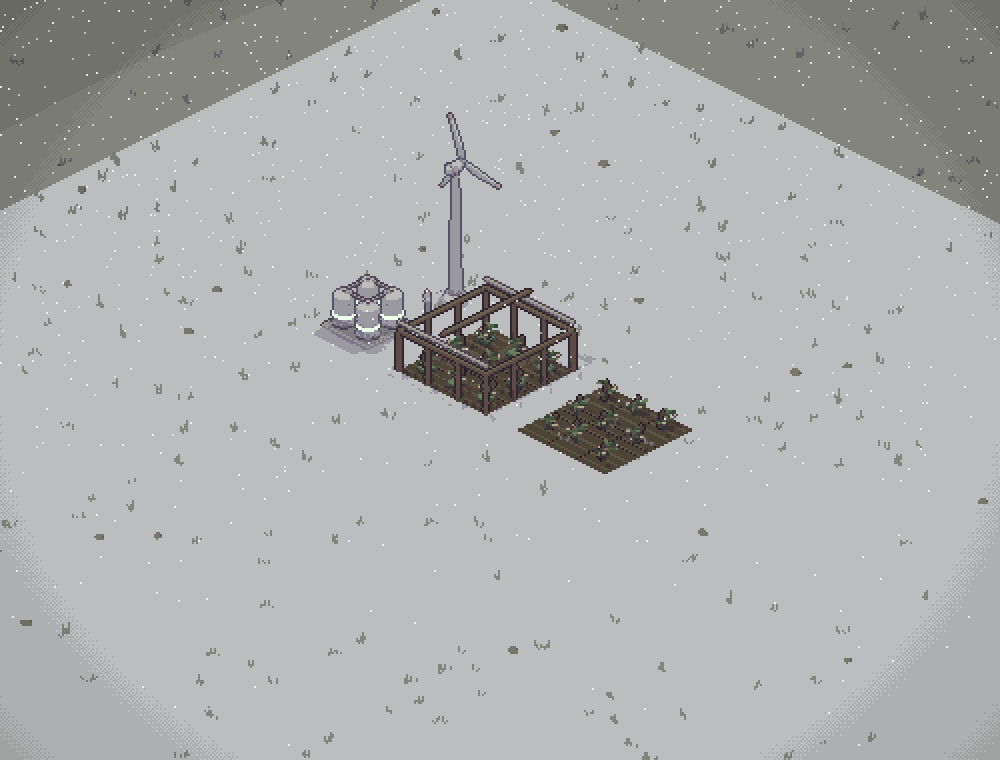
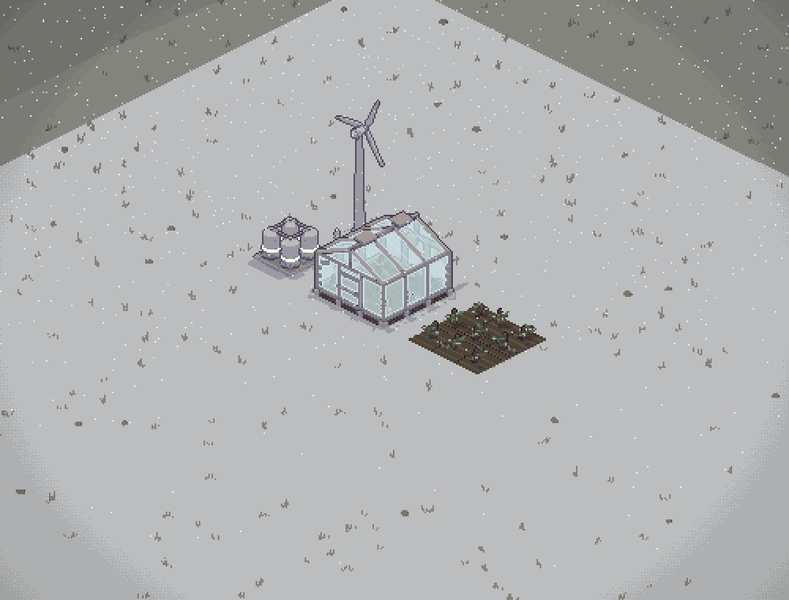
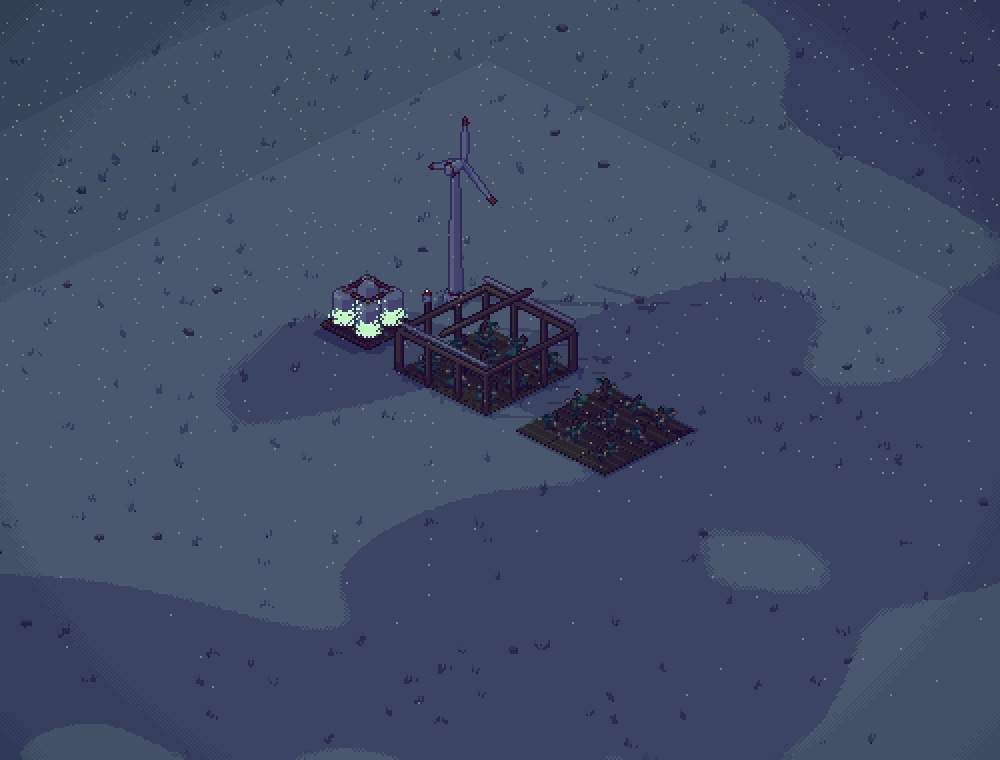
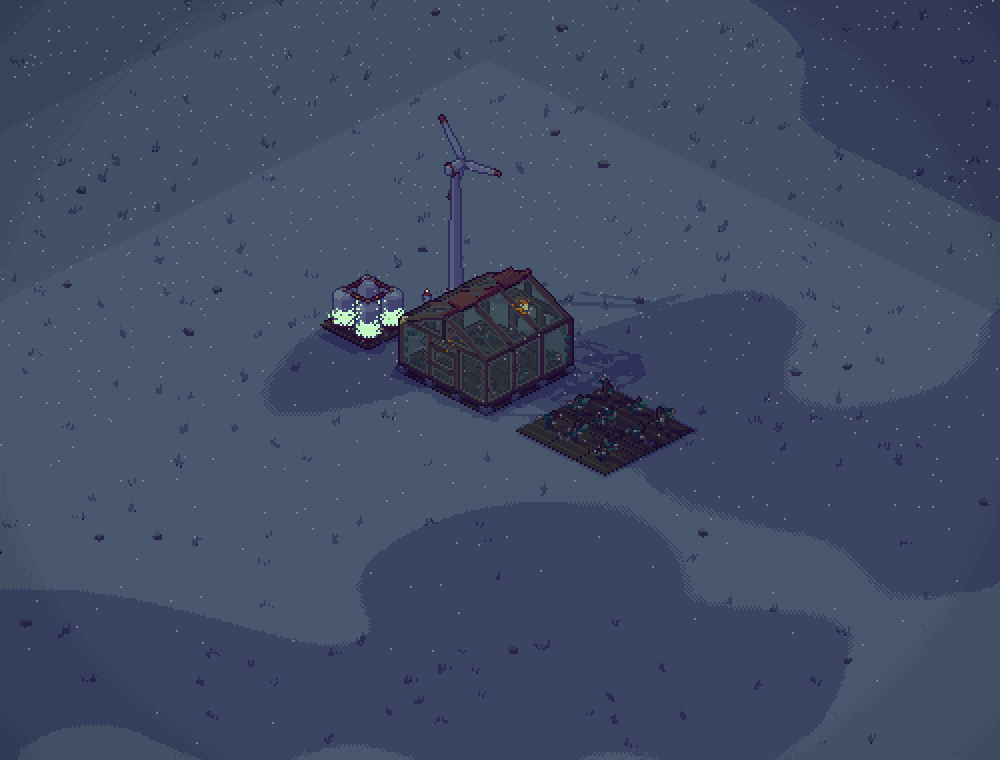
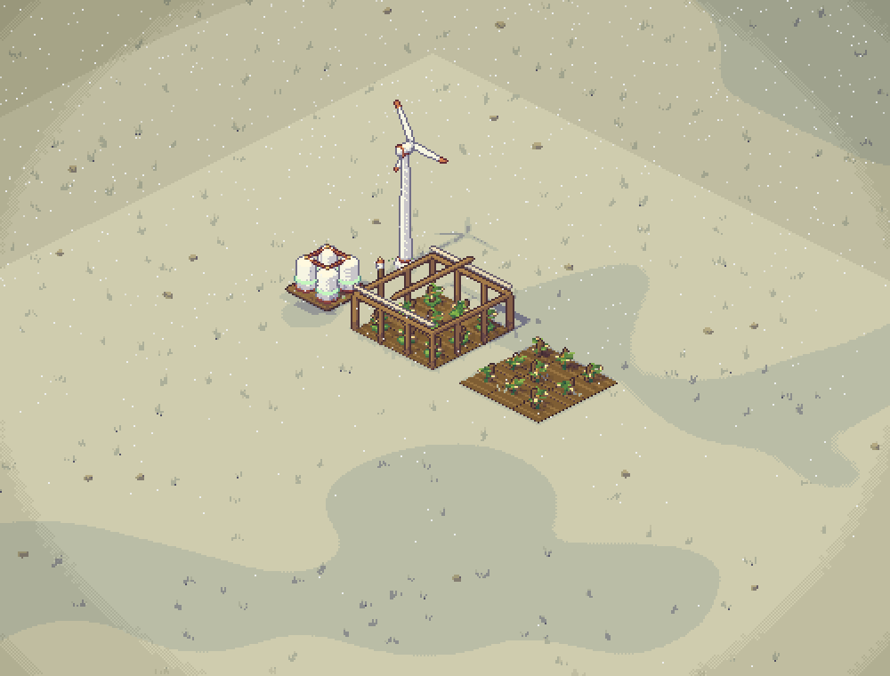
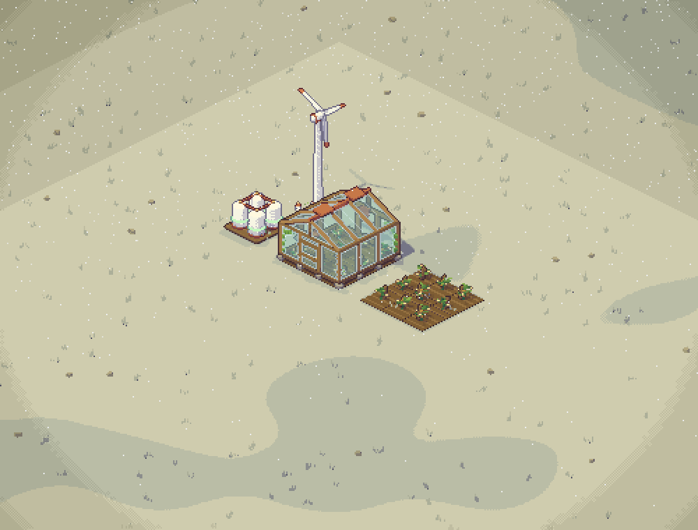

# Greenhouse 4.5 — visual evidence for #151

Before: original placeholder on implementation base. After: greenhouse GLB with renderer v0.5.0 glass, raised to clear ripe sunflowers.

Headless Chromium/SwiftShader, 1000×760, camera centred at (11, 10.5), zoom 42. Each shot uses the game with a flat, clear test map, one tomato greenhouse, a matching open field, pylon, charged battery and turbine. Crops are at growth 0.7; the simulation advances 0.1 s to balance heating, then pauses. The UI is hidden. Only one browser ran at a time. Summer/winter/night are frozen game times; ambient animation and weather easing may differ slightly.

| Scene | Before | After |
| --- | --- | --- |
| Winter, lying snow and blizzard |  |  |
| Winter night, powered heating |  |  |
| Summer |  |  |

Browser assertions on the after build verified night heating selection, zero-power extinction, daylight extinction, shell snow tint, and exactly nine tiles excluded from the snow sheet. Removing/replacing the greenhouse restores/removes those snow tiles without a relief change.

Independent review caught sunflower heads protruding through the original low roof; raising the eave to 1.45 m and ridge to 2.10 m fixed it. A raycast check of all crop stages, nine tiles, four rotations and conservative wind sway measured at least 0.059 m roof clearance. A fresh Codex follow-up reported no actionable findings.
