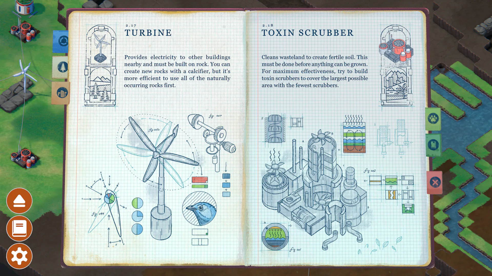
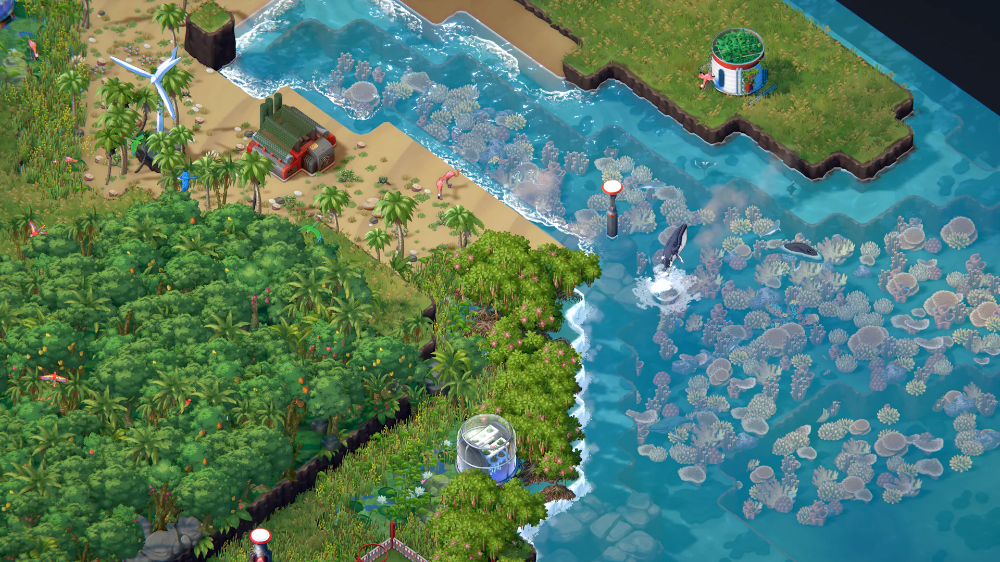
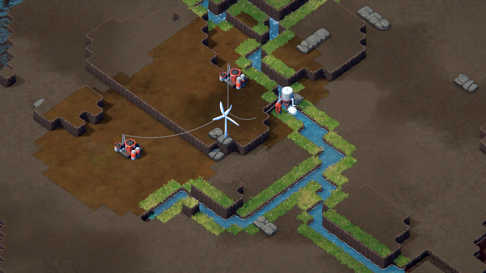
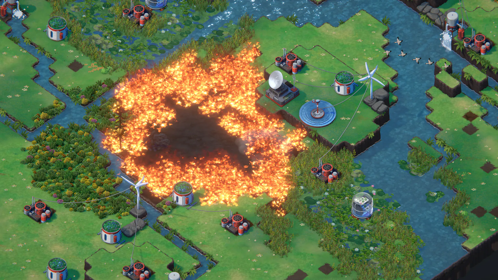
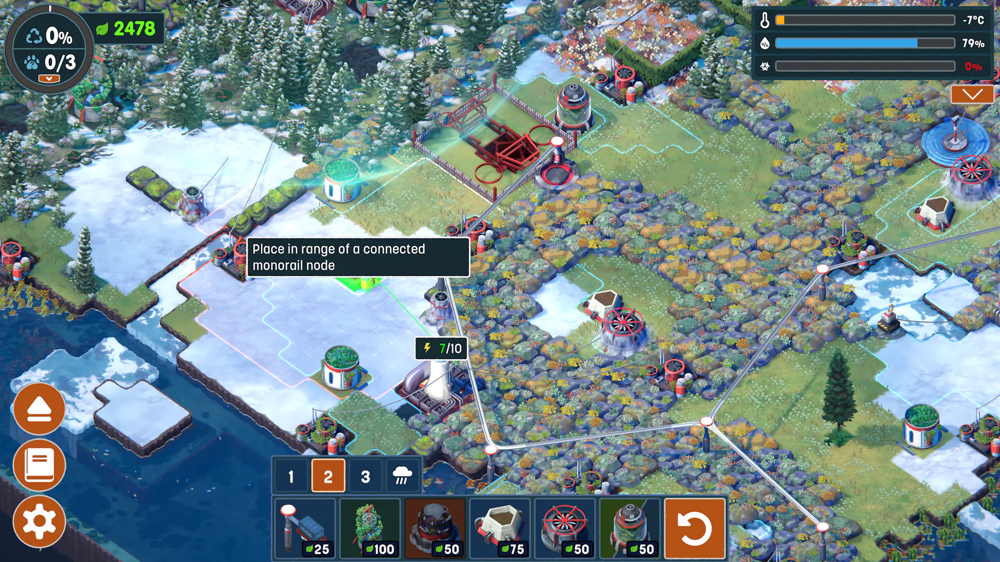

# Terra Nil visual study

This is a visual reference pack for exploring a Terra Nil-inspired direction for Soil-n-Silo. It documents observable design qualities and the developers' published process; it is not a specification to copy the game asset-for-asset.

## Official gameplay references

These five screenshots are from the [Free Lives press kit](https://freelives.net/terra-nil-press-kit/). The source page also has additional screenshots, logos, and press materials. Images are included here for internal design research and remain the property of Free Lives / Devolver Digital.

| Reference | What to inspect |
| --- | --- |
|  | Field-guide panel: paper, hand-drawn diagrams, and UI integrated into the world. |
|  | Dense, irregular foliage against bright water; overlapping vegetation and soft shoreline details. |
|  | Strong contrast between dry earth, stepped landforms, fresh water, and small machines. |
|  | A large warm event color against a broad range of greens and blue water; the landscape remains legible. |
|  | Snow biome, readable terrain layers, small machinery, connection lines, and the full gameplay HUD. |

## What stands out visually

These are observations from the screenshots above, not claims about the underlying implementation:

- **A fixed high isometric view** makes the terrain itself the main subject. Broad areas of terrain and water remain visible even with machinery and UI present.
- **Land is built from clear stepped masses.** Cliffs and shore edges have crisp silhouettes, while plants and water soften those hard boundaries.
- **Natural materials carry most of the detail.** Forests use varied silhouettes, density, and color; rocks and ground use mottled texture; water has bright surface detail and distinct shoreline foam.
- **Color carries state.** Dry brown, active green, deep forest, snow, and blue water separate regions at a glance. Strong orange fire and warm machine accents stand out without taking over every screen.
- **Built objects are small and readable.** Their silhouettes and highlights separate them from the environment, while the vegetation remains the visual focus.
- **The UI is functional and compact over the landscape.** Panels and icons have clear boundaries, bright selected states, and a restrained orange accent. The in-world field guide provides a warmer, illustrated counterpoint.
- **Restoration is presented as a visible transformation.** The same view can hold barren, actively engineered, and lush regions together, so progress is read spatially rather than only through meters.

## What the developers have said about making it

The official [Terra Nil Digital Artbook listing](https://store.steampowered.com/app/2321930/Terra_Nil_Digital_Artbook/) describes sketches, building concept thumbnails, close views of hand-painted textures, and art-direction alternatives. The artbook is sold as a digital PDF with the game on Steam.

An [online searchable preview of the artbook](https://www.scribd.com/document/813896056/TerraNil-DigitalArtbook) contains useful process notes; it is a user-hosted copy, not the publisher's distribution channel. Treat the following as developer-reported details from that preview and consult the official artbook for the complete source:

- The art team tested an anime / Studio Ghibli-influenced 3D direction with wind-moving grass, bright water highlights, and blended tile edges. They also explored paper texture and watercolor-like bleeding.
- They tried cel-shaded animation, but found it pulled attention toward buildings when the environment should dominate.
- Procedural composition was a challenge with a fixed isometric camera. The team prototyped plant placement with density and per-plant weighting controls, then tuned silhouettes, color balance, and repetition in the engine.
- Many plants were sprites; some were projected onto 3D meshes to receive better shadows. A masked vertex animation gave foliage a wind effect while excluding rigid parts such as trunks and rocks.
- Buildings were iterated as in-engine models early so scale, details, and color could be judged in their real context.
- The book describes an early clean-edged, circular, rounded-corner UI as generic and sterile, and says the final logo was made to feel more painted-over and organic.

For a talk by lead designer Sam Alfred, see GDC's [Developing “Terra Nil”: A Strategy Game About Nature, Not Expansion](https://www.gdcvault.com/play/1029027/Developing-Terra-Nil-A-Strategy). For a developer interview about the team's inspirations and the change from the early prototype, see [Free Lives on Terra Nil](https://gameworldobserver.com/2022/09/30/terra-nil-free-lives-interview-reverse-city-builder-studio-ghibli).

## Sources

- [Free Lives Terra Nil press kit](https://freelives.net/terra-nil-press-kit/) — official screenshots, press materials, team and engine information.
- [Terra Nil on Steam](https://store.steampowered.com/app/1593030/Terra_Nil/) — official gameplay page and screenshot gallery.
- [Terra Nil Digital Artbook on Steam](https://store.steampowered.com/app/2321930/Terra_Nil_Digital_Artbook/) — official artbook product page and contents summary.
- [GDC Vault talk](https://www.gdcvault.com/play/1029027/Developing-Terra-Nil-A-Strategy) — lead designer Sam Alfred on the game's design inspirations.
- [Game World Observer interview](https://gameworldobserver.com/2022/09/30/terra-nil-free-lives-interview-reverse-city-builder-studio-ghibli) — Free Lives on inspiration and development history.
- [Searchable artbook preview](https://www.scribd.com/document/813896056/TerraNil-DigitalArtbook) — secondary hosted preview used only to locate production-process details; the official artbook is the authoritative reference.

Research gathered 2026-10-14. The local screenshots are unmodified copies of the official press-kit images and are provided for this project's internal reference.
